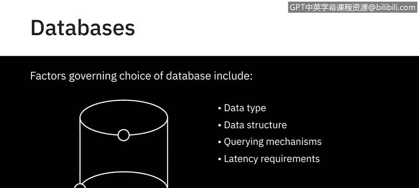
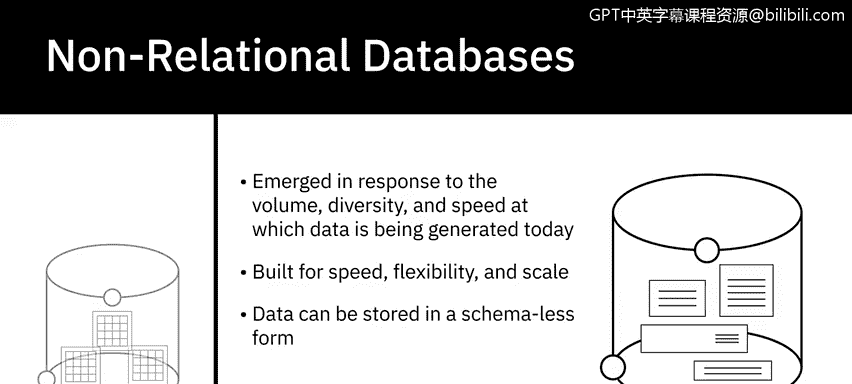
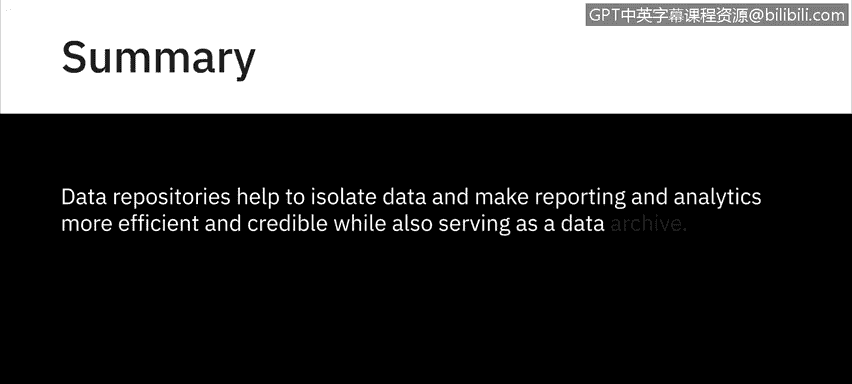

# IBM 数据分析师专业证书课程 1：《数据分析简介》｜introduction-to-data-analytics｜ - P57：14_01_overview-of-data-repositories.en_subtitled - GPT中英字幕课程资源 - BV18P411p7Qj

嗯。A data repository is a general term used to refer to data that has been collected。

 organized and isolated so that it can be used for business operations or mindd for reporting and data analysis。

 It can be a small or large database infrastructure with one or more databases that collect。

 manage and store datas In this video， we will provide an overview of the different types of repositories your data might reside in such as databases。

 data warehouses and big data stores and examine them in greater detail in further videos。

Let's begin with databases a database is a collection of data or information designed for the input。

 storage， search and retrieval and modification of data。

 and a database management system or DBMS is a set of programs that creates and maintains the database it allows you to store。

 modify and extract information from the database using a function calledQuing。For example。

 if you want to find customers who have been inactive for six months or more using the querying function。

 the database management system will retrieve data of all customers from the database that have been inactive for six months or more。

 even though a database and DBMS mean different things， the terms are often used interchangeably。

There are different types of databases， several factors influence the choice of database。

 such as the data type and structure， querying mechanisms， latency requirements， transaction speeds。

 and intended use of the data。

It's important to mention two main types of databases here， relational and non-relational databases。

 relational databases also referred to as RDBMSss built on the organizational principles of flat files with data organized into a tabular format with rows and columns following a welldefined structure and schema。

 however， unlike flat files， RDBMSss are optimized for data operations and querying involving many tables and much larger data volumes。

 Strd query language or SQL is the standard querying language for relational databases。

Then we have non-relational databases， also known as no SQL or not only SQL。

 nonrelational databases emerged in response to the volume。

 diversity and speed at which data is being generated today。

 mainly influenced by advances in cloud computing， the internet of things and social media proliferation。

 built for speed， flexibility and scale， non-relational databases made it possible to store data in a schemaless or free form fashion。

 no SQL is widely used for processing big data。

A data warehouse works as a central repository that merges information coming from disparate sources and consolidates it through the extract transform and load process。

 also known as the ETL process into one comprehensive database for analytics and business intelligence at a very high level the ETL process helps you to extract data from the different data sources。

 transform the data into a clean and usable state and load the data into the enterprises data repository。

 related to data warehouses are the concepts of data mars and data lakes。

 which we will cover later data marts and data warehouses have historically been relational since much of the traditional enterprise data has resided in RDBMSss however。

 with the emergence of no SQL technologies and new sources of data non-relational data repositories are also now being used for data warehousing。

Another category of data repositories are big data stores that include distributed computational and storage infrastructure to store。

 scale， and process very large data sets。Overall， data repositories help to isolate data and make reporting and analytics more efficient and credible while also serving as a data archive。

