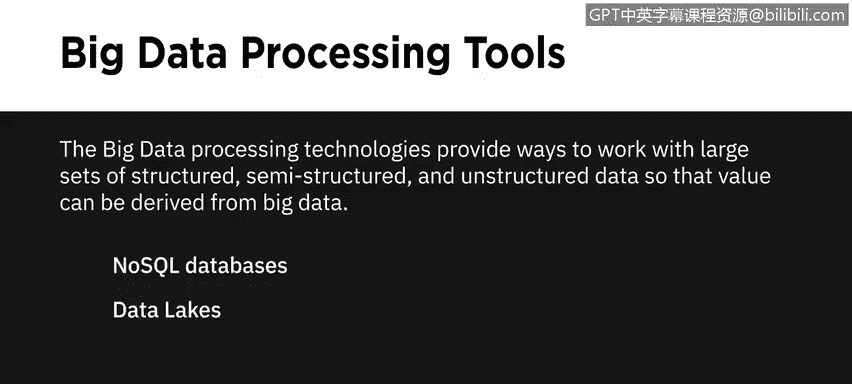
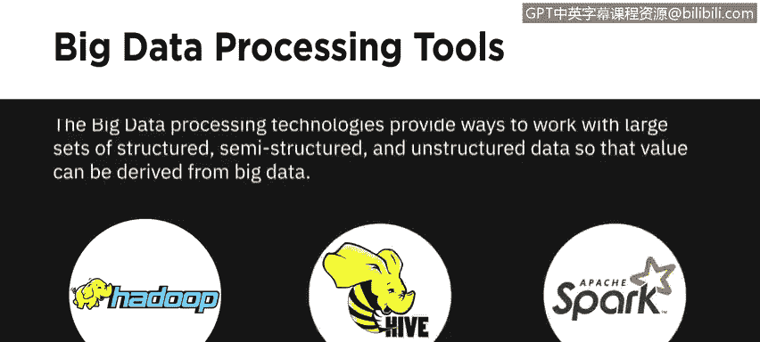
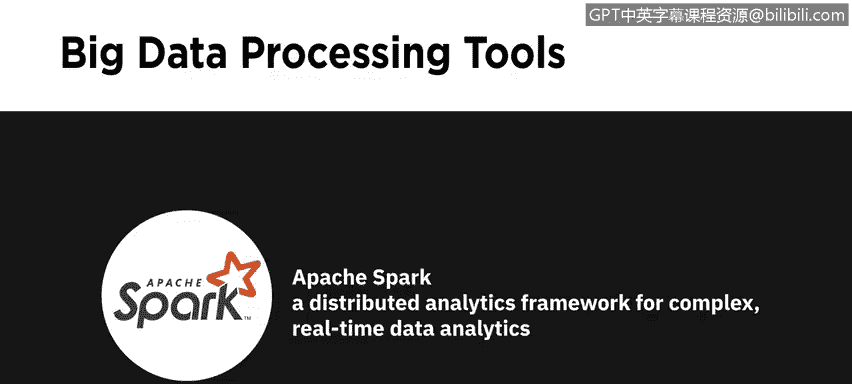
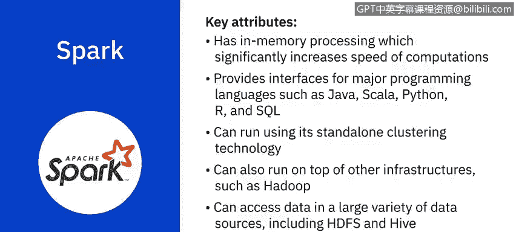

# IBM 数据分析师专业证书课程 1：《数据分析简介》｜introduction-to-data-analytics｜ - P62：19_06_big-data-processing-tools.en_subtitled - GPT中英字幕课程资源 - BV18P411p7Qj

Yeah。

The big data processing technologies provide ways to work with large sets of structured。

 semistructured and unstructured data so that the value can be derived from big data。

In some of the other videos， we discussed big data technologies。

 such as No SQL databases and data lakes。 In this video。

 we are going to talk about three open source technologies and the role they play in big data analytics。

 Apache Hadoop， Apache hive and Apache Spark。 Hadoop is a collection of tools that provides distributed storage and processing of big data。

😊。

Hive is a data warehouse for data query and analysis built on top of Hadoop。

Spark is a distributed data analytics framework designed to perform complex data analytics in real time。

 Hadoop， a Java-based open source framework， allows distributed storage and processing of large dataset sets across clusters of computers in Hadoop distributed system。

 A node is a single computer， and a collection of nodes， forms a cluster。

 Hadoop can scale up from a single node to any number of nodes。

 Each offering local storage and computation。 Hadoop provides a reliable scalable and cost effective solution for storing data with no format requirements。

Using Hadoop， you can incorporate emerging data formats， such as streaming audio， video。

 social media sentiment and clickstream data， along with structured semistructured and unstructured data not traditionally used in a data warehouse。

 Pro real time， Seservice access for all stakeholders。

 Opim and streamline costs in your enterprise data warehouse by consolidating data across the organization and moving cold data that is data that is not in frequent use to a Hadoop based system。

 One of the four main components of Hadoop is Hadoop distributed file system or HFS。

 which is a storage system for big data that runs on multiple commodity hardware connected through a network。

HDFS provides scalable and reliable big data storage by partitioning files over multiple nodes。

 It splits large files across multiple computers， allowing parallel access to them。

 Computations can therefore run in parallel on each node where data is stored。

 It also replicates file blocks on different nodes to prevent data loss， making it fault tolerant。

 Let's understand this through an example。 Consider a file that includes phone numbers for everyone in the United States。

 The numbers for people with last name starting with an A might be stored on server 1。

 B on server 2 and so on with Hadoop pieces of this phone book would be stored across the cluster to reconstruct the entire phone book。

 Your program would need the blocks from every server in the cluster。😊。

HDFS also replicates these smaller pieces into two additional servers by default。

 ensuring availability when a server fails。In addition to higher availability。

 this offers multiple benefits。 It allows the Hadoop cluster to break up work into smaller chunks and run those jobs on all servers in the cluster for better scalability。

Finally， you gain the benefit of data locality， which is the process of moving the computation closer to the node on which the data resides。

 This is critical when working with large data sets because it minimizes network congestion and increases throughput。

 Some of the other benefits that come from using HFs include vast recovery from hardware failures because HFs is built to detect faults and automatically recover access to streaming data because HFs supports high data throughput rates。

 Acmod of large data sets。 because HFs can scale to hundreds of nodes or computers in a single cluster。

😊，Portability because HDFS is portable across multiple hardware platforms and compatible with a variety of underlying operating systems。

Hive is an open source data warehouse software for reading。

 writing and managing large data set files that are stored directly in either HFS or other data storage systems such as Apache Hbase。

 Hadoop is intended for long sequential scans and because Hve is based on Hadoop queries have very high latency。

 which means Hve is less appropriate for applications that need very fast response times。

Hive is not suitable for transaction processing that typically involves a high percentage of right operations。

Hive is better suited for data warehousing tasks such as ETL， reporting， and data analysis。

 and includes tools that enable easy access to data via SQL。

This brings us to Sp a general purpose data processing engine designed to extract and process large volumes of data for a wide range of applications。

 including interactive analytics， streams processing， machine learning， data integration， and ETL。

It takes advantage of in memory processing to significantly increase the speed of computations and spilling to disk only when memory is constrained。

Spark has interfaces from major programming languages such as Java， Scala， Python， R and SQL。

 It can run using its standalone clustering technology。

 as well as on top of other infrastructures such as Hadoop。

 and it can access data in a large variety of data sources， including HDFS and Hve。

 making it highly versatile。The ability to process streaming data fast and perform complex analytics in real time is the key use case for Apache Spark。

