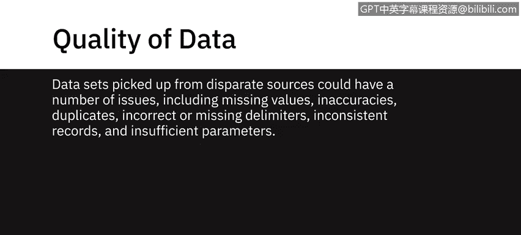
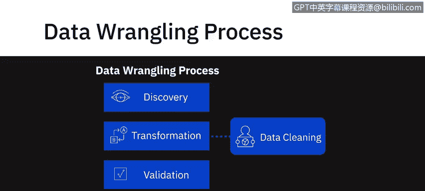
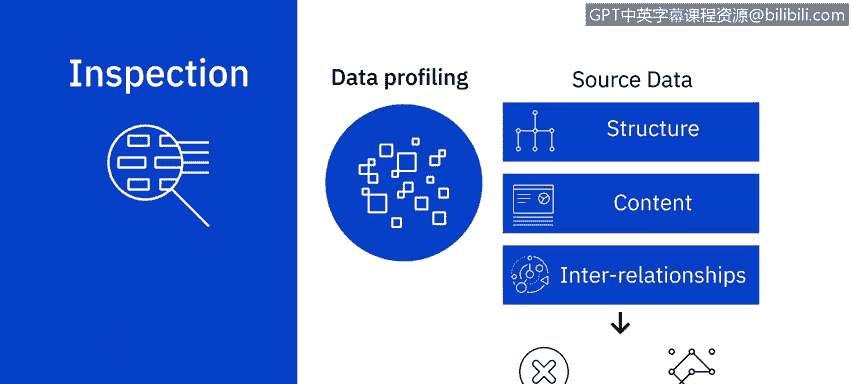
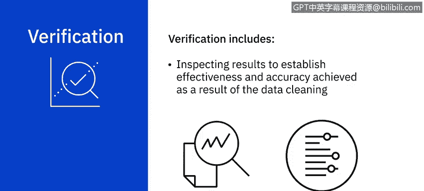
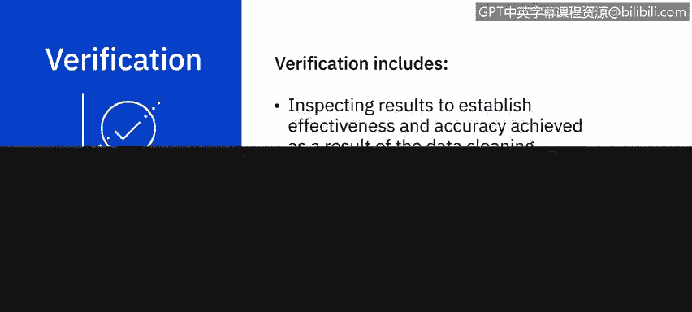
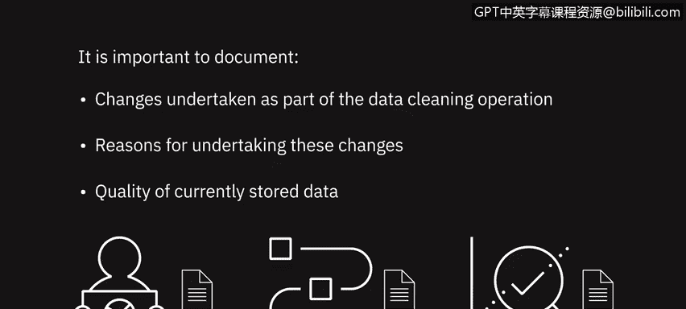

# IBM 数据分析师专业证书课程 1：《数据分析简介》｜introduction-to-data-analytics｜ - P68：25_03_data-cleaning.en_subtitled - GPT中英字幕课程资源 - BV18P411p7Qj

According to Gartner' report on data quality， poor quality data weakens an organization's competitive standing and undermines critical business objectives。

 missing inconsistent or incorrect data can lead to false conclusions and therefore ineffective decisions。

 and in the business world that can be costly。Data sets picked up from disparate sources could have a number of issues。

 including missing values， inaccuracies， duplicates， incorrect or missing delimiters。

 inconsistent records and insufficient parameters。 In some cases。

 data can be corrected manually or automatically with the help of data wrangling tools and scripts。

 but if it cannot be repaired， it must be removed from the data set。

Although the terms data cleaning and data wrangling are sometimes used interchangeably。

 it is important to keep in mind that data cleaning is only a subset of the entire data wrangling process。

Data cleaning forms a very significant and integral part of the transformation phase in a data wrangling workflow。

A typical data cleaning workflow includes inspection， cleaning and verification。

The first step in the data cleaning workflow is to detect the different types of issues and errors that your data set may have。

 You can use scripts and tools that allow you to define specific rules and constraints and validate your data against these rules and constraints。

You can also use data profiling and data visualization tools for inspection。

Data profiling helps you to inspect the source data to understand the structure。

 content and interrelationships in your data。It uncovers anomalies and data quality issues。

For example， blank or null values duplicate data， or whether the value of a field falls within the expected range。

Visualizing the data using statistical methods can help you to spot outliers。For example。

 plotting the average income in a demographic data set can help you spot outliers。

That brings us to the actual cleaning of the data。 The techniques you apply for cleaning your data set will depend on the use case and the type of issues you encounter。

Let's look at some of the more common data issues。Let's start with missing values。

 Miss values are very important to deal with， as they can cause unexpected or biased results。

 You can choose to filter out the records with missing values or find a way to source that information in case it is intrinsic to your use case。

For example， missing age data from a demographic study。

 A third option is a method known as imputation， which calculates the missing value based on statistical values。

 Your decision on the course of action you choose needs to be anchored in what's best for your use case。

You may also come across duplicate data， data points that are repeated in your data set。

 these need to be removed。Another type of issue you may encounter is that of irrelevant data data that does not fit within the context of your use case can be considered irrelevant data。

 For example， if you are analyzing data about the general health of a segment of the population。

 their contact numbers may not be relevant for you。Cleaning can involve data type conversion as well。

 This is needed to ensure that values in a field are stored as the data type of that field。

 For example， numbers stored as numerical data type or dates stored as a date data type。

You may also need to clean your data in order to standardize it。 For example， for strings。

 you may want all values to be in lower case。 Similarlyly。

 date formats and units of measurement need to be standardized。And there may be syntax errors。

 for example， white spaces or extra spaces at the beginning or end of a string is a syntax error that needs to be rectified。

 This can also include fixing typos or format。 For example。

 the state name being entered as a full form， such as New York。

 versus an abbreviated form such as NY in some records。

Data can also have outliers or values that are vastly different from other observations in the data set。

Outliers may or may not be incorrect。 For example， when an age field in a voter database has the value 5。

 you know， it is incorrect data and needs to be corrected。Now。

 let's consider a group of people where the annual income is in the range of $100000 to $200000。

 except for that one person who earns a million dollars a year。

 While the data point is not incorrect， it is an outlier and needs to be looked at。

Depending on your use case， you may need to decide if including this data will skew the results in a way that does not serve your use case。

This brings us to the next step in the data cleaning workflow verification。In this step。

 you inspect the results to establish effectiveness and accuracy achieved as a result of the data cleaning operation。

 You need to reinspect the data to make sure the rules and constraints applicable on the data still hold after the corrections you made。

And in the end， it is important to note that all changes undertaken as part of the data cleaning operation need to be documented。

 not just the changes， but also the reasons behind making those changes and the quality of the currently stored data。

 reporting how healthy the data is is a very crucial step。

