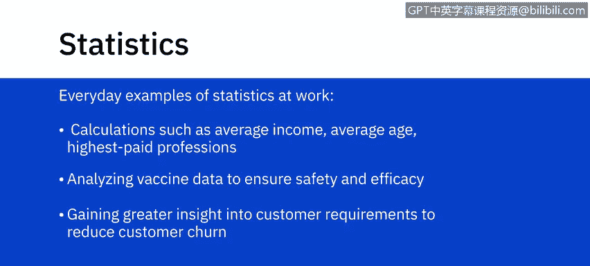
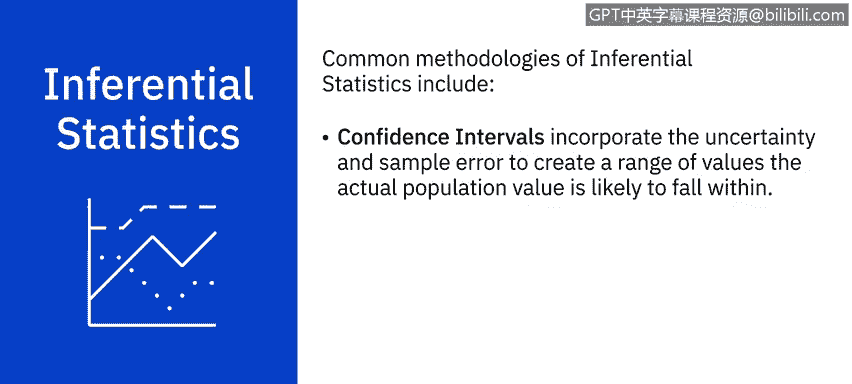
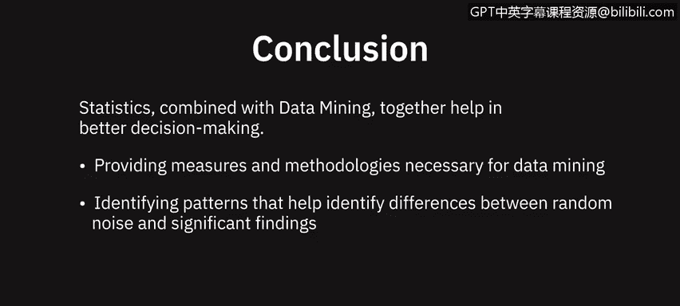

# IBM 数据分析师专业证书课程 1：《数据分析简介》｜introduction-to-data-analytics｜ - P70：27_01_overview-of-statistical-analysis.en_subtitled - GPT中英字幕课程资源 - BV18P411p7Qj

Before we understand statistical analysis， its relation to data analysis and specifically data mining。

 let's first examine what statistics is Staistics is a branch of mathematics dealing with the collection。

 analysis， interpretation and presentation of numerical or quantitative data。

It's all around us in our day to day lives， whether we're talking about average income。

 average age or highest paid professions， it's all statistics。

Today's statistics is being applied across industries for decision making based on data， for example。

 researchers using statistics to analyze data from the production of vaccines to ensure safety and efficacy。

Or companies using statistics to reduce customer churn by gaining greater insight into customer requirements。

Now， let's look at what statistical analysis is。 Stat analysis is the application of statistical methods to a sample of data in order to develop an understanding of what that data represents。

 It includes collecting and scrutinizing every data sample in a set of items from which samples can be drawn。

A sample in statistics is a representative selection drawn from a total population。

 where population is a discrete group of people or things that can be identified by at least one common characteristic for purposes of data collection and analysis。

For example， in a certain use case， population may be all people in a state that have a driving license and a sample of this population that is a part or subset of the population could be men drivers over the age of 50。

 Statistical methods are mainly useful to ensure that data is interpreted correctly。

 and apparent relationships are meaningful and not just happening by chance。

Whenever we collect data from a sample， there are two different types of statistics we can run。

 descriptive statistics to summarize information about the sample and inferential statistics to make inferences or generalizations about the broader population。

Descriptive statistics enables you to present data in a meaningful way。

 allowing simpler interpretation of the data。 Data is described using summary charts。

 tables and graphs without any attempts to draw conclusions about the population from which the sample is taken。

The objective is to make it easier to understand and visualize raw data without making conclusions regarding any hypotheses that were made。

For example， we want to describe the English test scores in a specific class of 25 students。

 we record the test scores of all students， calculate the summary statistics and produce a graph。

Some of the common measures of descriptive statistical analysis include central tendency。

 dispersion and skewness。Central tendency is locating the center of a data sample。

 Some of the common measures of central tendency include mean， median and mode。

 These measures tell you where most values in your dataset set fall。 So in the earlier example。

 the mean score or the mathematical average of the class of 25 students would be the sum total of the scores of all 25 students divided by 25。

 That is the number of students。If you order the above data set from the smallest score value to the highest score value of the 25 students and pick the middle value。

That is the value with 12 values to the left and 12 values to the right of a score value。

 That score value would be the median for this data set。

If 12 students have scored less than 75% and 12 students have scored greater than 75%。

 then the median is 75。Median is unique for each data set and is not affected by outliers。

Moode is the value that occurs most frequently in a set of observations。 For example。

 if the most common score in this group of 25 students is 72%。

 then that is the mode for this data set。So you can see how looking at your data through these values can help you get a clear understanding of your data。

Dispersion is the measure of variability in a data set。

 Commonmon measures of statistical dispersion are variance， standard deviation and range。

Variance defines how far away the data points fall from the center。

 That is the distribution of values。 When a distribution has lower variability。

 the values in a data set are more consistent。 However， when the variability is higher。

 the data points are more dissimilar and extreme values become more likely。

Understanding variability can help you grasp the likelihood of an event happening。

Standard deviation tells you how tightly your data is clustered around the mean。

 and range gives you the distance between the smallest and largest values in your dataset sets。

Skewness is the measure of whether the distribution of values is symmetrical around a central value or skewed。

 left or right。Skeweed data can affect which types of analyses are valid to perform。

These are some of the basic and most common use descriptive stat tools。

 but there are other tools as well， for example， using correlation and scatter plots to assess the relationships of paired data。

The second type of statistical analysis is inferential statistics。

 Inferential statistics takes data from a sample to make inferences about the larger population from which the sample was drawn。

Using methods of inferential statistics， you can draw generalizations that apply the results of the sample to the population as a whole。

 some common methodologies of inferential statistics include hypothesis testing。

 confidence intervals and regression analysis。Hypothesis testing， for example。

 can be used for studying the effectiveness of a vaccine by comparing outcomes in a control group。

Hypothesis tests can tell you whether the efficacy of a vaccine observed in a control group is likely to exist in the population as well。

Confidence intervals incorporate the uncertainty and sample error to create a range of values the actual population value is likely to fall within。

Regression analysis incorporates hypothesis tests that help determine whether the relationships observed in the sample data actually exist in the population。

 rather than just the sample。There are various software packages to perform statistical data analysis such as Staistical analysislysis System or SAS。

 Staistical package for the Social Sciences， or SPPSS and StatsSot。

Statistics form the core of data mining by providing measures and methodologies necessary for data mining and identifying patterns that help identifying differences between random noise and significant findings。

Both data mining， which we will learn more about in this course and statistics as techniques of data analysis help in better decision making。

