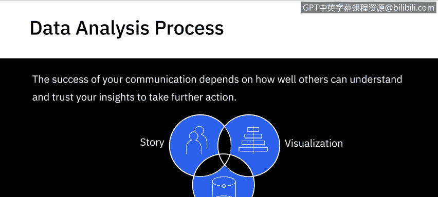
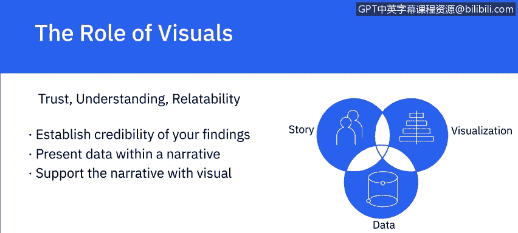

# IBM 数据分析师专业证书课程 1：《数据分析简介》｜introduction-to-data-analytics｜ - P73：30_01_overview-of-communicating-and-sharing-data-analysis-findings.en_subtitled - GPT中英字幕课程资源 - BV18P411p7Qj

嗯。The data analysis process begins with understanding the problem that needs to be solved and the desired outcome that needs to be achieved。

 and it ends with communicating the findings in ways that impact decision making。

Data projects are the result of a collaborative effort spread across business functions involving people with multidisciplinary skills。

 with the findings being incorporated into a larger business initiative。

The success of your communication depends on how well others can understand and trust your insights to take further action。

 So as data analysts， you need to tell the story with your data by visualizing the insights clearly and creating a structured narrative。

 explicitly targeted at your audience before you begin to create the communication。

 You need to reconnect with your audience。 begin by asking yourself these questions。

 Who is my audience， What is important to them， What will help them trust me。

 Your audience is mostly going to be a diverse group in terms of the business functions they represent whether they play an operational or strategic role in the organization。

 How impacted are they by the problem and other such factors。

Your presentation needs to be framed around the level of information your audience already has based on your understanding of the audience。

 You will decide what and how much information is essential to enable a better understanding of your findings。

 It's tempting to bring out all the data that you've been working with。

 but you have to consider what pieces are more important to your audience than others。

 A presentation is not a data dump。 Facts and figures alone do not influence decisions and move people to action。

 You have to tell a compelling story。 includelude only that information。

 as is needed to address the business problem。 Too much information will have your audience struggling to understand the point you're making。

 Beg your presentation by demonstrating your understanding of the business problem to your audience。

 It's easy to fall back on the assumption that we all know what we're here for。

 but reflecting your understanding of the problem that needs to be solved， and the。

Outcome that needs to be achieved is a great first step in winning their attention and starting with trust。

 Speaking in the language of your organization's business domain is another important factor in building a connection between you and your audience。

 The next step in designing your communication is to structure and organize your presentation for maximum impact。

 Refence the data you have collected。 Remember that the data。

 the very basis of everything that you are communicating is like a black box for the audience。

 If you are unable to establish the credibility of your data。

 People don't know that they can trust your findings。 Share your data sources。

 Hytheses and validations， work towards establishing credibility of your findings along the way。

 Don't gloss over any key assumptions made during the analysis。

 Orize information into logical categories based on the information you have。

 Do you have both qualitative and quantitative information， for example。😊。

Be deliberate in taking a top down or bottom up approach in your narrative。 both can be effective。

 Depend on your audience and use case。 Be consistent in your approach。

 It's important to determine what communication formats will be most useful to your audience。

 Do they need to take away an executive summary。 A fact sheet or a report。

 How is your audience going to use the information you have presented that should determine the formats you choose。

 Inights must be explained in a way that inspires action。

 If your audience doesn't grasp the significance of your insight or are unconvinced of its utility。

 The insight will not drive any value。100 word essay will not have the same impact as a visual in creating a clear mental image in the minds of your audience。

 A powerful visualization tells a story through the graphical depiction of facts and figures。

 Data visualizations。 Gs charts。Diagrams are a great way to bring data to life。

 whether you're showing a comparison， a relationship， distribution or composition。

 you have tools that can help you show patterns and conclusions about hypotheses。

 data has value through the stories that it tells your audience must be able to trust you。

 understand you and relate to your findings and insights by establishing credibility of your findings。

 presenting the data within a narrative and supporting it through visual impressions。

 You can help your audience drive valuable insights。😊。

