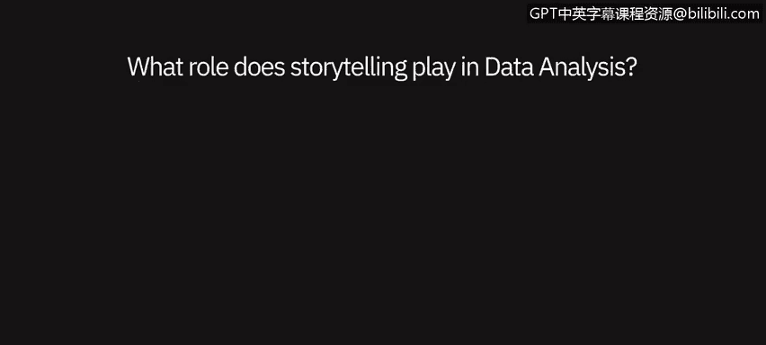
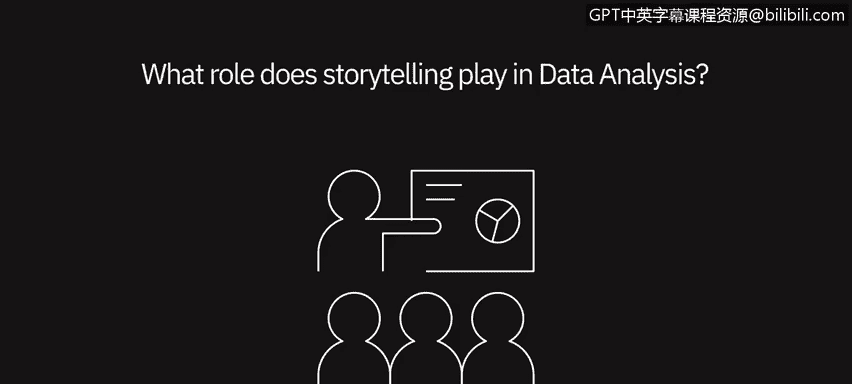

# IBM 数据分析师专业证书课程 1：《数据分析简介》｜introduction-to-data-analytics｜ - P74：31_02_viewpoints-storytelling-in-data-analysis.en_subtitled - GPT中英字幕课程资源 - BV18P411p7Qj

嗯。In this video， we will listen to data professionals talk about the roles storytelling plays in the life of a data analyst。

The role of storytelling in a data analyst' life cannot be overstated is super critical to get really good at storytelling with data I think humans naturally understand the world through stories So if you're trying to convince anyone to do anything with data the first thing you have to do is tell a clear concise。

 compelling story I also think it can be really useful for the data analyst to develop a story anytime they're working with a data set to help themselves under better understand the underlying data set and what it's what it's doing There's always going to be a balance between telling a clear。

 coherent， simple story and making sure you're conveying all the complexities that you might find within the data and I think finding that balance can be really challenging but is really critical the art of storytelling is significant in the life of a data analyst。

It doesn't matter how much or what wonderful information you've come up with if you can't find a way to communicate that to your audience。

 whether it's the consumer or a director level or executive level person， then it's for not。

 You have to find a way to communicate that。 and it's usually best to do it in a visual or through telling a story。

 so that they understand how that information can be useful。

 I have to say storytelling is a essential skill set。It's like the last mile in delivery。

A lot of people can handle the technical side through a short period of training。

 however the ability to extract value from data and to communicate it is in short supply If you think about the long-term career。

 I think it's very critical to know how to tell a compelling story with data Storytelling is absolutely crucial to data analytics this is how you actually convey your message everyone can show numbers but if you don't have a story around if you don't have a compelling reason to act then ultimately what you're presenting isn't going to resonate with your audience they did a study at Stanford where they had people present。

Their pitches and in that pitch they had simply KPIs， number statistics， but they also told a story。

The audience members were then in quizzed after the fact what they remembered from each of those presentations and it was those stories that stuck with them。

 yes there were still facts and figures contained within the story。

 but that is the way that you drive it home having that emotional connection to the story to the understanding to the data is really how you're going to get people to take the action that you want and need them to take。

