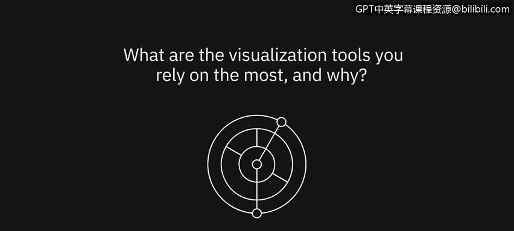
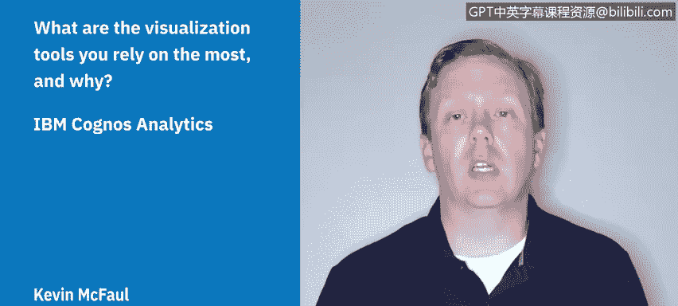
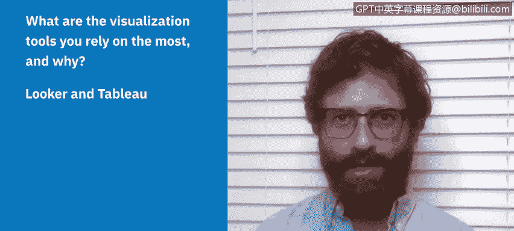

# IBM 数据分析师专业证书课程 1：《数据分析简介》｜introduction-to-data-analytics｜ - P77：34_05_viewpoints-visualization-tools.en_subtitled - GPT中英字幕课程资源 - BV18P411p7Qj

Yeah。In this video， data professionals talk about the visualization tools they rely on the most and why。

The visualization tool that I rely on most in my day to day life is cognitive animal。

There's a few reasons for this， why it allows me to very quickly import a spreadsheet。

 connect your database and visualize my data， whether that's me understanding what I want to look at and driving the fields on。

 or using our AI assistant to present the data to help me understand and explore what might be interesting in there if it's a new data set I've never worked with before。

Now， on top of that， I can also go ahead and start to do some more complex things or even just some more robust analysis with our reporting tool to allow me to build out and schedule reports for delivery。

 If I wanted my sales team to have their pipeline report or their sales opportunity report every Monday morning。

 set that up once use what we call ver key and then have that sent out automatically every Sunday night so it's waiting for them in the morning On top of this。

 I can start to combine multiple data sources and have the system help me create those joins together and then be able to visualize those all on a single simple dashboard that's highly interactive。

 allowing you to filter and sort dynamically as well as share that with the rest of organization so that not every user has to go through the same experience。

 We've set up the dashboard once everyone can then have access to it In terms of visualization tools。

 I rely the most on Looker， which is a data visualization tool that sits at top my company's internal database。

It's similar to Tableau， which I've also used in the past and find a pretty easy to use and the great thing about these data visualization tools like Looker and Tau is they let everyone throughout the organization regardless of whether or not they're data professionals easily kind of see their data and do basic aggregation or sorting on it。

 a data visualization tool I really rely on for exploratory data analysis is R I've been a big convert in recent years to the effectiveness of doing basic data analysis and data visualization in R particularly using the tiDverse which is a collection of packages that help you really easily load in your data aggregate it at different levels and also quickly and easily visualize it Tau and the Power B and nope brainer they're easy to pick up and very helpful。

ForTo demonstrate data。 And as more and more companies and people start to utilize them。

 there are more and more built in templates and libraries。

 I would say the visual will probably be Excel and were just the Microsoft and just looking at and using the sounds and。

The map rules to make sure that the data went I before I even dive in that is clean and it makes sense and that it is prepped for what we needed to be。

