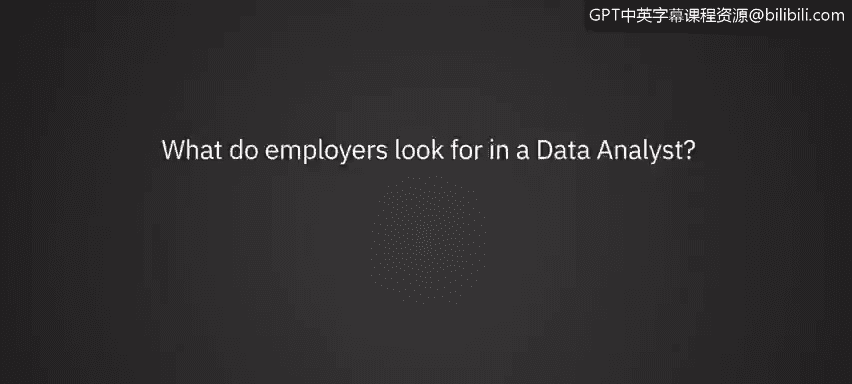
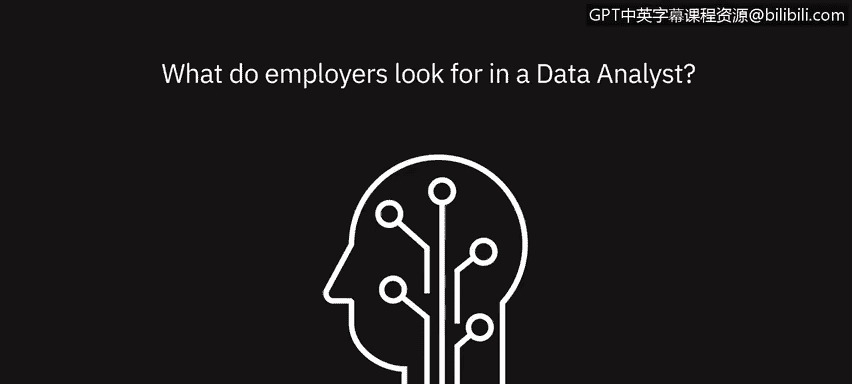
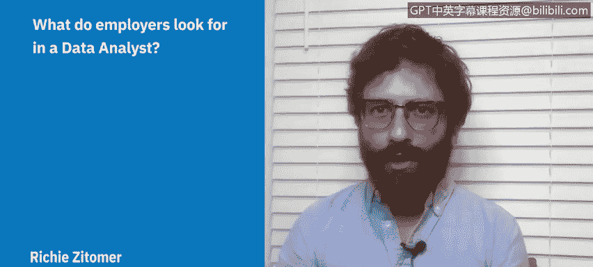

# IBM 数据分析师专业证书课程 1：《数据分析简介》｜introduction-to-data-analytics｜ - P80：37_03_viewpoints-what-do-employers-look-for-in-a-data-analyst.en_subtitled - GPT中英字幕课程资源 - BV18P411p7Qj

嗯。

In this video， we will listen to data professionals talk about what employers look for in a data analyst。

Employers look for data analysts with integrity。During the hiring process I will ask。

 if you had to choose just one， would you rather meet a deadline or get a right answer？

And I'm always looking for someone who would say， I want to make sure that the information is right。

Missing a deadline。Isn't as detrimental as a company making a multimillion dollar decision on wrong information or someone losing their job because it wasn't pulled or it wasn't reported correctly。

 So it's much more important to have integrity。 I think the number one thing employers look for in data analyst is someone who can communicate clearly。

 If you do the most brilliant analysis in the world。

 but you can't communicate it to external stakeholders， then it's really not worth anything。

 So I think that that skill is really sought after。

I think another thing that companies obviously look for when they look for data analyst is fluency with numbers。

 ability to understand complex analyses， ability to understand AP tests。

 and what the results of AP tests are saying and the implication of those results。

I also think increasingly employers are looking for。

Data analysts with really strong SQL skills Another thing employers are looking for and data analysts is a growth mindset and willingness to learn because the industry is changing at a really fast pace I think they're looking for programming skills including Python or SL and at the same time they're looking for some personalities whether you are detail oriented。

 whether you like working with data and whether you are problems over so on so forth as an employer I hire people all the time What am I looking for we're looking for people who are detail oriented and who are somewhat overachievers。

 they don't just want to do what's what's in front of them they want to go further and so we're looking for people who have higher aspirations and who also are able to think outside the box and aren't just going to if I say do ABC they're not just going to do that they're going to do it plus they're going to do。

pl think and give me some alternatives people who are able to troubleshoot if something goes wrong they're not just going to stop and say oh my goodness I need to go talk to my supervisor they're going to say here's a problem here's my thoughts here are two possible solutions on how you can resolve this so that the job and the company can keep moving forward that's what you want so not just detail oriented and not just good with numbers you also have to be someone who can think outside the box and be able to problem solve and troubleshoot those are what's going to that's what employers are going to be looking for now more than ever they look for the ability to no data and by no data we mean several things right be comfortable with it in various formats be able to think about it and by that we mean know what kind of data you want to solve the problems that are at hand。

So the knowing the data skill is very important， problem solving is another very key skill， meaning。

If there is a problem presented to a data analyst， they should be able to know how to tackle that problem using data in whatever format it may be sitting in and being able to analyze it and present the insights that will then solve the problem they also need to be very。

Dynamic in that if there are。If they are presented with a very different kind of data set， suddenly。

 which looks nothing like it did before， they need to be able to adapt to that。

Change so that that's why the quality of being dynamic and adaptable is also important they also need to be able to pick up technical skills quickly and by that we mean if there is one kind of SQL paradigm being used in one setting they need to be able to you operate under a different paradigm if there is a place that's using our studio but they know Python they need to be able to pick up our studio quickly and that kind of thing so being able to learn fast being dynamic and knowing data those are the few things that employeess do look for in a good data analyst。

