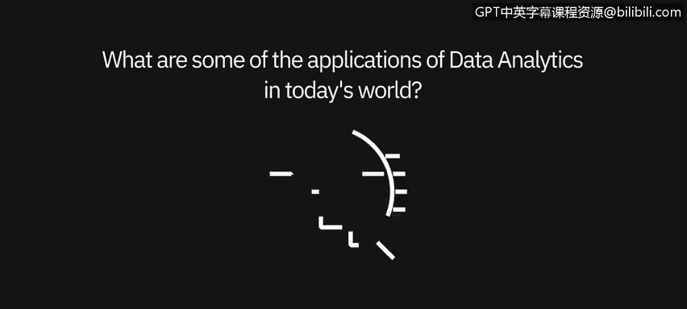
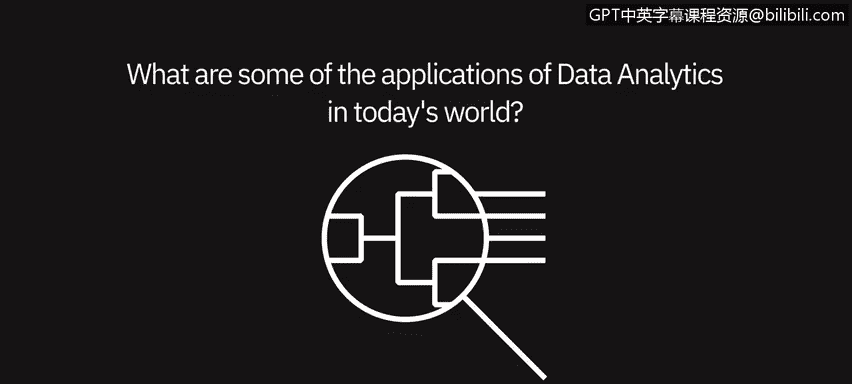

# IBM 数据分析师专业证书课程 1：《数据分析简介》｜introduction-to-data-analytics｜ - P9：8_观点：数据分析的应用.zh - GPT中英字幕课程资源 - BV18P411p7Qj

嗯。In this video， practicing data professionals talk about some of the applications of data analytics in today's world。

The applications of data analytics in the world today is everywhere every commercial that you see someone had to analyze and identify either from the consumer or for the company what information they wanted to share so you know four out of 10 dentists or you'll see information related to calorie counts or reactions to certain things all of that required analysis this isn't something that should be thought of separate and apart from it's what we do every day in our lives even people monitoring their sugar level with diabetes there's always analysis going on so that applications are universal。

So the great thing with analytics in this day and age is that it's very widely applicable。

Every industry， every vertical， every function within a given organization can benefit from data and analytics。

 whether you're doing sales pipeline analysis， whether you're doing financials at the end of the month。

 creating predefined and standardized formatted reports。

Or if you're doing something like headcount planning or headcount review。

All these across every vertical， as I said， whether it's airlines。Pharmaceuticals， banking。

All these and the functions within them can benefit from atic。

AndIn this climate that we're in right now with the pandemic。

 there are companies who are paying close attention to their customers buying habits。

 obviously they may have varied from what these companies expected these habits to be and so now data analytics is more important because they need to make sure they can pivot and keep up with the demand and really be able to cater to what their clients and their customers want。

I can talk about the applications of data analytics in finance。 These years。

 we have seen more and more applications of alternative data analytics in the finance world。😊。

For example， we can use sentiment analysis of tweets and news stories to supplement traditional financial analysis and to inform better investment decisions Besides the satellite imagery data can be used to track the development of industrial activities and the geolocation data can be used to track the store traffic and to predict the sales volume。

