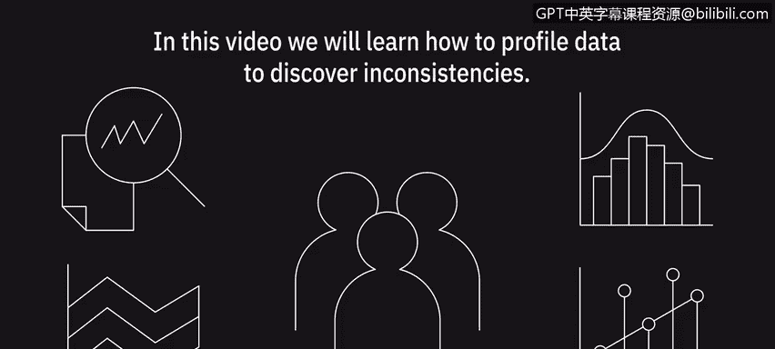
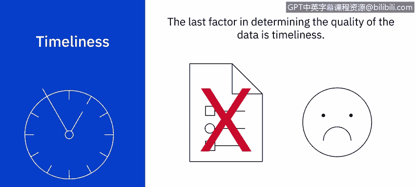
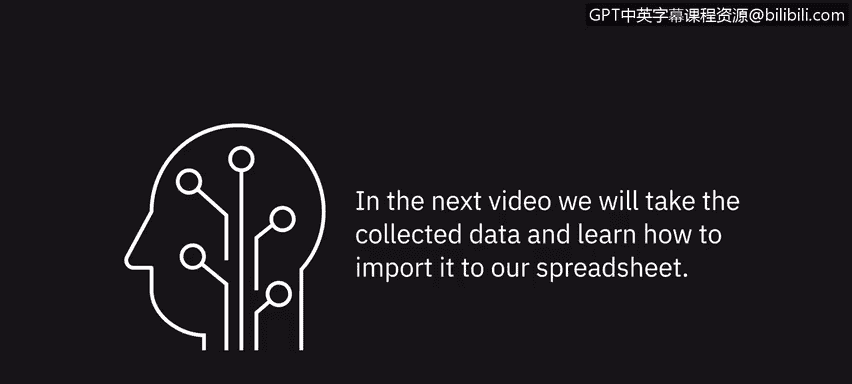

# IBM 数据分析师专业证书课程 2：《数据分析Excel基础》｜excel-basics-data-analysis-ibm｜ - P11：10_数据质量介绍.zh - GPT中英字幕课程资源 - BV1zu4y1Q7dR

嗯。Data analysis can play a pivotal role in business decisions and processes in order to use the data to make competent decisions。

 we must have the right information for the project， and the data must be free from errors。

 In this video， we will learn how to profile data to discover inconsistencies。

 Whether we are working with small sets of data or analyzing a spreadsheet with thousands of rows。

 One of the most difficult parts of the data analysis is finding and keeping clean data to help with this process and qualify the data。

 Look at these five traits。 accuracy， completeness， reliability， relevance and timeliness。

Accuracy is the first and most significant aspect to data quality。

 A data analyst must clean the data set by removing duplicates。

 correcting formatting errors and removing blank rows。

Another important aspect of data quality is determining if the information required to complete the data set is readily available。

 Why does this matter as a trait for quality data， Let's say we are given the task to calculate the revenues of all sales per region after collecting the data。

 We discovered that no regions were specified。 This data would then be considered incomplete。

 and other sources would have to be considered to obtain the data required。

Reliability is another vital factor in determining the quality of data。 For instance。

 let's say we are given the task to determine the agent revenue by customer。 When gathering the data。

 we find that agents keep their own records and do not always update the information in the shared company database with those factors in mind。

 We would then determine that the data in the shared company database was unreliable and new processes would need to be established to ensure reliable data。

Relevance is another trait of quality data。 When collecting information。

 a data analyst must consider if the data being assembled is really necessary for the project。

For example， when reviewing the data related to the sales revenue per customer。

 information such as customer birthdays and other personal information is also included。

By making the determination early to exclude the personal information from the data set。

 the analysts would save themselves from having to review unnecessary information。

The last factor in determining the quality of the data is timeliness。

 This trait refers to the availability and accessibility of the selected data。

 Let's say our sales report is going to be used for weekly employee reviews。

 but our report is only refreshed once a month。 This error in refreshing the data would cause a report to become outdated and would have serious consequences for employee reviews。

🎼In this video， we learn the important role of a data analyst in qualifying data by considering the five traits of good quality data。

 an analyst can save time， avoid serious issues and have data that is free from errors。

 In the next video， we will take the collected data and learn how to import it to our spreadsheet。😊。

