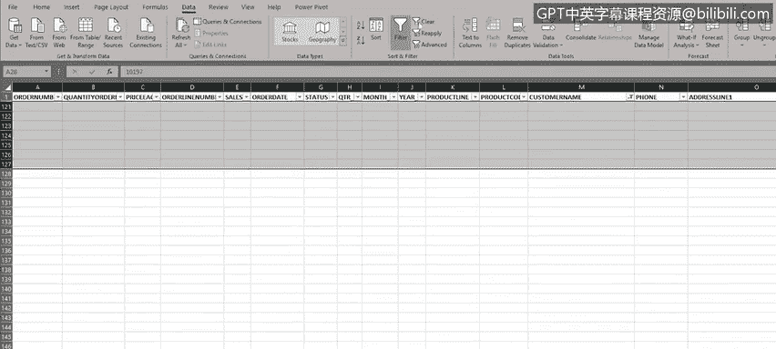
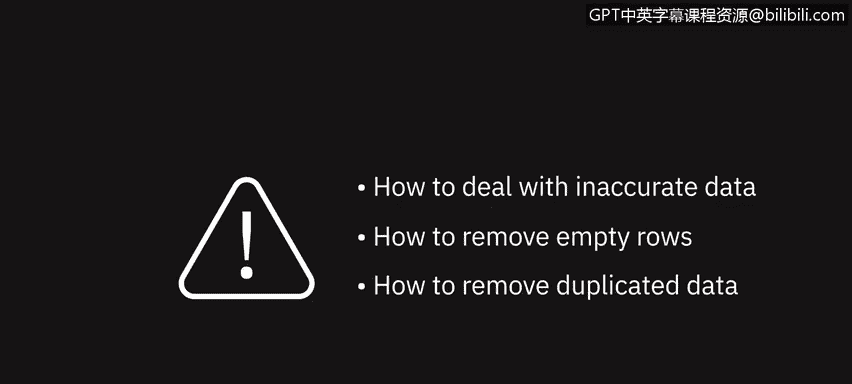

# IBM 数据分析师专业证书课程 2：《数据分析Excel基础》｜excel-basics-data-analysis-ibm｜ - P15：14_删除重复或不准确的数据和空行.zh - GPT中英字幕课程资源 - BV1zu4y1Q7dR

嗯。Now that we have learned about the importance of data quality and data privacy。

 in this video we will learn how to deal with inaccurate data， how to remove MDD rows。

 and how to remove duplicated data。It's very common when collecting or importing data。

 whether through manual or automated processes to get errors and inconsistencies in your data。

 This can be as simple as spelling mistakes， Ex white space or the wrong case used in text to empty rows or missing values in your data to inaccurate or duplicated data。

 having these errors and inconsistencies in your data can lead to issues with formulas not working with unsuccessful sorting and filtering operations。

 and therefore inadequately visualized and presented data findings。

These data errors and inconsistencies require you to carry out some form of data cleaning routine to improve the quality and usability of the data。

Let's start off with one of the easier of those tasks， which is spell checking In Excel。

 This works in pretty much the same way as you may have already encountered in applications such as Microsoft Word or other common word processing applications。

 I have some data here relating to the sales of toy vehicles。

 And the first thing we need to do is select what data we wish to check for spelling。 In this case。

 we will try column K， which contains the product line data。 Then we click spelling。

 which is on the review tab。Well， that seems to be okay。

 so let's try the country information in column T。So we do have an error here where a country name has been misspeelt or more likely mistyped。

We just click change if we are happy with the spelling suggestion。

 or we could choose another suggestion from the list or even ignore this error if we know the data is correct。

 but in this case， we will change it。Here's another typo for a country name。 And here's one more。

 So that seems to be all the errors in this column。 Let's try the final column now。

 which is the deal size in column X。Here is the misspelling of the word small and another for medium。

 And that seems to be all for this column。The next inconsistency we will look for is empty rows。

 Emp rows in your data can cause lots of issues relating to moving around your data。

 working with formulas and sorting and filtering。 Therefore。

 it's very important to remove them from your data。

 If you remember from an earlier lesson when we click control plus down arrow。

 it should take us to the end of that column of data。 But notice if we do that in this data set。

 the cursor keep stopping when we get to an empty row。

 meaning that the data set is essentially being split into multiple sections。

 separated by these empty rows。That's not good。 So let's resolve that。 Now。

 We have a couple of options。 One option is to just manually scroll down the sheet。

 looking for empty rows and deleting each one， which is easy enough。

 and fine to do if you only have a small amount of data。

 But imagine if you are dealing with hundreds or thousands or even tens of thousands of rows。

 That would be a very laborious and time consuming process。 There is a much better way。

 which involves selecting all our data first。 Either using the mouse or the control plus shift plus end keyboard shortcut。

 Then we select the filter icon on the data tab。 We can now see that each column has a filter icon next to the column header。

 If we then select the customer name， column filter in column M。 Then uncheck， select all。

 Then scroll down to the bottom of the list。 we can check the item called blanks。 and then click O。

 This will。😊，Now show only the empty rows at the top of our sheet。 This can be quite hard to see。

 but if you look in the row numbers， you can see that rows 28，29，65，73，74。

75 and 117 are listed at the top and are highlighted in blue text。 We can now select these rows。

 either using the mouse or going to the first cell in the first data row， which is a 28。

 and then using the control plus shift plus end keyboard shortcut。

 Then delete the offending empty rows。 We then need to clear the filter and turn it off。

 so we can view our data again。

Now， if we go back to the first row in the top of the data sheet and try the control plus down shortcut again to go to the end of the data column。

 it will work。 The next inconsistency we'll look for is duplicated rows of data。

 It's quite common for duplicate data rows to exist in your imported data caused either by human input error or an error in the import process。

 There are two ways of doing this in Excel。 The first way includes reviewing the data you plan to remove first before deleting it to ensure you are deleting the right data。

 This is our preferred method， as it provides an additional level of data security。

 The second method， which we will also show you， is simpler。

 as you don't review the data to be removed first， but it lacks the security of the first method。

 it's important to select a column of data that you would not expect to have duplicate values in。

 For example， if we consider the price each column， which is C。

Would expect lots of these values to be repeated because the unit price of some products is the same。

 So this is a bad example of a column to use to find duplicates。 Instead。

 let's use the sales column in column E， because it is far less likely that these values will be duplicated in the normal process of things。

 as they are the total sales for each order。 So we select the column and choose conditional formatting。

 Then highlight sales rules， and then duplicate values。 When we click O and scroll down the sheet。

 We can see that only a few values have been identified as being duplicates。

 There seem to be duplicate values in rows 36 to 40 and in rows 74 to 78。

 Let's zoom out so we can see both duplicate sections together。😊。

It seems like these are in fact exact duplicate entries and are likely to be an input error。

Let's delete the second section of duplicate rows as they are out of sequence as they relate to motorcycle sail and are in the ship's section of the sheet。

So that was the first and recommended method of removing duplicate rows of data。

 which previews the data to be removed first。 Now， let's try the second simpler but less secure method。

 Let's go back to 100 per zoom and go back to the top of the worksheet。

This time we select the whole data sheet and on the data tab， we use the remove duplicates button。

 We then unselect all the columns， Then only select the sales column。

 and the duplicate rows are deleted。 The last cleaning process we'll look at in this video is using the find and replace feature to repair some misspeelt surnames in the customer contacts column。

Find and replace tools are under find and select on the home page in Excel。

 If you have used other office products such as Word， it should be familiar to you already。

 We've had an email from a Swedish customer informing us that we have her surname spelt incorrectly on her order sheets。

 So we type the misspeelt surname into the Find what box and click find next。

 Then click it again to see there are multiple incorrect entries。

 If we click find all all instances are listed and we can open the replace tab to enter a name to replace the incorrect spellings。

 Her surname should be Laren with a double S So we'll replace all instances with that corrected spelling。

😊，That looks better， and we are finished In this video， we learned how to deal with inaccurate data。

 how to remove empty rows and how to remove duplicated data。 In the next video。

 we will look at changing the case of text， fixing date formatting errors and trimming white space from data。

😊。

