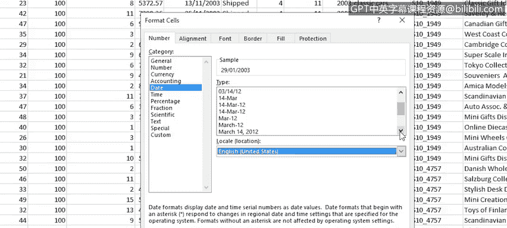

# IBM 数据分析师专业证书课程 2：《数据分析Excel基础》｜excel-basics-data-analysis-ibm｜ - P16：15_处理数据中的不一致性.zh - GPT中英字幕课程资源 - BV1zu4y1Q7dR

嗯。Now that we've learned how to deal with inaccurate data。

 how to remove empty rows and how to remove duplicated rows in this video。

 we'll look at changing the case of text， fixing date formatting errors and trimming white space from data when you collect or receive data from various sources。

 it's quite common to find that your data contains text in mixed case。 that is some in uppercase。

 some in lowercase and some in capitalized proper case， Also known as sentence case。

 Some of this may be intentional， but often it's not Excel doesn't have a change case button like there is in Microsoft word。

 So you need to use other methods to perform this data cleaning task。Those methods are functions。

 namely the upper， lower and proper functions you can use these functions to help you change the case of text in your data。

You can see that the header row here is using all uppercase characters。

 So if you want to change that to use proper case， then you need to add another row to put the function in。

 This is referred to as a helper row。 The proper function is simple to use Just type equals then proper。

 then open parenthesis， then the cell reference in this case a1。

 then close parenthesis and press enter here you can see that the result in a2 is in proper case。

 Now， you can try and drag the formula right across to column X。 by using the fill handle on a2。

 but this can be tricky when you have a lot of columns。 So let's try another way。

 instead of dragging， you can use shift plus right arrow to select the columns across to X first。

 Then press F2 to bring the cursor into focus in cell A2。 Then you hold down the control key。

You press enter and it fills across for you。You might think that you could now remove the original row。

 but look at what happens when you do。 you get a ref error because the formula is referencing an invalid reference and the header row cells now contain just the failed formula rather than the actual header text。

 So you need to undo that。 And instead， you copy the contents of the helper row to row1。

 But when you paste， you needn to choose the paste values option。

Now the header row cells just contain header text and you can remove the helper row in row too。Now。

 let's use the upper function to change text from proper case to uppercase。

 insertsert a column to the right of the column you want to change。 This will be a helper column。

 Then you type the formula containing the upper function in the first data cell in this new helper column again。

 it's a simple formula。 you type equals， then upper， then open parenthesis。

 then the cell reference in this case。 T2。 and then close the parenthesis and press enter。

 you can see the result in the country name in upper case。

 and you can then copy that formula down the rest of the column by double clicking the fill handle cross symbol。

 As before you then copy and paste the contents of the helper column to the original column。

 But use the paste values option。 Now， you can delete the helper column。Next。

 we'll use the lower function to change text from proper case to lowercase。 As before。

 you insert a column to the right of the column you want to change。

 This will be another helper column。 Then you type the formula containing the lower function in the first data cell in the helper column。

 Once again， it's a very simple formula。 you type equals， then lower， then open parenthesis。

 then the cell reference in this case， K2， and then close parenthesis and press enter。

You can now see the result is the product line data in lower case。

 and you can now copy the formula down to the rest of the column by double clicking the fill handle once more。

 As before， you then copy and paste the contents of the helper column to the original column by ensuring you use the paste values option。

 Now， you can delete the helper column。It's quite common to receive data that has a mixture of date formats or that uses a date format that isn't suitable for your region。

 Now， let's look at how to change the format of some dates。

You can see that this date format is currently using a two digit day， a two digit month。

 and a four digit year value。 When you open the number format dialog box。

 you can see in the locale box that this is an English or United Kingdom date format。

You want to use a US date format。 So you first change the locale to English United States。

 In this list， you can see there are several date options to choose from。

 Let's choose one that uses the full month name， then a two digit day and a four digit year value。

 you could then copy this formula to the rest of the date cells。 However。

 if you want to format these dates using your own custom format。 You can do that。 too。

 in the number format list， you select custom and then choose an existing format that is similar to what you want and simply modify it to create a new custom format。

Here we'll have the day then three letter month， then four digit year。

To apply that new custom date format to the rest of the column。

 you could either use the format painter tool or you can select the rest of the column and choose the new column format from the custom list in the number format dialog box。

You might find that your data has some white space。 That is unwanted spaces in your data Here。

 you can see that we have some spaces at the start。

 some spaces at the end and some unwanted double spaces in the middle of our data。

 We'll first have a look at what you can do to clean up these unwanted spaces in your data by using the find and replace feature in Excel。

 So you first select all the data。 Then on the home tab， you click find and select， then replace。

 to get rid of double spaces。 you enter a double space in the find what box。

 and a single space in the replace with box。😊，Then you click find next and choose replace for each item you want to change。

 You could click replace all to do all the fixes in one go。

 But unless you are absolutely sure of the changes。

 it's better practice to check and replace each one in sequence。

 in case there are some valid reasons for these extra spaces。 if you have a very large dataset set。

 you might also choose replace all to save you a lot of time。

 So using the find and replace feature got rid of most of those unwanted white spaces。

 but not all of them， we removed double spaces using that feature。

 but we also have some single spaces left at the start and end of some of the cells。 You can't use。

 find and replace to remove single spaces。 Otherwise， you would lose all spaces in your data。

 including standard spaces between words， which you don't want to remove。

 But there is another tool you can use to clear spaces from cells。 And that's the。😊，Trim function。

To use the trim function， you once again insert a helper column。 The trim function is simple to use。

 just type equals， then trim， then open parenthesis， then the cell reference。 in this case， M2。

 then close parenthesis and press enter。 You can then double click the fill handle symbol to copy this formula down to the remainder of the column。

 Now， you need to copy the contents of the new column N to column M。 and remember， once again。

 to paste using the paste values option。You can now see that those erroneous spaces have been removed or more accurately speaking。

 have been trimmed， and lastly， you can remove the helper column。In this video。

 we learned how to change the case of text， how to change date formatting and how to trim whitespace from data in the next video。

 we will discuss how to use the flash fill and text to columns features in Excel to help clean data。

