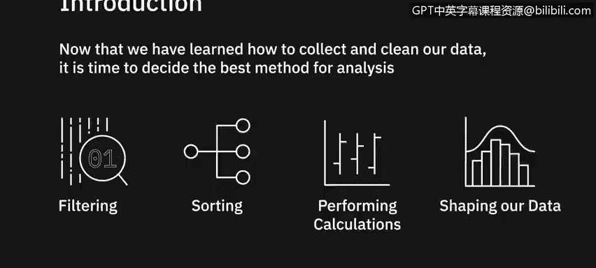
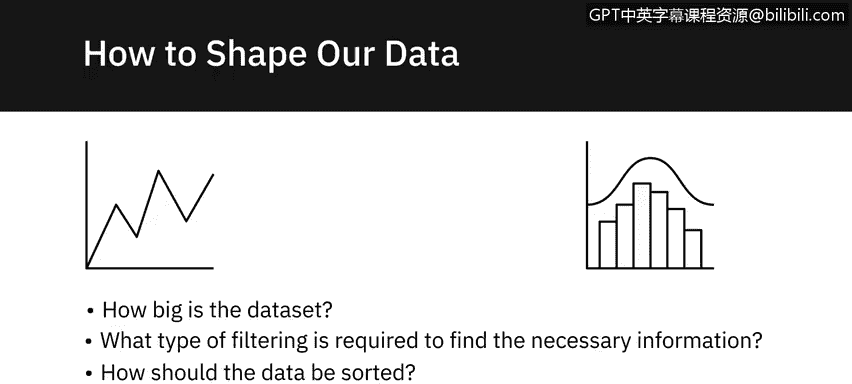
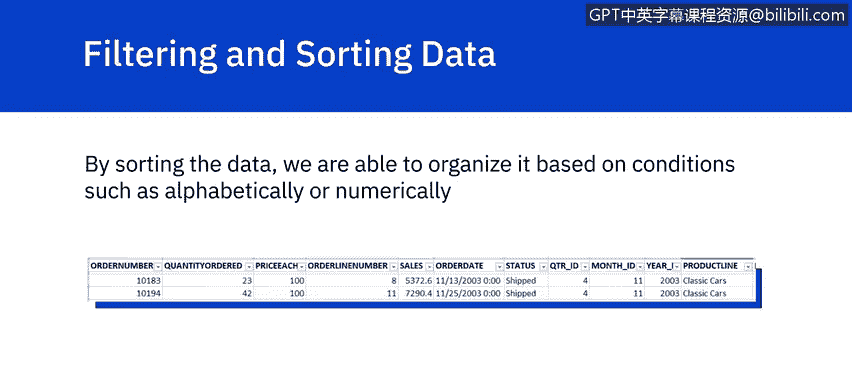
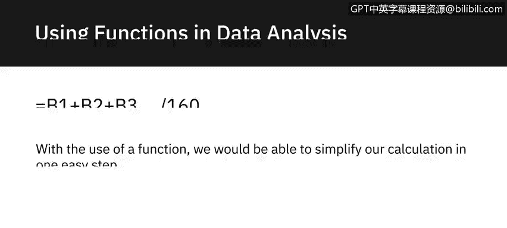
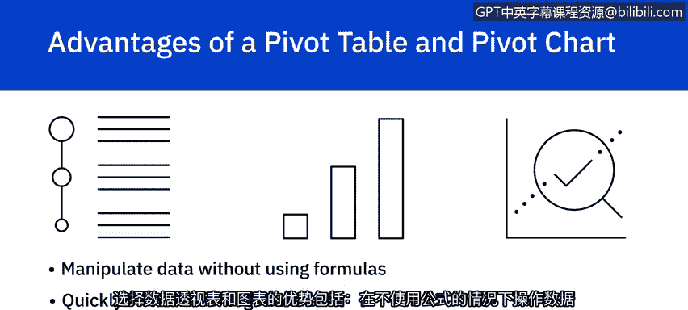
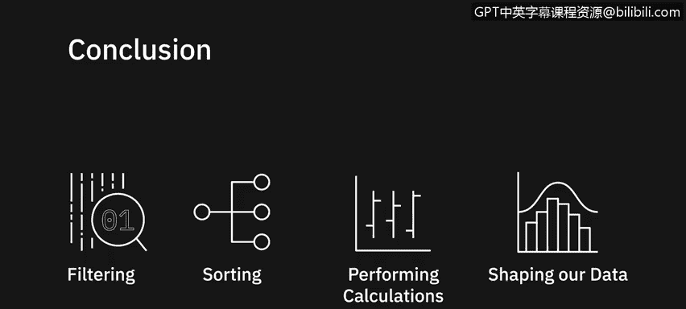

# IBM 数据分析师专业证书课程 2：《数据分析Excel基础》｜excel-basics-data-analysis-ibm｜ - P19：18_使用电子表格分析数据介绍.zh - GPT中英字幕课程资源 - BV1zu4y1Q7dR

嗯。Now that we have learned how to collect and clean our data。

 it is time to decide the best method for analysis in this video。

 we will discuss the importance of filtering， sorting， performing calculations。

 and shaping our data to provide meaningful information。

Deciding how to manipulate our data can sometimes be difficult before we make any changes or adjustments。

 we will need to visualize the final output。Below are some questions to ask before beginning the task。

 How big is the data set， What type of filtering is required to find the necessary information。

 How should the data be sorted， What type of calculations are needed。

 Now that we have visualize the final output。 We must decide the best approach to shape our data。

 The most basic step would be to filter and sort the data。

 By sorting the data we are able to organize it based on conditions such as alphabetically or numerically。

For example， if we wanted to check for duplicate order numbers。

 we could sort the data and quickly see any duplicates。After sorting and removing the duplicate row。

 we find that the view needs to be more specific to meet our requirements。

 We now decide that we only want to see the data for the month of November。 By adding a filter。

 We can now choose to only see items with a month I D that is equal to 11。By filtering our data。

 we are now able to only see the rows that meet the filter criteria。

 and it allows us to better analyze our information。

Becoming familiar with all the tools to analyze data can seem daunting。

 but one key benefit of using a spreadsheet is the ability to use functions。

Functions in Excel are organized by several categories， including mathematical， statistical， logical。

 financial and date and time based。 Let's say we wanted to get an average of company revenue for the month of June。

 We realize there are over 100 items that would need to be calculated。

 In normal circumstances to get an average。 We would have to create a formula to add each row and divide by the total number of rows。

 This type of calculation would not only be very long。

 but can expose the analyst to possibly making a mistake。With the use of a function。

 we would be able to simplify our calculation in one easy step， equals average open parenthesis， B1。

 colon， B160， close parenthesis。

While sorting and filtering data on our spreadsheet can be useful on its own。 First。

 converting your data to a table has many benefits。 When we convert our data into a table。

 we are able to filter and calculate the data more efficiently。

One example is the ability to easily calculate columns for the column MSRP。

 we choose sum and we're able to quickly calculate the sum of the column。

If we then look at the data and we only want to calculate the MSRP total based on Japan。

 we would filter the country column to only display Japan。

 and the column would then only add the values in the rows that were associated with Japan。

While all data may not work in a table， there are quite a few advantages to formatting your data as a table。

 automatic calculations， even when filtering column headings never disappear。

 Bed rows to make reading easier。 Tables will automatically expand when adding new rows。

Sometimes data needs to be more organized than what a basic tabular format can give us。

 and creating pivot tables with charts can be a better way to analyze and display the required information。

In Excel， we have the option of creating a pivot table to display and analyze our data。

 an optionally an associated pivot chart。 For example。

 let's say we want to know what company ordered products in the month of October from the original table of data。

 we create a pivot table to organize and analyze the required data along with a pivot chart to display the information。

By then adding the month filter to the newly created pivot table。

 we can see the results for the month of October， not only in the table。

 but the changes are automatically updated in the pivot chart。

When trying to single out specific information in a large data set。

 a pivot table is a nice way to show only the information that is required。

 This allows us to quickly and easily scan the essential information。

Pivt charts are a nice accessory to pivot tables， as they allow us to visually process data。

 and in most cases， will let the audience grasp the information quicker。

 The advantages of selecting a pivot table and chart are manipulate data without using formulas。

 quickly summarize large data sets， ability to display engaging charts and graphs。

In this video， we learned about the importance of filtering， sorting， performing calculations。

 and shaping our data to provide meaningful information。

 and we learned about some of the tools to begin analyzing our data。In the next video。

 we will learn more about filtering and sorting our data。

