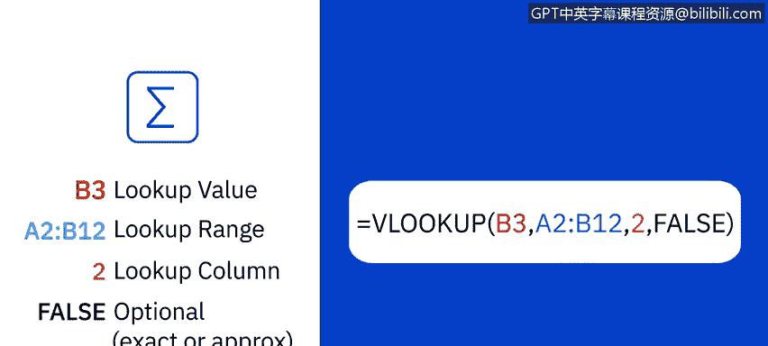
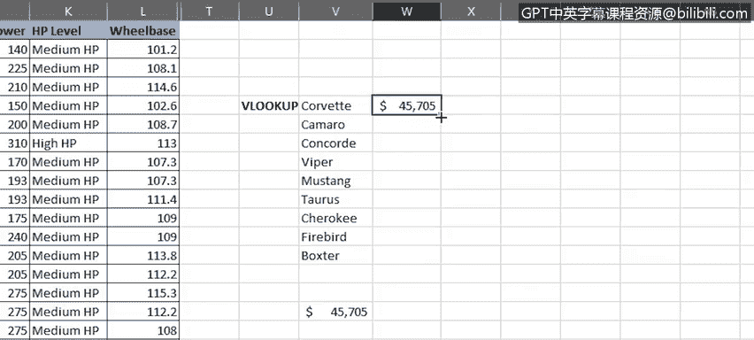
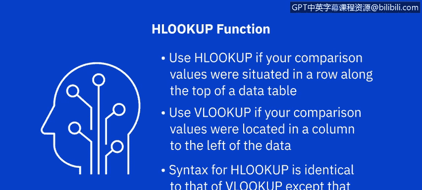
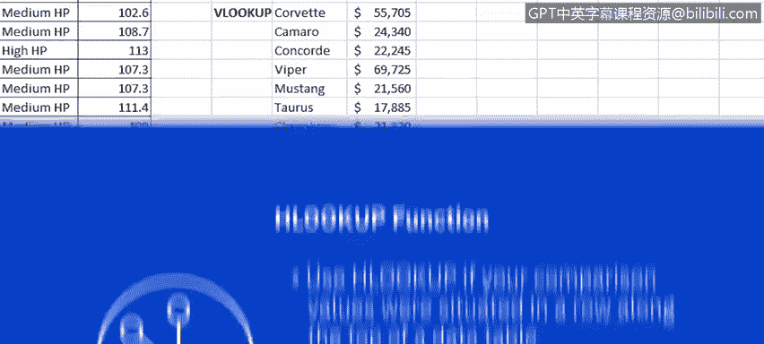
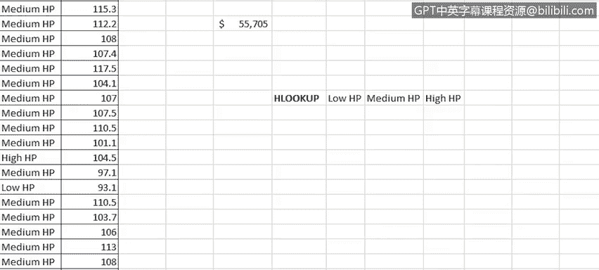
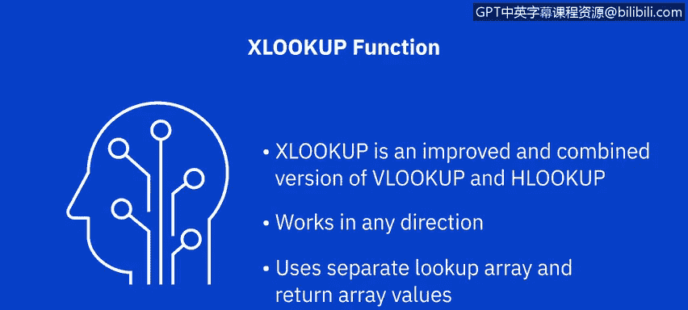

# IBM 数据分析师专业证书课程 2：《数据分析Excel基础》｜excel-basics-data-analysis-ibm｜ - P23：22_使用vlookup和hlookup函数.zh - GPT中英字幕课程资源 - BV1zu4y1Q7dR

嗯。Now that we've learned how to use the if， ifs， count if and some if functions， in this video。

 we'll look at how to use the V lookup and H lookup reference functions。

The lookup is one of the most commonly used reference type functions in Excel。

 and it enables you to find data referenced in a lookup table。

It stands for vertical Lookup and therefore is a useful tool when you want to find something in a table or range by row。

Shortly， we will look at H Lookup， which stands for horizontal Lookup。

 which looks for data by column instead。V lookup works by using a common shared key between the source data and the lookup data in the lookup table。

 A typical lookup formula would look like equal sign V lookup open parentheses。

 B3 comma A2 colon B12 comma 2 comma false close parentheses where B3 is the lookup value。

 That is the value or word you are looking for。 A2 colon B12 is the lookup table or range。

 That is the table array or range of cells that contains the lookup value in a formula。

 Excel references this as table underscore array。 The lookup table can be on the same worksheet or in another separate worksheet2 is the lookup column number That is the number of the column in the lookup table that contains the value you are looking for in a formula。

 Excel references this as Col underscore index。

numb。False is an optional parameter that determines whether the match found has to be exact。

 denoted by false， or can be approximate， denoted by true。In a formula。

 Excel references this as open square bracket， range， underscore， lookup， close square bracket。

The square brackets round this argument in the formula signifies that it is an optional argument。

 whereas the others are required arguments of a V lookup formula。

 If you don't specify the optional false or true parameter in your formula。 It will default to false。

 That is an exact match is required， you can also use the number 0 instead of false and the number one instead of true。

Okay， now let's see the V lookup function in action。In the car sales worksheet。

 suppose we wanted a quick price list of our favorite cars。

 The first thing we need to do is put the column containing the value we want to search for in the leftmost column as V lookup requires this。

 Then we can delete the original column。 We then enter the formula seen in cell V 16。

 which is looking for the word Corvette in the table array from cell A 2 to G156。

 and then looks for the value in the fifth column In this case。

 the price column that matches the row containing Corvette and returns an exact value of $45705。😊。

Note that in this example， we are using a part of our existing data table as the lookup table or table array。

Let's format that as US currency， then we'll format it to zero decimal places。In fact。

 rather than use the reference a 25 in the formula。

 it will be easier to use the reference to the word corvette in the mini table in this worksheet where our list of favorite cars is。

 So that is V 5。 and the formula still works。 Now， let's copy that formula up to the favorite car table above it in the worksheet。

 But there's a problem， because when we copy the formula， the cell references changed。

This happened because as we learned earlier in this course。

 the default state of cell references is relative， and we want them to be absolute in this case。

 So let's undo that copy operation to make the cell references absolute。

 We need to add dollar symbols to all the cell references in the formula。

 This can either be done manually or you can put the cursor in each cell reference in turn in the formula and press F 4 each time to automatically add the dollar symbols。

Let's try and copy the formula again。 And this time， it works。

If we use the fill handle on cell W 5 to copy it down to the rest of the cars， it doesn't work。

 In fact， we end up with the same result in every cell。 Why。

 Because each one is referencing the same cells in the look up value。

 because we used an absolute reference。 All we need to do now is modify the formula to remove the absolute reference for just the row parameter in the look up value part of the formula by removing the dollar symbol。

So in sell W 5， we change dollar V dollar 5 to dollar V 5。 Then when we drag the fill handle down。

 it will copy the formula correctly， and all the prices will be changed to reflect their correct retail price。

Lastly， to show that the two tables are now connected by this V lookup function。

 if we change the retail price for the Chevrolet Corvette in the main data table and sell E25。

 the price will also change in the favorite carss price list。

Let's now take a look at the H lookup function， which， as we mentioned earlier。

 does the same thing and works in virtually the same way as the V lookup function。

 But it looks for data in columns rather than rows。

 So H lookup looks for a word or value in the top row of a table。

 and then returns a value in the same column from a row specified in the table array。 Therefore。

 you would use H lookup if your comparison values were situated in a row along the top of a data table。

 In contrast， you would use V lookup if your comparison values were located in a column to the left of the data you want to find as they were in the previous task。

😊，Of the two functions， V lookup is used far more frequently than H lookup because of the nature of most data tables。

 The syntax for H lookup is identical to that of V lookup。

 except that you specify a row index number referenced in a formula by Excel as row underscore index underscore nu。

 This indicates the number of the row in the lookup table that contains the value you are looking for。

Let's create a small look up table on the right hand side of our main data table。

 A few columns have been hidden in this worksheet to make viewing a little easier。

So now we've got low HP， medium HP， and high HP in the top row of our lookup table。Next。

 we'll add winging symbols as ratings for the three horsepower levels。

1 sad face for the low horsepower rating，2 neutral faces for the medium rating and three happy faces for the high horsepower rating。

Now， let's add a new column to the right of the H P level column and call it H P rating。

 Then in cell L2 we' enter the H look up function。 This function will look for the value in cell K2。

 which in this case is medium H P， and it will look for it in the cell range from Y 21 to A A22。

 which is our little lookup table and it will return the answer it finds in row 2 of the table under medium H P。

 and use an exact value。 note that we've used some absolute references in this formula 2。

 Not that what is returned is the text K K， So we need to format the cell using the wingings font。

Now， when we double click the fill handle， the whole column shows the HP rating symbols relevant to each row's HP level value。

 and we're done。Although V lookup and H lookup are regularly still used as the de facto functions for lookup references in Excel。

 there is a newer function called X lookup， this version is only supported on Excel desktop versions from Excel for Microsoft 365 and on Excel for the web。

 as well as on Excel for iPad and iPhone and Excel for Android tablets and phones。

 X lookup is an improved and combined version of Vlookup and H lookup together。

 It can work in any direction， vertically or horizontally。

 It also uses separate lookup array and return array values。

 Instead of a single table array and a column or row index number。😊。

In this video， we learned how to use the Vlookup and H lookup functions in Excel to find and connect to data referenced in both vertical and horizontal lookup tables in the videos coming up in the next lesson。

 we'll start to look at using pivot tables in Excel。

