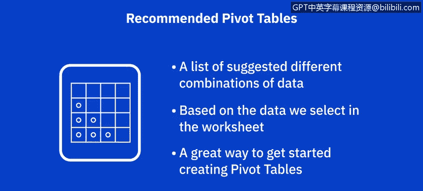
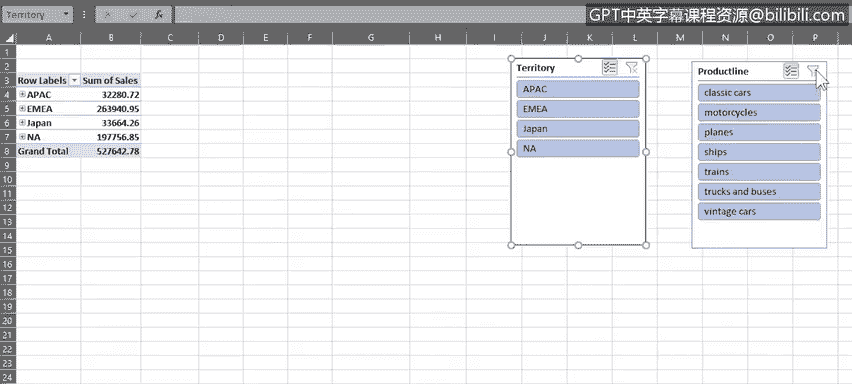
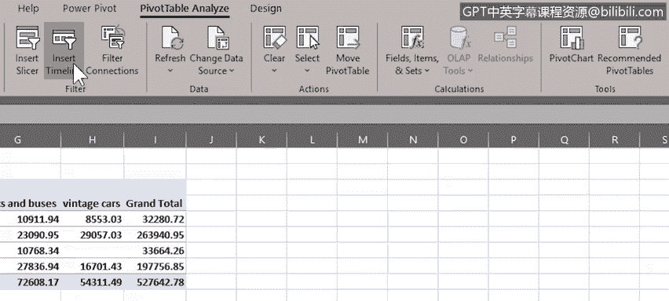
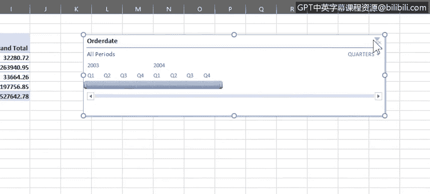
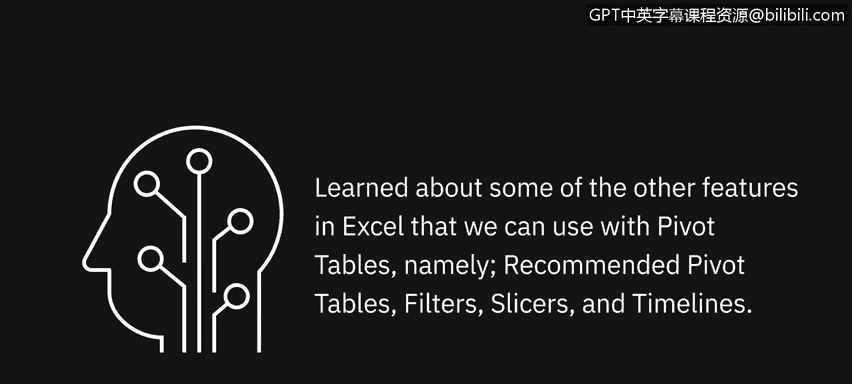

# IBM 数据分析师专业证书课程 2：《数据分析Excel基础》｜excel-basics-data-analysis-ibm｜ - P26：25_数据透视表功能.zh - GPT中英字幕课程资源 - BV1zu4y1Q7dR

嗯。Now that we've learned how to create and use pivot tables in Excel in this video。

 we'll look at some other features that we can use with pivot tables。

 including recommended pivot tables， filters， slicers and timelines。😊，First。

 let's look at recommended pivot tables， which isn't exactly a feature as such。

 It's really more of a list of suggested different combinations of data that could be used when creating a pivot table。

These recommendations are based on the data we select in the worksheet。

 and they are a great way to get started creating pivot tables if you don't have much experience with them yet。

 For example， in the vehicle toy sales worksheet， If we select column B。

 which contains data about the quantity of items ordered when we choose recommended pivot tables from the insert tab。

 then we are presented with a list of potential data combinations related to the order quantity information。

😊。

However， if we select column F， which contains order size information。

 then the recommended pivot table list changes to reflect that data。And if we select column E。

 which contains sales information， then the pivot tables recommended are related to sales data。

Let's select the third one down， which is the sum of sales by territory。

 because that sounds like something we could get some useful insight from by presenting it in a pivot table。

Note that the new worksheet is opened containing the recommended pivot table and a new pane opens on the right。

 called Pi table fields。Let's rename the worksheet to something more meaningful In the pivot table fields pane。

 you can see that some fields have already been added to the rows and values areas。

Although it's a recommended pivot table， we can still make it our own by adding more fields。

 for example。 So let's add the product line item to the columns area using drag and drop。 Now。

 we have columns for each of the product lines in our pivot table， such as motorcycles。

 ships and trains。😊，In the pivot table， we can manually expand any field we want to view its contents here。

 we can see that the order dates are located underneath the territory names in our pivot table。

Note that this matches the order of the fields in the row area of the pivot table Field pane。

We can manually collapse each of the fields， too， but we also have the option of expanding all the fields at once and collapsing them all。

 too。The next feature we will delve into is pivot table filtering。

Pivot table filters work in much the same way as the standard filters we used earlier in the course。

 Note that we already have some inbu filtering in this pivot table。 For example。

 the rose label header is a filter， and we can filter on any of the listed territories such as Japan。

 Just like standard filters。 It's very simple to clear a filter in a pivot table。

We also have a column labels filter allowing us to filter on any of the product line items in this pivot table。

 For example， we could show data only for the trains product。

We also have the option of adding the product line field as a standard filter instead of a column heading by dragging it to the filters area in the pivot table fields pane。

And we can then use it as a standard filter， as we have done earlier in this course。

The filter also allows us to select multiple filter items。

 But because it's now being used as a standard filter rather than a column header。

 we can't see the split of the information on these two product lines。 We just see a combined total。

 When we had the filter as a column header。 The information on each product line was presented separately in each column。

 Let's display all the field totals again。 and we'll drag the product line field back to the columns area where it was previously。

 so we can see the split of our different product lines in the pivot table。

The next pivot table feature we will look at are slicelicers。

 Slicers are essentially on screen graphical filter objects that enable you to filter your data using buttons。

Slicers make it easy to perform quick filtering of your pivot table data。

 and they also display the current filter state， making it easier for you to know and see what data is currently being shown and which is being hidden by the filter。

For example， if we remove the product line field from the pivot table by dragging it out of the pivot table fields pane and then from the pivot table Ana tab。

 we click insertst slicelicr and then choose the territory field as our slicer。

We can see that the slicer can be freely moved around anywhere on the worksheet。

 and it contains buttons for each of the territory names， such as EMEA， North America and Japan。

We can also select the multi selectlect button to filter on multiple territories if we wish。

 we can click the clear filter button to clear all the slicer filters。

Let's add another slicer to our worksheet for the product line field。 However。

 be sure to select a cell in the pivot table first， because if you don't。

 then the insert slicer button won't work。Note that sliceers can also be added from the filters group on the insertt tab。

 as well as from the Pi table Ana tab。We'll select the product line field this time for our slicer and drag it near the top of the worksheet。

As before， we can select only one slicer item， or we can turn on multi selectlect and choose several items to filter on in the slicer。

Then let's clear the slicer filters， and now let's filter using both slicers。

Note that when you use multi select filtering， when you select an item， you are， in fact。

 filtering it out。 That is， you are defining which items will not be displayed in the pivot table。

 This is the opposite behavior to when you were selecting single items in a slicer。

So now we are displaying only classic cars， trains and trucks and buses products for the EMEA and North America territories。

 Now， let's clear those slicer filters and put the product line field back in the columns area of the pivot table。

 So it's ready for the next feature we will explore。😊。

And let's move these slicers out of the way further down the worksheet。

The last useful feature for pivot tables we are going to look at is timelines。

 A timeline is another type of filter tool that enables you to filter specifically on date related data in your pivot table。

😊，This is a much quicker and more effective way of dynamically filtering by date。

 rather than having to create and adjust filters on your date columns。

We can add a timeline for our pivot table， either from the Pi table analyze tab or from the insert tab。

 again， ensure you select any cell in the pivot table。 First。

 we'll select the order date field as our timeline filter。

Then we can drag it up the worksheet and enlarge it。

The default for this timeline is to display data by month。

 but you can also filter by days or by quarters。You can select a single quarter。

 or you can select a range of quarters。 In this case。

 we'll select 12 months between quarter 3 of 2003 and quarter 2 of 2004。

You can use the clear filter button to clear a timeline filter。 You can also filter by years。

 For example， here we have selected 2003 only。

And you can combine slicers and timelines as filters in a pivot table。 For example。

 here we can filter the slicers to display only data for trains in the EMEA and North America territories and only in the year 2003。

And if we filter on the year 2004 instead， you'll see that there is no data being displayed。

 meaning that there were no sales of train products in 2004 in either the EMEA or the North American  Territories。

Timelines and slicers have their own tabs in the ribbon when you select them。

 and their properties can be modified to change how they look and how they work。For example。

 let's change this timeline to a light green shade。

And let's change this slicer to a nice orange color。 And lastly， to remove a timeline or slicer。

 you can either select it and press the delete key or right click it and choose cut。In this video。

 we learned about some of the other features in Excel that we can use with pivot tables。

 namely recommended pivot tables， filters， slicers and timelines。

