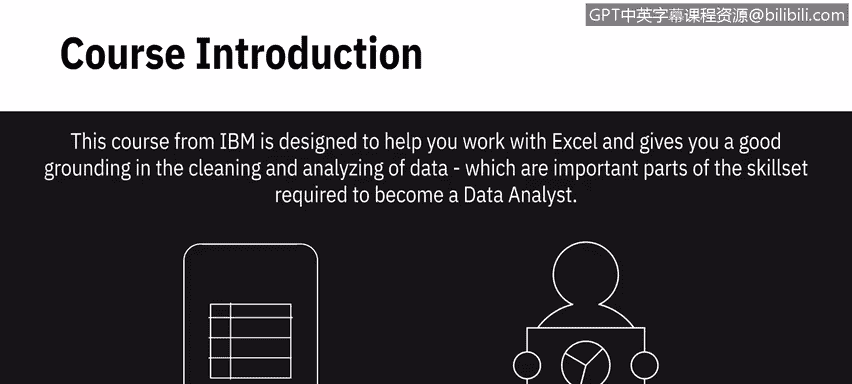
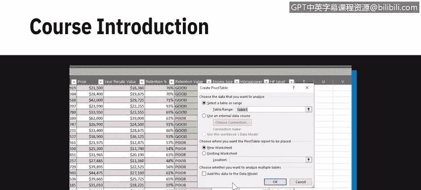
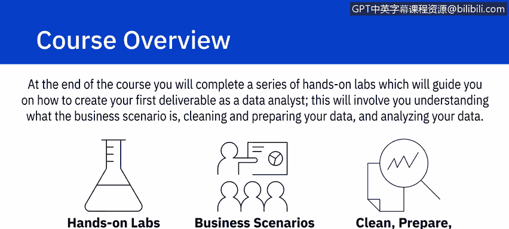
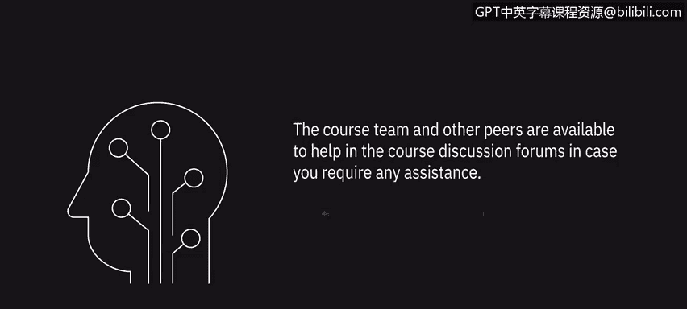

# IBM 数据分析师专业证书课程 2：《数据分析Excel基础》｜excel-basics-data-analysis-ibm｜ - P27：0_01_course-introduction.en_subtitled - GPT中英字幕课程资源 - BV1zu4y1Q7dR

嗯。🎼Do you want to learn how to use spreadsheets and start analyzing data using Excel。

 This course from IBM is designed to help you work with Excel and gives you a good grounding in the cleaning and analyzing of data。

 which are important parts of the skill set required to become a data analyst。

 You will not only learn data analysis techniques using spreadsheets。

 But also practice using multiple handson labs throughout the course。 in module 1。

 you will learn about the basics of spreadsheets， including spreadsheet terminology。

 the interface and navigating around worksheets and workbooks。😊。

In module2， you will learn about selecting data， entering and editing data， copying。

 and auto filling data， formatting data， and using functions and formulas。In module 3。

 you will learn about cleaning and wrangling data using a spreadsheet。

 including the fundamentals of data quality and data privacy。

 removing duplicated and inaccurate data， removing empty rows。

 removing data inconsistencies and white spaces， and using the flash fill and text to columns features。

In moduleule 4， you will learn about analyzing data using spreadsheets， including filtering data。

 sorting data， using common data analysis functions， creating and using pivot tables。

 and creating and using slicers and timelines。At the end of this course in moduledule 5。

 you will complete a series of hands on labs which will guide you on how to create your first deliverable as a data analyst。

 This will involve you understanding what the business scenario is。

 cleaning and preparing your data and analyzing your data。

You will follow two different business scenarios throughout the course with each using their own dataset。

 these different scenarios and data sets will be used in the lesson videos and in the hands on labs。

After completing this course， you will be able to understand how spreadsheets can be used as a data analysis tool。

 understand when to use spreadsheets as a data analysis tool and their limitations。

 createate a spreadsheet and explain its basic functionality。

Perform data wrangling and data cleaning tasks using Excel。 analyze data using filter。

 sort and pivot table features within Excel spreadsheets。

You will also perform some intermediate level data wrangling and data analysis tasks to address a business scenario。

The course team and other peers are available to help in the course discussion forums in case you require any assistance。

Let's get started with your next video where you will get an introduction to spreadsheets。

