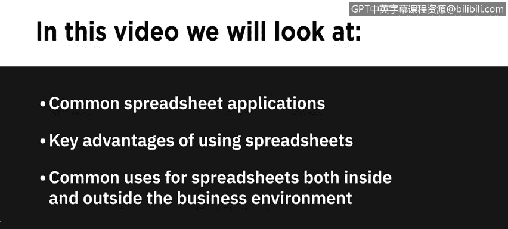
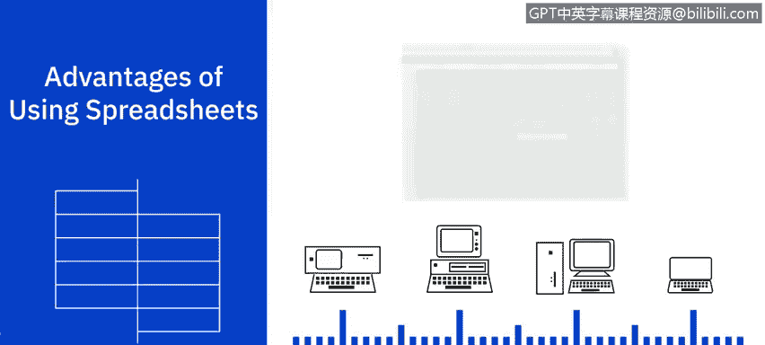
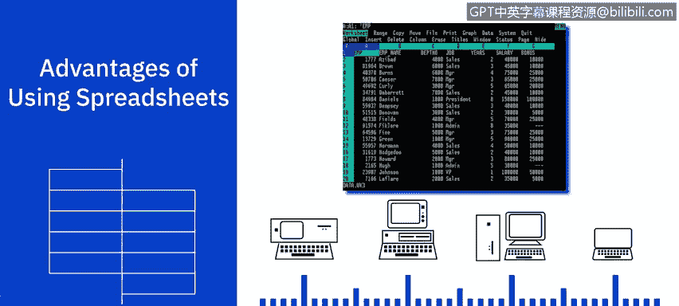
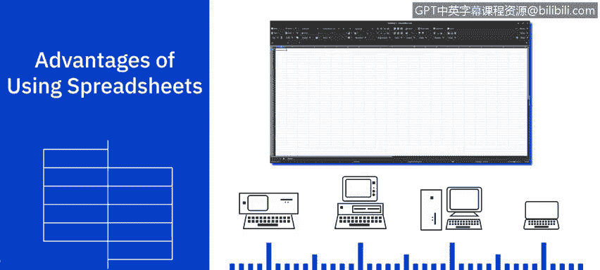
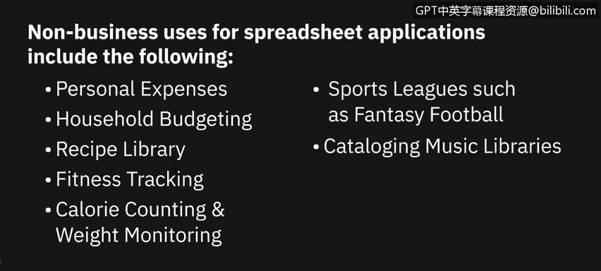
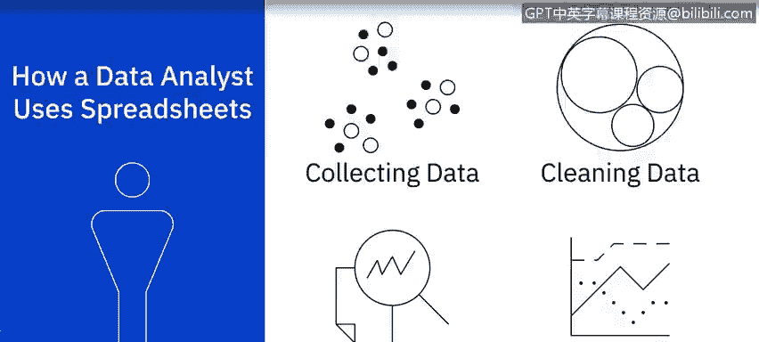
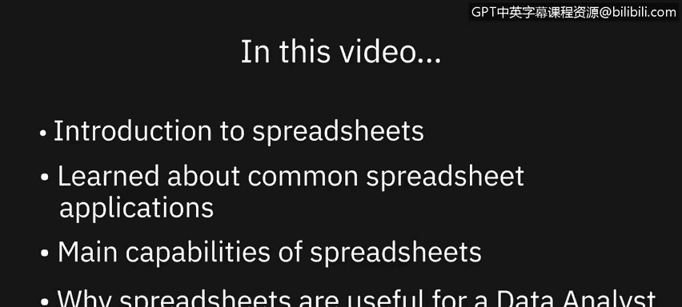

# IBM 数据分析师专业证书课程 2：《数据分析Excel基础》｜excel-basics-data-analysis-ibm｜ - P28：1_02_introduction-to-spreadsheets.en_subtitled - GPT中英字幕课程资源 - BV1zu4y1Q7dR

嗯。In this first video of the course， we will list some of the common spreadsheet applications available。

 learn about key capabilities of spreadsheets， and discuss why spreadsheets might be a useful tool for a data analyst。

There are several spreadsheet applications available in the marketplace。

 Some of them are more widely known and used than others， and some are free。

 while others need to be paid for。 by far， the most commonly used spreadsheet application。

 and the most fully featured of them all is Microsoft Excel。

 The desktop version comes in a paid form as part of the Office suite and some Microsoft 365 subscriptions。

 but there is also a webbased cutdown version called Excel for the web also known as Excel online。

 The online version is free to users with a Microsoft account。

 but does not offer all the advanced features that the desktop version provides。

 The next most popular is Google sheets， which offers a lot。

 though not all of the features that Excel provides。 and is free with a Google account。

 This is a webbased application。 and it integrates nicely with other Google Apps such as Google Form。

 Google Analytics。😊，And Google Data Studio。 Then there is Librey Office Calc。

 a totally free and open source desktop spreadsheet application that offers more basic functionality than Excel or Google sheetets。

 but still has a lot of the tools you need for data analysis such as charts。

 conditional formatting and pivot tables， other spreadsheet apps include Zho sheet a fully featured webbased application。

 that is comparable with Google sheetets， Open office Calc， Quip for Salesforce， Smartsheet。

 which is predominantly for project management and Apple numbers。

 which is included with Apple devices such as Mac computers。

 and is also available on the app store for other Apple devices。

 So there are many spreadsheet application options open to you from fully featured to basic from cloudbased to desktop apps from paid for to free versions。

 It's up to you to decide which one fits your needs and your budget。😊。

des several advantages over manual calculation methods For example。

 once you have your formulas correctly written， you can be assured that your calculations are accurate and that the calculations will be performed automatically for you。

Spreadsheets also help keep your data organized and easily accessible your data can be easily formatted。

 filtered and sorted to suit your needs if you do make mistakes in your data entry or your calculations。

 you can easily edit them undo them or use error checking tools to help remedy those mistakes and lastly you can analyze data in spreadsheets and create charts。

 graphs and reports to help visualize your data analysis since spreadsheet software for personal computers first appeared on the market in the 1970s with VisCalc on the Apple2 PC spreadsheets have come a long way in terms of the capabilities and features they now offer businesses from uncomplicated tables and relatively simple computations to powerful tools for analysis management and visualization of enormous sets of data。

The most common business uses for spreadsheet applications include the following。

 data entry and storage， comparing large data sets， modeling and planning， charting。

 identifying trends， flow charts for business processes， tracking business sales。

 financial forecasting， statistical analysis， profit and loss accounting， budgeting。

 forensic auditing， payroll and tax reporting， invoicing， and scheduling。

 and away from the business side of things， other typical uses include personal expenses。

 household budgeting， recipe library， fitness tracking， calorie counting and weight monitoring。

 sports leagues such as fantasy football， cataloging music libraries， and even contact lists。

 shopping lists and Christmas card lists as a data analyst。

 you can use spreadsheets as a tool for your data analysis tasks including collecting and harvesting data from one or more。

Cing data to remove duplicates， inaccuracies， errors and resolve missing values to improve the quality of the data。

Analyzing data by filtering， sorting and interpreting it to determine what useful information can be gleaned from it and visualizing data to help you tell a story about your data analysis findings to key business stakeholders and any other interested parties within your organization。

In this video we had an introduction to spreadsheets。

 we learned about some common spreadsheet applications。

 what the main capabilities of spreadsheets are and why spreadsheets might be a useful tool for a data analyst In the next video we will look at the basics of spreadsheets。

 including common spreadsheet terminology。

