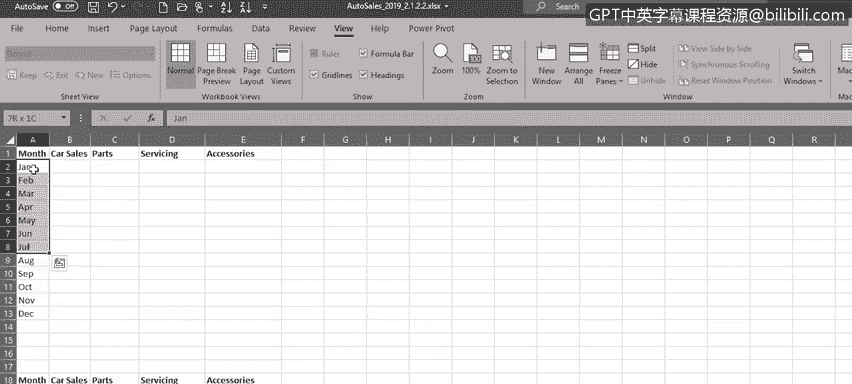
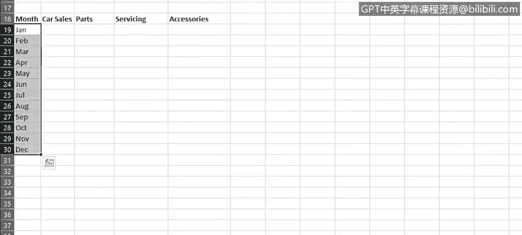
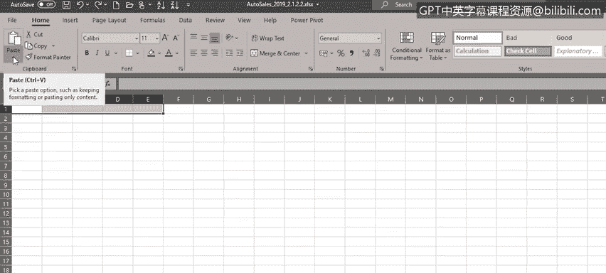
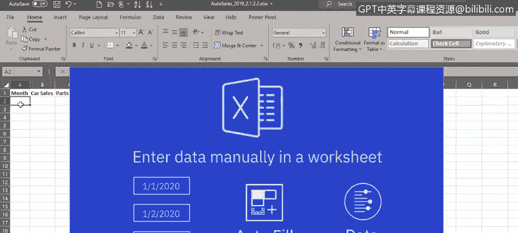
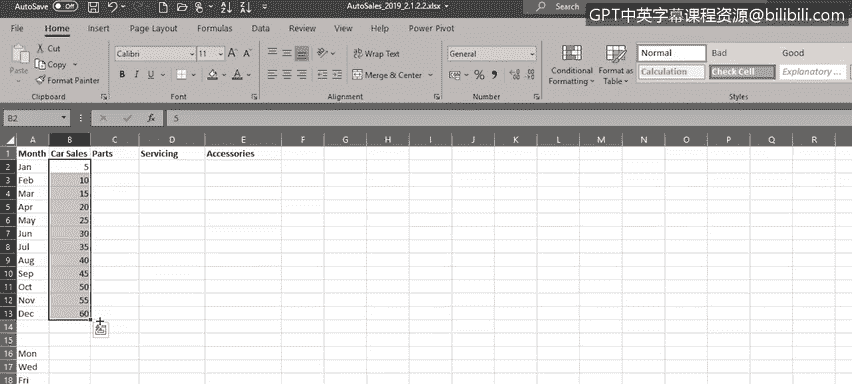
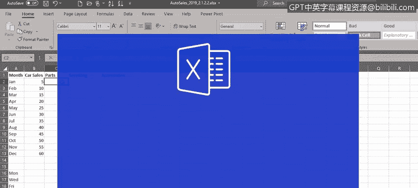
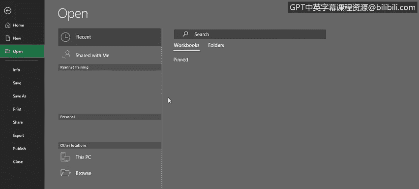

# IBM 数据分析师专业证书课程 2：《数据分析Excel基础》｜excel-basics-data-analysis-ibm｜ - P33：6_02_copying-filling-and-formatting-cells-and-data.en_subtitled - GPT中英字幕课程资源 - BV1zu4y1Q7dR

嗯。Now that we have learned about some of the handy viewing features provided in Excel and entered and edited some data。

 let's discuss how to move， copy， and fill data， and how to format cells and data to suit our needs。

The first thing we are going to discuss is how to move data。

 so if you select a range of cells in this case， the headings in A1 to E1 and then hover over the top or bottom edge of a selected cell。

 you will see the move pointer， then you can drag the selection to another place on the worksheet。

Alternatively， if you want to copy the data instead， you do the same thing。

 but this time you also hold control key as you select and drag the selection to another location。

 and you will see the copy pointer。 if you are not comfortable with dragging。

 you can also use copy and paste menu commands or keyboard shortcuts。

If you select some data in column A and copy it to the clipboard。

 then you simply select the new location and paste the copyied data。

You can also move or copy between worksheets， so let's create a new worksheet。

 then select some data from sheet1， and this time let's use the Control+ C keyboard shortcut to copy it to the clipboard。

 then choose the other worksheet and use the control+ V shortcut to paste the data。

However， notice that the column widths are not the same as the original source data。

 so let's undo that and try another paste option。By default， when you paste the copied data。

 it uses the column width settings of the destination cells。

 so to paste it and retain the column widths of the source data。

 you choose the special option under the paste command called Keep source column widths as an alternative to having to enter data manually in a worksheet。

 you can use an Excel feature that automatically fill cells with data when it follows a sequential series or pattern。

 The feature is called autofill， and it can be especially useful when you need to enter lots of repetitive data into Excel such as date information。

😊。

For example， if you enter a month in a cell， even using a shortened version of the name。

 you can use what's called the fill handle to select down to the end of the series。

 an autofill will work out what the series is based on the selected data。

 Let's try the same thing with days of the week。 If you enter month for Monday in a cell。

 then drag the fill handle to use autofill。 It will determine that you want to enter the days of the week sequentially。

 However， if you also enter when for Wednesday in the next cell down and select both cells in the series that is a16 and a17。

 and then drag the fill handle down。 Autofill determines that the sequence has changed to every other day and fills in the data series for you。

😊，It's important to select all the cells that determine the pattern when using autofill so that it can best determine what the pattern is。

 in this case， cells A16 and A17。A similar thing applies to numerical patterns。

 if you enter5 in a cell and then use the fill handle to fill the data down the column because the data is not the name of a day or month。

 for example， Autofill can't determine what the pattern is yet。 So in this case。

 it just copies the value 5 into every selected cell。However。

 if you enter the value 10 in B3 and then use the fill handle to fill data down the column。

 Autofill determines that the pattern is incrementing by5 each time。

 and it fills in the remainder of the data pattern for you。

Now we're going to look at formatting our data， and there are essentially two distinct parts to this。

 First， there's formatting of the cells themselves with a fill color and a bold border， for example。

 and bold text within it。 and then there's formatting the data in the cells。 for example。

 making it text format number format or a specific currency or accounting format。

Let's open the car sales worksheet we used previously， then select the headings in cell A3 to P3。

 either using the mouse or you could use the shortcut keys control+ shift plus right arrow。

On the Home tab， click the Styles droprop down arrow and then select a style color for your cells。

 then you can make the selected cells bold。Then you select the data in the manufacturer column。

 either using the mouse or the shortcut keys control plus shift plus down arrow in the Sts drop down arrow。

 select another style color for the selected cells again， you can make the cells bold。

 Then you select the data in the model column again。

 either using the mouse or the shortcut keys Control plus shift plus down arrow。

In the Styles drop down arrow， select another style color for the selected cells。This time。

 you could make the selected cells italic。And you can also change the font size and style。 Lastly。

 you can select all the other cells in the data by using the mouse or the control plus shift plus right arrow。

 then down arrow and apply borders to the data cells。 Now it's time to format the cell data。

 the sales figures and columns C and D can be formatted to display only1 decimal place。

 just select the data and click the decreased decimal button。

 We also have an issue with a couple of the car models。 If you look in cells B129 and B130。

 where the model name is supposed to be displayed。 you can see there are actually two dates listed instead。

 And if you look in the number format box， the format type is custom。

 This has happened because the model numbers are supposed to be the sob 9，5 and the sob 9，3。

 But when the files were imported from Cv files。 these two cells must have been incorrect。😊。

Determined to be date values and not just numbers。 You can fix this by formatting these two cells as text and then enter the correct values of 9。

5 and 9，3。 The last thing we want to do is format some data as currency。

 If you look at the heading and column F。 It says it is price in thousands of dollars and sell F 4 is using the general format。

 So let's change the format of this column to American currency format。

 We select the column F in this case， Then select more number formats from the dropdown list。

 Then we choose the currency option and the correct currency symbol and format。 and we're done。

In this video， we learned how to move， copy， and fill data。

 and how to format cells and sell data to suit our needs。

In the next video， we will look at the basics of formulas， learn how to perform simple calculations。

 and learn how to select ranges and copy formulas。

