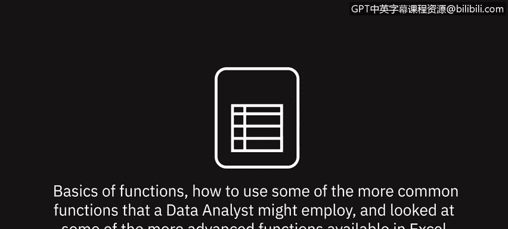
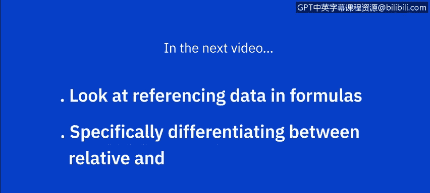

# IBM 数据分析师专业证书课程 2：《数据分析Excel基础》｜excel-basics-data-analysis-ibm｜ - P35：8_04_intro-to-functions.en_subtitled - GPT中英字幕课程资源 - BV1zu4y1Q7dR

嗯。Now that you have learned about the basics of formulas。

 learned how to perform some basic calculations， and how to select ranges and copy formulas。

 next we will have an introduction to functions， including using some common statistical functions。

 and then we will learn about some more advanced functions that a data analyst might also use。

First， let's look at some common functions used for statistical calculations。

 we'll add some row headings for average minimum， maximum， count and median， then in cell B20。

 let's work out the average of the car sales for the year from the table above。

On the Home tab in the editing group， we click on the Autosomeum droprop down list and choose averagever。

Now， because AutoSum tries to add up the values directly above it in the column。

 we need to modify the cell range here to B2 to B13。Then we can use the fill handle。

 as we've seen before， to copy the formula across to column E for the minimum calculation in B21。

 we select min from the autosum list and again， we need to modify the cell range。

 So this calculates the lowest value in our range and fill across to column E and for the maximum calculation。

 we select max from the list， and then modify the range， and once again， copy the formula across。

 This calculates the highest value in our range， in B23， we will calculate the count。

 which basically just means the number of values that exist in the selected range So we select count numbers from the list。

 then modify the range for the median calculation， we can select more functions from the autosum list then select statistical as the category and scroll down to find the median function。

😊，The median returns the exact middle of a range of selected values。

 note that if you're selecting an odd number of values。

 it will return the figure that is the middle value in your selected range。

 but if you have selected an evenD number of values in your range。

 it will return the middle figure between the two middle values in your range。Once again。

 we need to change the cell range to B2 to B13， and we can then copy this formula across to column E。

You've seen AutoS and some of the common statistical functions in Excel。

 but there are another 400 plus other functions available， so let's explore just a few of those now。

On the formulas tab in the function library group， there are drop down lists for several function categories。

 The first is a list of recently used functions， which updates automatically as you use them。

 Then you have functions related to financial calculations。 If you hover over the name of a function。

 you see a short description for each one。 So here we have the accrued interest function。

 and here is the interest rate function。The logical list has Boolean operator functions such as and if and or。

There are several functions related to text， such as Concat。

 which is an updated version of a previous function called concatetnate。

 which is still supported by the way for backwards compatibility。

 find and search There are also several functions related to dates and times such as network days。

 weekday and weekna。In the Lookup and reference list， there are functions such as areas， H Lookup。

 sort by， and V Lookup。In the Ma and Trig list， you'll find lots of useful mathematical functions such as power。

 some if and some product， alongside many functions for trigonometric purposes such as cosine。

 Sine and tangent There is also a more functions list which provides several more function categories such as statistical。

 engineering and information。In the statistical list， you'll find functions such as average count。

 Max， median and min。 we saw some of these used earlier in this video。

If you're struggling to find the function you want in these lists。

 you can also search for a function， just click the insertsert function button on the formulas tab and then either browse the category lists available or choose all and look down the alphabetical list for the function you wantAlternatively。

 type the name of a function you want and click go to search for it。

 then select the one you want from the returned search。In this video。

 we learned about the basics of functions， how to use some of the more common functions that a data analyst might employ。

 and looked at some of the more advanced functions available in Excel。

In the next video， we will look at referencing data in formulas。

 specifically differentiating between relative and absolute references and error handling in formulas。

