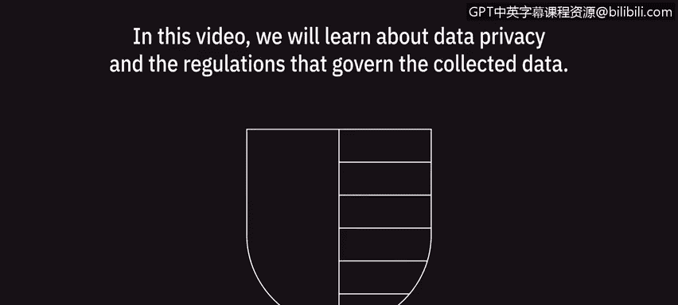
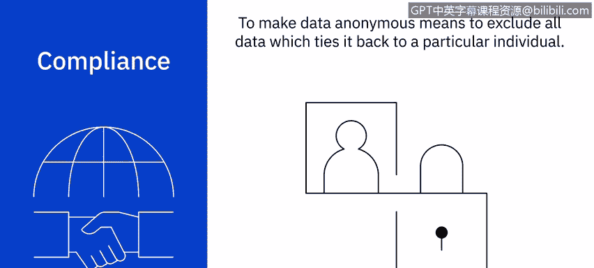
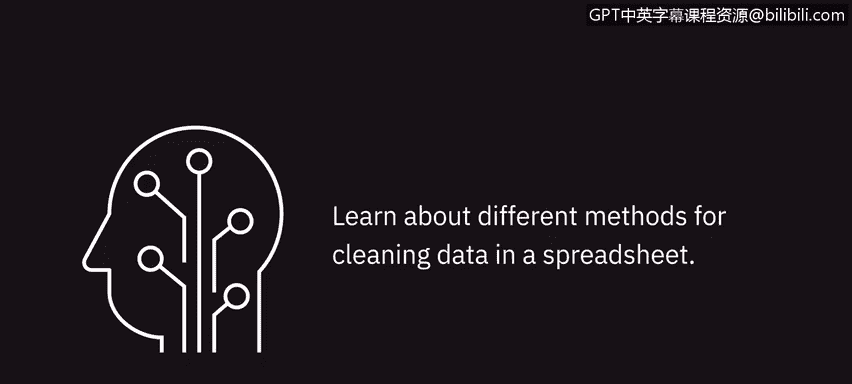

# IBM 数据分析师专业证书课程 2：《数据分析Excel基础》｜excel-basics-data-analysis-ibm｜ - P39：12_03_basics-of-data-privacy.en_subtitled - GPT中英字幕课程资源 - BV1zu4y1Q7dR

嗯。In this video， we will learn about data privacy and the regulations that govern the collected data。

When collecting customer data， specific regulations apply to how that data can be used。

By understanding data privacy regulations and getting familiar with the following three fundamentals。

 you can eliminate the risk of financial penalties and keep the trust of your customers。

 confidentiality， collection and use， compliance。Confidentiality is an important element in data privacy。

 and it acknowledges that the customer's personal information belongs to them。

The types of information that can be accessed by a data analyst can range from sales forecasts to employee information or even patient records。

 When accessing these types of records， the analyst must be able to recognize the different types of personal data。

Personal information or P is any type of information that can be traced back to a specific individual。

 This type of information can include anything from emails to images。

Personally identifiable information or PII is specific information that could be used to identify an individual。

This type of information could include a Social Security number or a driver's license number。

 And lastly， sensitive personal information or SI may not necessarily identify a specific individual。

 but contains private information that needs to be protected， because if made public。

 it could possibly be used to harm the individual。 This type of information can include data about race。

 sexual orientation， biometric or genetic information。

By understanding personal data and the associated regulations。

 we can efficiently anonymize our data by removing unnecessary information。

This type of action can help build customer confidence and continue to develop the free flow of information。

When searching through data， the analyst must know the location of the company collecting the data and the location of the respondent。

 knowing where the data was collected is an essential element of data privacy and what regulations must be applied。

The general Data Protection Regulation or GDPR is a regulation specific to the European Union and only applies to the jurisdiction of the individual。

A new law created in Brazil called the LGPD will take effect in August 2020。

 these new data policy regulations apply to individuals within Brazil and ignores the location of the data processor。

While the United States does not have one countrywide principle law for data privacy。

 because of this， individual states began to make their own regulations。 for instance。

 California created the California Consumer Privacy Act or CCPA to better protect customer data。

There are also industry specific regulations that govern the collection and use of sensitive and personal data。

 for example， in healthcare， HIPAA or HPAA privacy rules govern the collection and disclosure of protected health information In retail。

 the PCI standards govern credit card data and failure to safeguard card to holder information can result in hefty fines。

With a basic understanding of these policies， we are able to remain compliant when handling any sensitive information。

 Unfortunately， breaches and customer data is an all too common occurrence。

 and understanding how to remain compliant is essential。

Understanding the data privacy regulations of the European Union， the United States。

 and other countries as well as industries is key to keeping data safe。

Companies must comply with these privacy regulations at all times and also make sure policies are readily accessible to employees。

For example， let's say a data analyst downloads a spreadsheet of sensitive information。

 In order to complete the report by Monday morning。

 the analysts decided to take their work laptop home for the weekend。After driving home。

 the analyst accidentally left the laptop in their car。 The next morning。

 they found their car had been stolen along with the laptop because it is the responsibility of the company to keep customer data safe。

 This was a breach of privacy when the data left the company property。

This type of action could not only cost the company large amounts of money in fines and penalties。

 but could also reduce customer confidence causing a significant impact to revenue。

While data privacy applies to most data that is collected。

 there are some instances where these regulations do not apply in order for these laws and regulations not to apply。

 the particular collection of data must be completely anonymous。

To make data anonymous means to exclude all data， which ties it back to a particular individual。

While this approach might not be practical in all circumstances。

 collecting data with privacy in mind could remove privacy limitations and make data collections more accessible。

In this video， we learned about the importance of data privacy and the challenges that a data analyst can face when collecting and sorting through data in the videos in the next lesson。

 we will learn about different methods for cleaning data in a spreadsheet。

