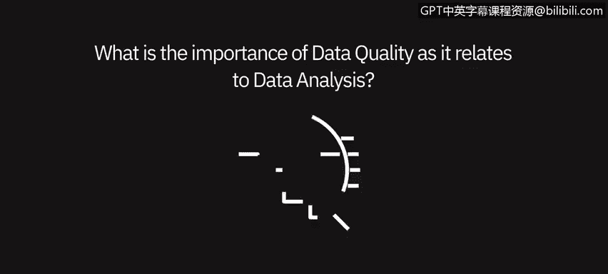
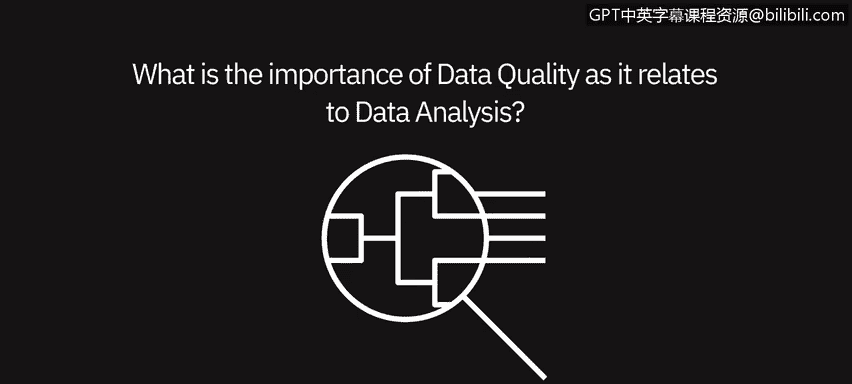
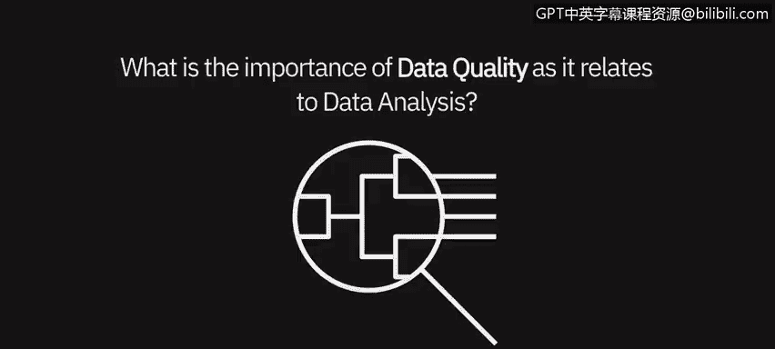
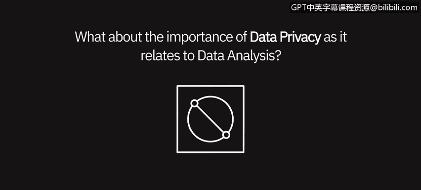

# IBM 数据分析师专业证书课程 2：《数据分析Excel基础》｜excel-basics-data-analysis-ibm｜ - P40：13_04_viewpoints-data-quality-and-privacy.en_subtitled - GPT中英字幕课程资源 - BV1zu4y1Q7dR

嗯。In this video， we will listen to several data professionals discuss the importance of data quality and data privacy as they relate to data analysis。

Let us start with what is the importance of data quality as it relates to data analysis Data quality is of the utmost importance in terms of data and analytics and the reason behind this is because as soon as what you're presenting does not align with what someone expects that's the first thing that they time to go after where did you get the data what's happened to the data。

 how has it been transformed because。

People like to think that they know and understand their business and when you start to challenge that if you don't have the ground to stand on of the data。

 that it's quality that it's clean and that it is from a trusted source。

 that's when you start to get into a lot of discussions a lot of debate and ultimately the plot of what you're trying to present gets lost The backbone of any successful data analysis project is good quality eat data there's a common term in computer science called garbage in garbage out。

 which is essentially if you read in bad quality data。You can expect to get bad quality results。

 so there's really nothing more important when doing a data analysis than making sure that you're working with good quality data。

 and it's really important to sense check the data yourself and really feel comfortable that the data you're using is of a really high quality。

Data accuracy is above all garbage in garbage out。 It's a waste of time to analyze data of poor quality。

 and it might mislead the business direction。 The integrity of the data that you're using or providing for someone else to use is of the utmost importance data is used to determine when or where to launch a product if a division is profitable or not and it's easy to get things confused if you're not paying attention to the details using inventory as an example if you're looking at inventory at a skeku level and you accidentally pick the wrong sw to analyze and then you draw these conclusions that this particular item isn't profitable when in fact it is so that's a major major decision for a company to make obviously so the expectation is that there will be lots of due diligence but in the beginning。

 if you start off with that data and then you。Build on that only to。

Later realized that it wasn't a good idea。 You've lost time， energy， effort， and in some cases。

 trust。Thank you for those viewpoints What about the importance of data privacy as it relates to data analysis？

Data privacy is incredibly important， especially when you're working in industries like pharmaceuticals or healthcare。

 but that's not where it stops， we have to have the ability to make sure that the users are getting the appropriate level of data based on their roles and their permissions。

Now we can do this through a number of。Cuts of the data specific to each geography or each function。

 or in some tools such as cognitive analytics， we can start to build out that as part of our model within there you can say who has access to what。

 whether it's at a granular level of this person can see data in Canada or the US or whether it's simply this person can see this report in its entirety or not。

There's lots of different ways to handle this， but data privacy is of the utmost important across all industries。

In today's world， data privacy is a huge thing on the tax side。

 especially of our business we have what we call PII personal identifiable information we have to protect that and so we can't just send things through email。

 we don't send tax returns or even actually in our business period。

 we don't send things through email that have sensitive PII data in it， we encrypted it。

 we make sure the email is encrypted or we use software some certain softwares that will allow us to not show the social security numbers or the names or the data birth and whatll happen is it has a certain sequence and we share that with the client by calling them we don't put that in an email and we certainly don't put that in the same email with the encrypted information because we want to make sure that you're always safe so we have to make sure we're protecting it at all costs。

