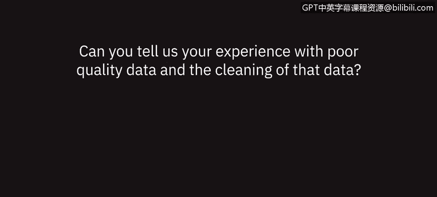

# IBM 数据分析师专业证书课程 2：《数据分析Excel基础》｜excel-basics-data-analysis-ibm｜ - P44：17_04_viewpoints-issues-with-data-quality.en_subtitled - GPT中英字幕课程资源 - BV1zu4y1Q7dR

嗯。In this video， we will listen to several data professionals discuss issues around data quality。

 Can you tell us your experience with poor quality data and the cleaning of that data。

 A large portion of my time is spent cleaning。😊。

Verifying， checking data Before I run an analysis， working in healthcare care。

 most of the information captured is based off of what someone's put in。

 so humans can't be calibrated。 Two people can have a similar situation and look at things slightly differently。

 So it's up to me to make sure that if one describes something as na blue。

 and the other person describes it as dark blue that I consolidate it and make it blue。

 That's just an example。 We don't normally do that in healthcare care。

 But the thought is that you always have to check the integrity of the information before you do your analysis to make sure that your results are accurate。

No data is going to be perfect， that's an unfortunate reality in the world in which we live in databases and data is collected for the broadest possible purpose。

 but oftentimes there are still things that are missing or not quite in the format that we want。

 whether that's collecting data and time as a single field whereas when we're doing our analysis we want to be able to break it out by。

Day month and quarter。These are things that we can take into consideration there's a lot of different cleansing activities that that can be done and can be undertaken to help you get something that's specific and works for you and the way you want to work。

I have had experiences with。Poor quality data where I'm reviewing financial statements and I'm looking at margins。

 calculating ratios， trying to understand if what I'm looking at is number one directionally correct。

 but two am I looking at the right thing are all of these calls current costs relevant to the period that I'm analyzing。

 hass all of the data been captured。 Do I have all of the revenue for a given month Then you have to go back and look at the sources。

 scrub that information to validate that what you're seeing is correct。 and。

From an accounting perspective， if that data is incorrect or out of period。

 then adjustments need to be made to the general ledger。

 which houses the data to properly reflect what's happening poor data quality can really come into play and cause discussions that don't need to be happening they can cause you to be second guess they can cause you to not be able to be firm and present your case and your data reliably Now if this is the case。

 there's several different ways you can analyze one is to go all the way back to the source to ensure that the source data is being pulled appropriately or simply being able to outline and be very specific and direct in terms of what transformations or changes have been done to the data through tracking this in something like what's knowledge catalog and being able to present that to your audience if you're filtering and sorting data and you find that it's wrong。

 you have to go back and and fix things that time could have been spent working on other deliverables。

Again， it can cause the data integrity into question if you're constantly having to redo or reiterate certain parts of data and quite frankly。

 it can be frustrating at times if you're habitually having to do that so。

Paying attention to the details and the minutia so that you're not wasting time backtrack on something that you could have fixed early on are just some of the many benefits of ensuring that your data quality is good。

