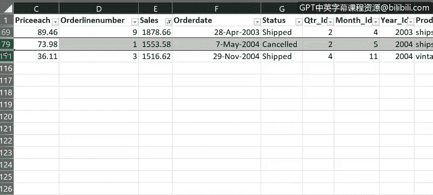
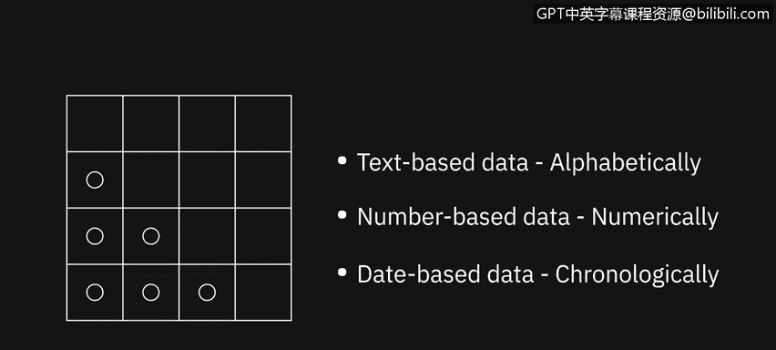
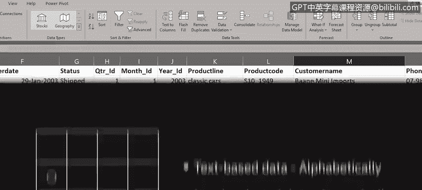
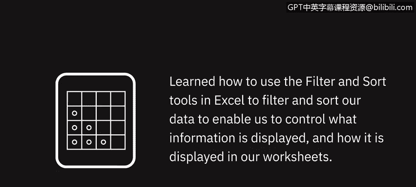

# IBM 数据分析师专业证书课程 2：《数据分析Excel基础》｜excel-basics-data-analysis-ibm｜ - P46：19_02_filtering-and-sorting-data-in-excel.en_subtitled - GPT中英字幕课程资源 - BV1zu4y1Q7dR

嗯。In the previous video， we learned how to use the flash fill and text to columns features in Excel to help clean data In this video。

 we will discuss how to filter and sort our data to enable us to control what information is displayed and how it's displayed in our worksheets。

 filtering your data enables you to gain more control over which parts of your data are displayed at any given time in Excel。

 This can help with the visibility of data by narrowing down the data to within specified criteria and parameters。

 and it can also help when searching for specific pieces of data to filter your data。

 The first thing you need to do is turn filtering on which is very simple on the data tab。

 click filter and that's it。 you will now see a small filter icon next to each of the column headers。

 As a side note， if you want to only filter on one or more columns select those columns first then click filter as。

😊。

Another side note， if you format your data as a table。

 the columns automatically have filter controls added to them。

 So now each column has a filter that can be applied to the data in that column in the order date column。

 you can filter on the years in product line， you can filter on the different product types and in customer name。

 you can filter on each customer by name。Let's first filter on the year。

 We'll select orders from 2004 only by deselecting the other year。 And if you wanted to。

 we could expand the year and filter by months Also。 but we won't do that for now。

 If you look at the status bar at the bottom of the worksheet。

 You can see that there are only 50 out of 114 records now displayed。If you want to clear a filter。

 you can either click the clearear filter from option or click the select all item in the filter list。

 Now， let's filter on the product line column to display only the rows that hold data for sales of classic cars。

And again， we'll clear the filter。 Lastly， we'll filter on the customer name column and only display sales to many gifts distributors limited。

And then clear that filter。 So far， we've only applied one filter at a time。

 but suppose you want to filter down to a greater degree。We can do that， too。

 by just enabling all those filters together。 And now we are only displaying sales of classic cars to many gifts distributors limited in 2004。

😊，Remember， if you only want to clear one filter， then click its filter button in the column header and click the clear filter from option。

 But if you want to quickly clear all filters， you can use the clear button in the sort and filter group on the data tab。

 So far， we've used what are commonly referred to as auto filters。

 but you can also use custom filters to specify other criteria to apply to a filter to text or numbers。

For example， if you wanted to see sales orders that are over or under a certain value。

 you can do that with custom filters for the sales column。

 let's add a number filter that only displays sales that are over $2000。

 If you look in the status bar。 you can see that we are now showing 111 out of 114 records。

Then let's clear that filter and filter it the other way to display the sales orders that are below $2。

000。We can see that there are only  three orders that are below $2000。

 It's important to note that the data rows that we don't see have not been removed。

 They are still there。 They have just been hidden from view by the filters。

And this is indicated by the row numbers you see on the left in blue。

 The row numbers start at 69 and jump in large increments。

 indicating that there are many more rows of data in our data set than are currently being displayed。

 Let's clear those filters。 If we look at a column filter for a column that contains text。

 You will see that the menu item changes to text filters instead of number filters。

 And you can see that there are several text filter options。

And if you want to turn off filtering altogether for a worksheet。

 just click the filter button on the data tab。Now， let's take a look at the basic sorting capabilities in Excel。

 Soting is a very important part of the role of a typical data analyst。

 You might need to organize your text based data alphabetically。

 your number based data numerically or your date based data chronologically when you sort data using these logical parameters。

 It makes it easier for you to conceptualize and visualize your data in a more meaningful way。

When sorting data， the first thing you need to do is select which data to sort， for example。

 if you want to sort your customers alphabetically。

 select a cell in the customer name column first and then either sort by a to Z or by Z to A。

And if you want to sort your sales figures numerically， select a cell in the sales column first。

 and then either sort from smallest to largest or from largest to smallest。 And lastly。

 if you want to sort your customer's order dates chronologically。

 select a cell in the order date column first， then sort from oldest to newest or from newest to oldest。

 But you can also sort your data by more than one column at a time。

 simply select a cell in your data， then on the data tab， click sort。😊。

Then either use the sort by column suggested or use the drop down list to select a different column in this case。

 we'll choose the order date column as our first sorting criteria and we'll choose oldest to newest in the order drop down list。

To add a further sorting level， you click add level。

 Then you choose another sort column in the then buy drop down list。 In our case， we'll choose sales。

 And for this sort level will choose largest to smallest in the order list。

 If you have a header row in your data as we do here。

 then ensure you select the my data has headers checkbox， then click O to sort。

 So the data is now sorted to list the oldest orders by order date first。

 then within each order date。 If there are multiple instances with the same order date。

 Then the next sorting level lists data by the largest order values first down to the smallest order values。

In this video， we learned how to use the filter and sort tools in Excel to filter and sort our data to enable us to control what information is displayed and how it is displayed in our worksheets。

