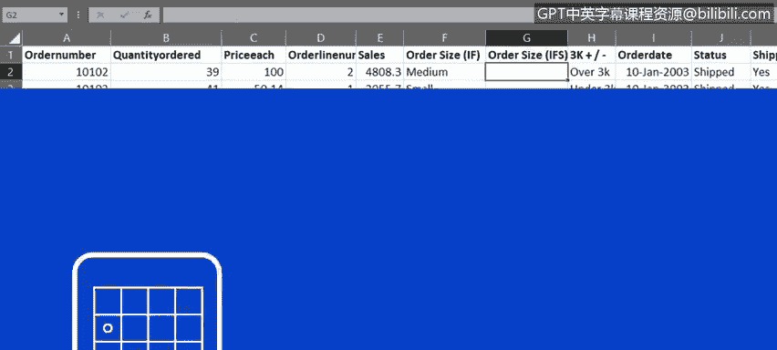
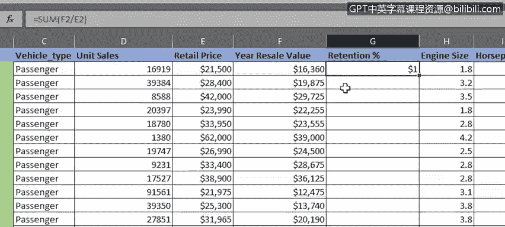
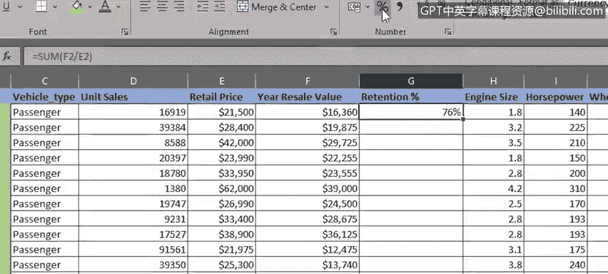
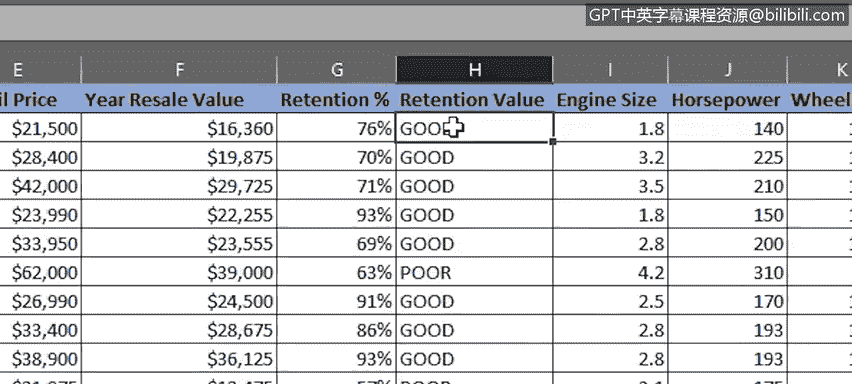
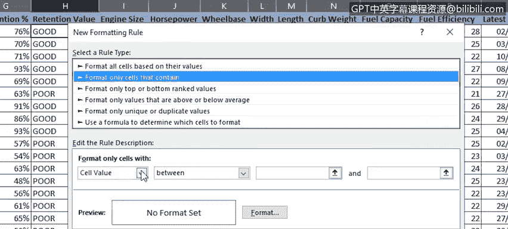
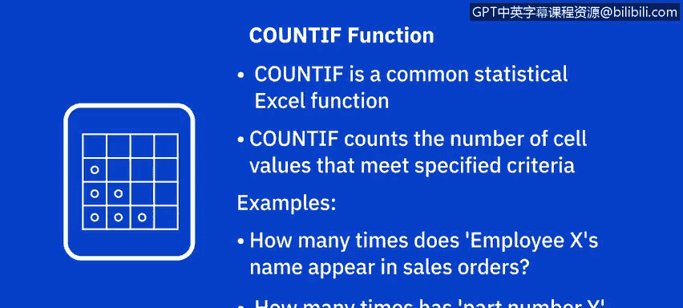
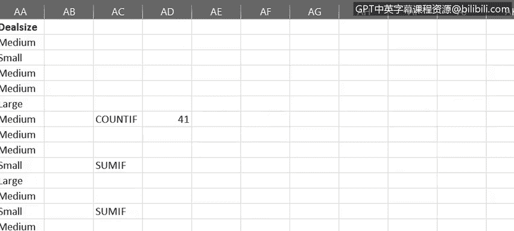
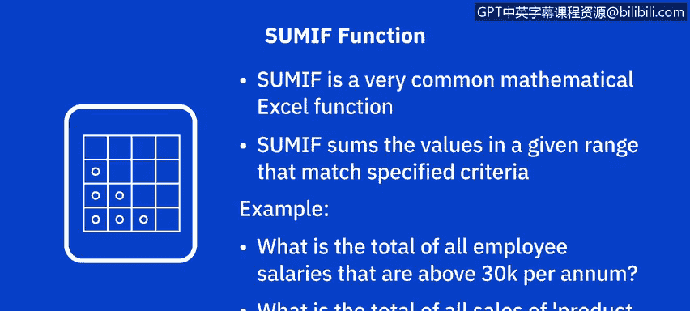
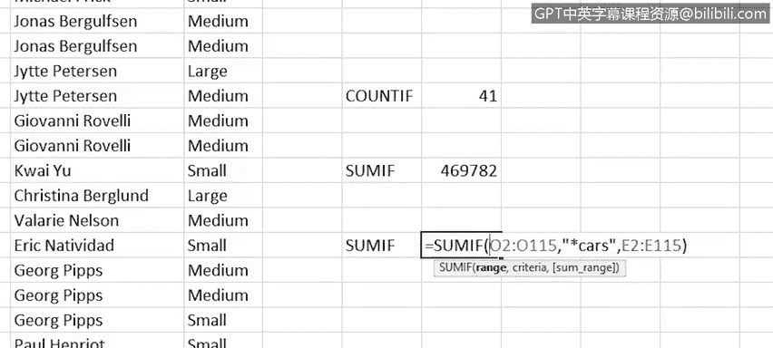

# IBM 数据分析师专业证书课程 2：《数据分析Excel基础》｜excel-basics-data-analysis-ibm｜ - P48：21_04_useful-functions-for-data-analysis.en_subtitled - GPT中英字幕课程资源 - BV1zu4y1Q7dR

嗯。Now that we've learned how to use the filter and sort tools in Excel to filter and sort our data to enable us to control what information is displayed and how it is displayed in our worksheets in this video。

 we'll discuss how to use some of the most common functions， a data analyst might use namely， if。

 ifs， count if and some， if。😊，First up， let's look at how to use the if function。

 The if function is one of the most used logical functions in Excel。

 The if function enables you to logically compare a value against criteria you set in the function。

 and then return a result based on whether the result of the logical comparison is true or false。

 and these values can be text values or numeric values。

 and if function essentially says if something is true， then return of value or do something。

 But if it's not true， then return a different value or do something else。For example。

 in our vehicle toy sales worksheet， if we wanted to have a column that recorded whether the order had been shipped or not。

 you could add a new column to the right of the existing column。 Let's call it shipped。

 and then enter the formula seen in cell H2。 This formula is saying if the text in G2 says shipped。

 then return yes， And if it doesn't， then return。 No。

 you can then use the fill handle to copy this formula down the column。

You can see that most of the cells do say yes， but some don't。

 as the order hasn't been shipped for one reason or another。

 we can also use the if function to emphasize the size of an order。

 So if we add a new column to the right of sales and name it 3 K plus or minus。

 then enter the formula seen and cell F 2， this formula is s。 if the order is over 3000。

 then return the text over 3 K。 But if it isn't， then return the text under 3 K。

 and we can copy the formula down the column。In an ideal world。

 you would only use the if function to apply one or two conditions。

 but there may be scenarios where you would want to apply multiple conditions。 In these cases。

 you can use the nesting capabilities of functions to bring together several if statements in one formula。

 These are called nested if functions。For example， if we add another column here for the order size and then enter the formula seen in cell F 2。

 you can see that this formula contains multiple if functions。 One is needed for each condition。

 one for large， one for medium and one for small， and it requires three sets of parentheses。

So it's a relatively long and complex formula， but it does work。Again。

 we can copy the formula down the column。Even though Excel technically supports the nesting of up to 64 different if functions in a formula。

 it is not a recommended best practice。Having multiple if functions in a singular formula can become extremely challenging to manage。

 For example， suppose you come across a formula like this that you haven't used for some time or even worse was created by someone else。

 It could be quite difficult to work out how and why it is being used。Also。

 if your conditions increase， then you need to add more conditions to an already quite complex and long formula。

 which will only complicate matters more。To resolve this issue。

 a new function was developed called Ifs。 The Ifs function is only supported on Excel 2019。

 Excel for Microsoft 365 and Excel for the Web。As the name suggests。

 this function can replace multiple nested if functions being used in a single formula to simplify matters。

So if we add a further column for order size but this time we'll use the ifs function instead。

 as you can see in cell G2， this formula only has one set of parentheses instead of three and only uses one function instead of three。

Let's copy that formula down the column too。Now， let's have a look at another example of using the if function。

 but we'll combine it with conditional formatting too。

If we switch to the car sales worksheet and add a new column to the right of the year resale value column and call it retention percent。

 then we enter the formula seen in cell G2， which will divide the year resale value by the original retail price。

 We need to format this as a percentage， and then we can copy it down the column。 Next。

 we'll add a column to highlight the retention value for each car。

 The formula we add here in cell H2， uses the if function to state that if the percentage in the previous column is greater than 69%。

 Then mark it as good， but if it isn't， then mark it as poor。 Once again。

 we copy the formula down the column。😊。

We could also use conditional formatting to highlight the retention value percentages even more。

 We select H2 and on the home tab， click conditional formatting and make a new rule。

The condition in our rule will only format cells that contain a specific text value。

 and that value is the word good。

And if it does match that condition， then format it with a dark green font and fill the cell in Pa green。

Let's copy that conditional formatting down the rest of the column。

 You can see that the cells that contain the word good are now formatted as we defined。

 but the cells containing the word poor are not。Let's add another conditional format rule this time we'll select manageage rules because we are going to add another rule to our existing rule。

The new rule will be the same as the previous one with the exception of looking for a match with the word poor instead and formatting those matching cells with red text and a pink background fill。

And once again， we copy that down the column。Now， all the cells that contain the word port are formatted as red text with a pink cell fill。

Let's now have a quick look at how to use the count if function。

 Count if is one of the statistical functions provided in Excel。

 You can use it to count the number of cells that meet a certain criterion。

 such as the number of instances where an employee's name appears in a list of sales invoices or the number of occasions。

 a particular part number appears in a list of purchase orders。

Let's switch to the vehicleicle toy sales worksheet。

 Suppose you want to find out how many of the sales orders in the list went to customers based in the United Kingdom。

 We enter the formula you see and sell A D 7。 Note that when we are using text as a criterion。

 we have to enclose the text in quotation marks。So there were six sales orders in the UK。

And if you wanted to discover the same thing for French customers。

 then you would just edit the existing formula or copy it and then edit it。

 You can see there were 14 orders for French customers。 Notice that this time。

 the text entered was in lower case， and it still works。

 So names in this function are not case sensitive。 and let's do the same for United States customers。

 there are 41 orders to customers based in the states。

There is also a newer function called count ifs， which applies criterion to cells across multiple ranges to count the number of occasions where all criteria have been met。

 This removes the need to use multiple count if functions in a long and complex， single formula。

 The count ifs function is only supported on Excel 2019， Excel for Microsoft 3。

65 and Excel for the web。😊，Now let's take a look at how to use the sum if function。

 which is a very commonly used mathematical function in Excel。You use the sum。

 if function to sum the values within a specified range that meet specified criteria。 For example。

 you might want to add up only the salaries that are over a specified salary level。

 or you might want to find the total of all sales of a particular product category。

We'll enter the formula scene in cell AD D 10。This formula will add up each of the sales orders that have a total of more than $3000。

 Again， notice that because we have used an arithmetic operator that is the greater than operator。

 we must enclose the criterion in quotes。If we specify a criterion that is only a number。

 we don't enclose it in quotes。So the total sum of all orders that were over $3000 is almost $470000。

 You can also use wild cards， such as question mark and asterisk when searching for partial matches。

 and you can also specify to extract values from a different column。

 then the column where you have specified the criteria。 For example。

 if we enter the formula you can see and sell A D 13。 It will sum all the car sales in column E。

 for only those products in the product line column that end in cars。

There is also a newer function called some ifs that you can use to some cells based on multiple criteria。

 This removes the need to use multiple sum if functions in a long and complex single formula。

 The sum ifs function is only supported on Excel 2019， Excel for Microsoft 3。

65 and Excel for the Web。

In this video， we learned how to use the if， ifs， count if and some if functions in the next video。

 we'll look at how to use the V lookup and H lookup reference functions。

