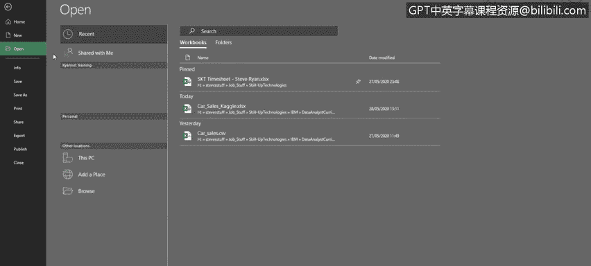
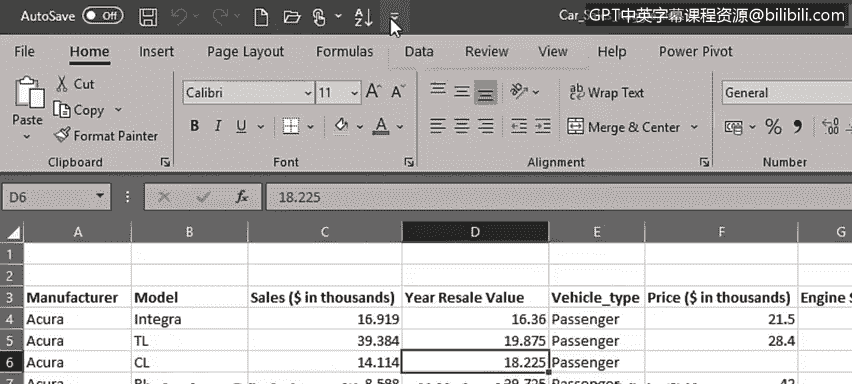
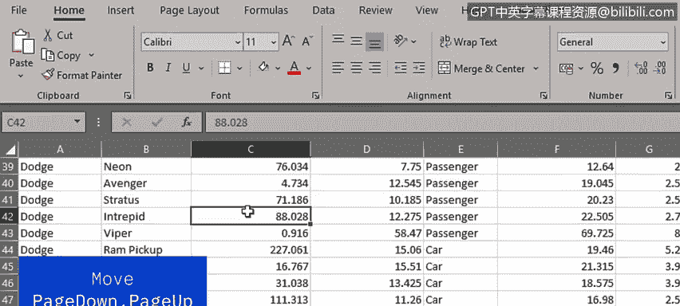
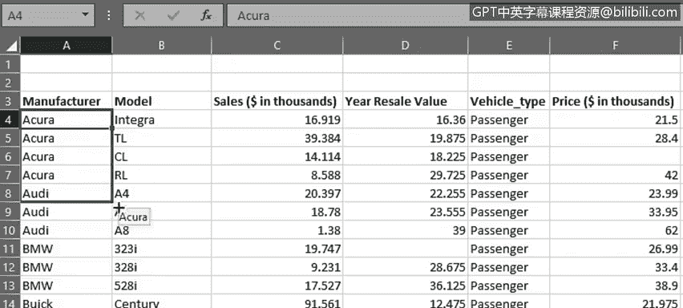
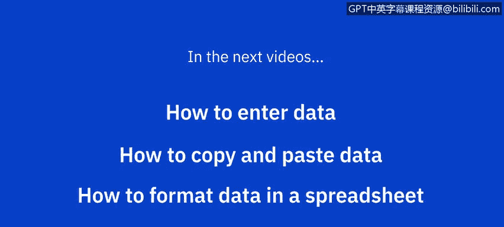

# IBM 数据分析师专业证书课程 2：《数据分析Excel基础》｜excel-basics-data-analysis-ibm｜ - P4：3_电子表格基础部分2.zh - GPT中英字幕课程资源 - BV1zu4y1Q7dR

嗯。Now that we have a basic understanding of the main elements that make up a worksheet。

 let's see how to move around a spreadsheet， get familiar with the ribbon and menus。

And learn how to select data in a worksheet。

To open a sample file， we click file This opens backstage view here you can create a new workbook or open save or print a workbook you can also access Excel option Now we want to open our sample file so we click open and either select it from my recent list or click browse to find the data file we want The first thing we should do is get acquainted with the ribbon and menus notice that on the ribbon at the top we have several tabs Some of these tabs may be familiar to you with other office products such as the home insert and view tabs while others might be new to you such as formulas data and Power pivot。

To make a little more workspace for ourselves， we can hide this ribbon by double clicking any tab and to unhide it。

 we do the same。The other option is to use the shortcut key， control+ F1。

The ribbon is organized into groups of buttons to make them easier to find so on the home tab we have groups for font alignment。

 number， styles and so on Some of these groups contain all the available buttons on the ribbon when viewing in full screen such as styles and cells。

 but other ribbon groups have more options which we access by clicking the little arrow icon in the bottom right corner of the group as can be seen here on the number group for example。

 the next item I want to point out is the quick access toolbar at the top of the screen above the ribbon As the name suggests this is where you can quickly access the tools you use most often you can see we already have some tools in this toolbar such as save。

Undo。Redo new and open， but we can add other tools to the toolbar if we wish。

 so if we click the drop down arrow in the toolbar and then select a tool we use a lot。

 such as sort ascending， that will be added， and we will also add the sort descendending button。

Now we need to be comfortable with moving around a worksheet。

 you can simply use the arrow keys to move left， right， up and down one cell at a time。

 but you can also use page down and page up to move around a bit faster。

 which is especially useful if you have lots of rows of data。

 and to move even quicker up or down a large data sheet， use the vertical scroll bar。

And to move left or right， use the horizontal scroll bar again。

 these can be very useful when you have a large data set。

There are also some useful shortcuts you can use Control+ Home key， for example。

 takes you back to the start of the worksheet that is cell A1 control+ end takes you to the cell at the end of your data in the worksheet。

Control+ down arrow takes you to the end of the column you're in。

 while control+ up arrow takes you back to the top of that column。

So a quick way to find out how many rows of data you have in your worksheet is to go to the first cell in your data and press control plus down arrow to see the last row of data。

 So here you can see we have 160 rows。 Now， how do we go back to the top again Control plus home will do it so far we have seen how to navigate around our worksheet and its data。

 Now we need to look at how we select data。 This is very important because you often need to select data to move it。

 copy it or select it in a formula。The simplest selection is a single cell。

 usually done with a mouse or maybe a directional arrow key。

 The next step up is to select multiple cells together。

 and this can be done either with a mouse by dragging from one cell to additional adjoining cells。

 or you can use the shift key with directional arrow keys。

Next up is selecting a single column or row， which is done simply by selecting the letter at the top of the column or the number on the left of a row。

Then we can progress to selecting multiple columns and rows by clicking the mouse button。

 holding it down and dragging across more columns， or if you are not comfortable with dragging。

 you can also select the column first， then hold shift plus arrow keys to select multiple columns the same applies to rows2 However。

 if you have data in noncontuous rows or columns that is not next to each other you can select the first column then use the control key to select another unconnected column such as column C and F here。

 the largest thing you might want to select is the whole worksheet which you can do by clicking in the top left corner of the cells。

However， this selects the entire worksheet， including all the empty rows and columns。

 so if you only want the data in your worksheet，😊，You can use the shortcut control+ A。

A word of warning when selecting data in cells， rows and columns。

 there are three types of cross symbols that you might see when working with selected cells。

The first one is the large white cross that you see when you select a cell as can be seen here in cell A4。

 This is the select cross that we have been using already in this video to select cells。

The second type you might see is when you hover over the bottom edge of a cell and see a thin black cross type symbol with arrows on each point。

 this is the move symbol and would move the cell data to another location。

The last type is the small thin black cross that is seen when you hover over the bottom right corner of a cell。

 this is the fill handle or copy symbol and it fills or copies the cell data to another location。

In this video， we learned how to move around a spreadsheet。

 become familiar with the ribbon and menus。And learn how to select data in a worksheet in the next videos。

 we will discuss how to enter data， how to copy and paste data。

 and how to format data in a spreadsheet。

