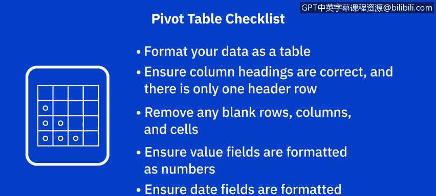
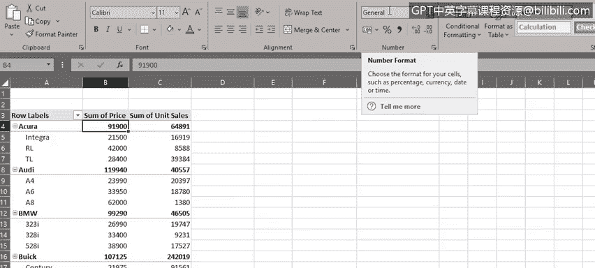

# IBM 数据分析师专业证书课程 2：《数据分析Excel基础》｜excel-basics-data-analysis-ibm｜ - P50：23_01_introduction-to-creating-pivot-tables-in-excel.en_subtitled - GPT中英字幕课程资源 - BV1zu4y1Q7dR

嗯。Now that we've learned how to use the V lookup and H lookup functions， in this video。

 we'll look at how to create and use pivot tables in Excel。

We'll first look at how to format our data as a table。

 then how to create pivot tables and use fields in a pivot table to analyze data。 And lastly。

 we'll see how to perform calculations in a pivot table。

Having a worksheet full of informational data is all very well， but to really get some use out of it。

 we need to analyze it from different perspectives to find answers to questions related to the data。

Now， we've already used features such as filters and formulas to draw mathematical and logical conclusions about our data。

 but not all questions can be answered easily using filters and formulas alone。

In order to obtain usable and presentable insights into your data， you need something else。

 and that something else is pivot tables。Pivott tables provide a simple and quick way in spreadsheets to summarize and analyze data to observe trends and patterns in your data and to make comparisons of your data。

A pivot table is dynamic。 so as you change and add data to the original data set on which the pivot table is based。

 So the analysis and summary information changes  too。

A data analyst can use pivot tables to draw useful and relevant conclusions about and create insights into an organization's data in order to present those insights to interested parties within the company。

Before you start to create a pivot table in Excel， it can be very helpful to first format your data as a table。

 The reason for this is not only to make it more organized and defined and to add table styles to your data。

 But primarily it makes it a lot easier when adding records to the data set。

In the car sales worksheet， let's first select any cell within the data。

 And then on the home tab in the Sts group， choose format as table。

 Then choose a style from the gallery。 Note that Excel automatically knows the boundaries of our data range。

 but we can change this if we need to。And ensure you select My table has headers， if indeed， it does。

After you click O， and the data has been formatted as a table。

 Note the filter dropdowns at the top of each column。

 These are automatically added when you format as a table。

If we now scroll down to the bottom of the table and start adding another row of data for another vehicle。

 when you click tab or enter， note that it is automatically formatted and included as part of our table。

 Okay， now， let's see how to create a basic pivot table and how to use fields to arrange data in a pivot table。

Just before we do that， there are a few things you should use as a checklist to ensure your data is in a fit state to make a pivot table from。

 And these are format your data as a table for best results。 Insure column headings are correct。

 and there is only one header row， as these column headings become the field names in a pivot table。

Remove any blank rows and columns and try to eliminate blank cells also。

Ensure value fields are formatted as numbers and not text。

 Insure date fields are formatted as dates and not text。

In the worksheet， we can just select any cell in the table。 Then on the insert tab。

 we click pivotvo table。 Note that in the select a table or range box。

 the table name table 1 is already entered for us。 If we hadn't just formatted this data as a table。

 we would specify the cell range here instead。 under that。

 we need to decide whether we want to create the pivot table on a separate new blank worksheet or on this worksheet。

 A new worksheet is the default and is the most commonly used option。So a new blank worksheet opens。

 displaying some basic pivot table instructions in the graphic on the left of the worksheet and a pivot table fields pane on the right。

You can rename the worksheet for the pivot table， if you wish。To build the pivot table report。

 we need to add some fields from the top of the pivot table fields pane to one or more of the sections in the bottom part of the pane。

 For example， if we want to find out the total sales for each model of car。

 Let's drag the manufacturer field to the rose section of the report and then we'll drag the model field there。

 too。But this isn't really the way we want it to look。

 So we'll drag the manufacturer field to appear at the top of the row section above the model。

 which makes more sense with our data。Next， we'll add the price field to the column section。

 But again， that really isn't the way we want to view the data。

 So we'll drag price to the values section instead。

 which makes a lot more sense and looks a lot better。Next。

 we'll add the unit sales field to values  too。 So now we can see both the individual price for each model and the number of unit sales of each model。

Let's have the vehicle type field to columns， but that doesn't seem very useful。

 So let's remove that field， which we can do in two ways。

 either by using the drop down menu or if we undo that。

 we can also do it by simply dragging the field out of the columns section。

 either to the left over the worksheet or to the top over the fields list above。

Let's now look at how to perform a simple calculation in a pivot table。

 If we look at the sum of price column in our pivot table。

 we can see that the figures are formatted as general。 So first。

 let's change the format of these figures to US currency。

This can be done by modifying the value field settings for the field in the relevant section of the pivot table fields pane。

Will format the field as US dollars and show no decimal places。 Next。

 we' add a calculated field from the pivotvo table analyzed tab using the fields。

 items and sets button。We want this field to calculate the total sales for each model by multiplying the price by the number of unit sales。

When we create and add this formula， it gets added to the pivot table field's pane as a field called total model sales。

And we can change the format to make it US dollars again。

A new column called sum of total model sales has now appeared in the pivot table in our worksheet。

In row 5， we can see that there have been over $360 million of sales of the Accurura Integra model。

 And in row 7， we can see that there has been over a billion in sales of the Accurura T L model。

In this video， we learned how to format data as a table。

 how to create a pivot table and use fields to analyze data in a pivot table and how to perform calculations using pivot table data。

In the next video， we'll look at some other features of pivot tables。

