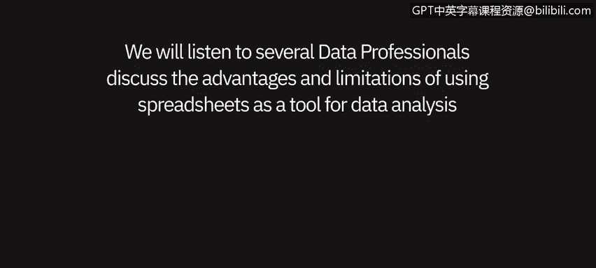
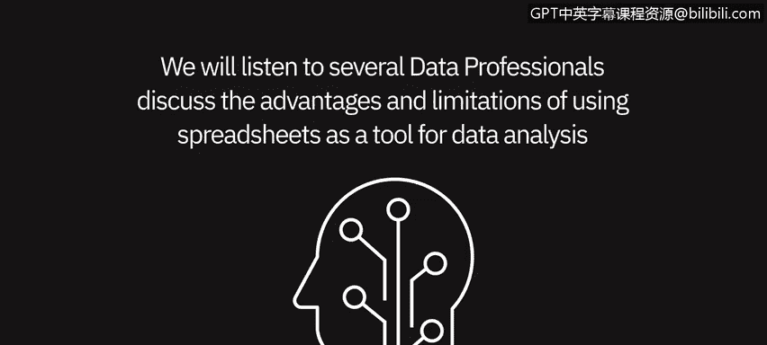
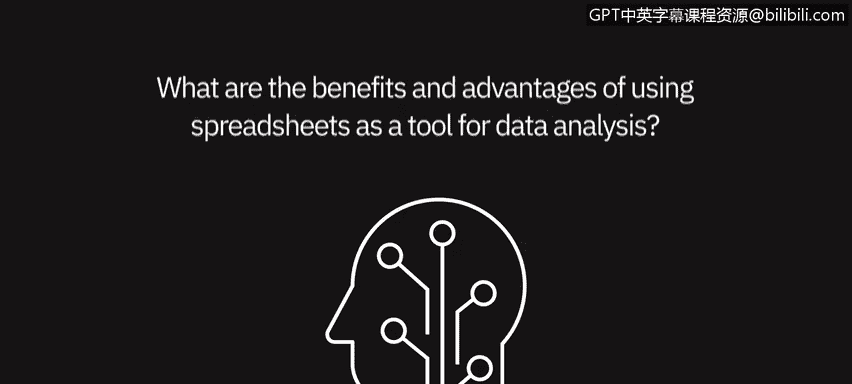
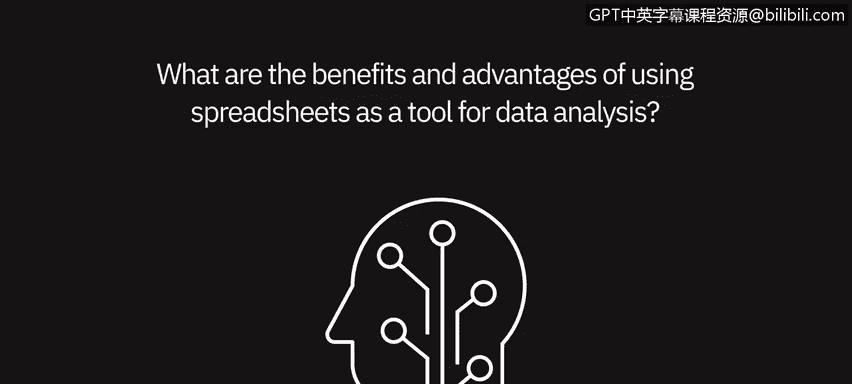
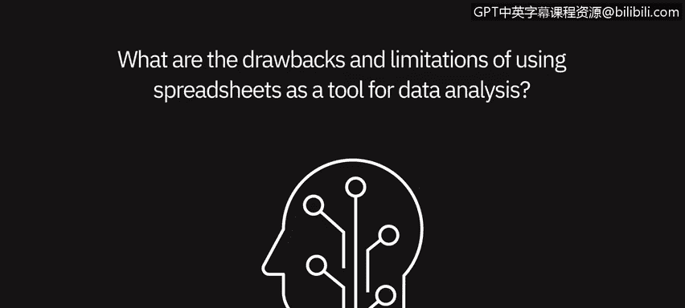

# IBM 数据分析师专业证书课程 2：《数据分析Excel基础》｜excel-basics-data-analysis-ibm｜ - P5：4_观点：作为数据分析工具的电子表格.zh - GPT中英字幕课程资源 - BV1zu4y1Q7dR

嗯。🎼In this video， we will listen to several data professionals discuss the advantages and limitations of using spreadsheets as a tool for data analysis。

 Let us start with what are the benefits and advantages of using spreadsheets as a tool for data analysis。

My experience using spreadsheets as a tool for data analysis is somewhat mixed。

 I think they can be really， really useful in the right context。

 but using spreadsheets definitely has its limitations。

 So the big pro of using spreadsheets is you can see all the data cleanly laid out in front of you in a table So I think it's very clear to anyone looking at a spreadsheet。

 exactly what the data is， what format it comes in。

 all of that you can just easily visually inspect it。

 As a CP I use Microsoft Excel on a daily basis and I have done so for the duration of my career the functionalities。

 the pivot the pivot tables， the charts， etc。 but also being able to use formulas my personal favorite this index match for using。

's pretty simple way to take just thousands of lines of information and sift through all of that to find specifically what you're looking for Excel is really that one stop shop where you can perform calculations analyze financial ratios and even export reports out of the ERP that I spoke of earlier to customize it as you need My experience is using spreadsheets is that they're great for simple analysis I will say spreadsheets over the years。

 the process itself has just improved as systems improved as technology improves spreadsheets are a way to go spreadsheets overall when you do have probably anywhere from zero to 20000 lines of data it's a good way to go you can really pull out the data。

 whether I'm trying to see how much a clients making per month but they may have you know1 thousand transactions。

 all of that's helpful I can use this spread。heets to whittle down what is actually going on per month or if I want to do a sum if or you know if this happens。

 give me this number it's really helpful to be able to dig in and wrap your hands around it and take something that seems on the surface 20000 lines seems almost unmanageable。

 But if I take it and I massage it put it in a spreadsheet and then sorted， filter it。

 making it pretty put it in a pivot table I can get what I need。

 it's just all about not looking at it as being this intimidating thing but making it more manageable and breaking it down into by Spsheets are the easiest way to analyze data and present data We don't need any fancy tools or additional software for spreadsheets It's like the commonly utilize the language to communicate Thank you for that insight。

 but let's move on to look at the other side of the coin What are the drawbacks and limitations of using spreadsheets as a tool for data analysis。

I think one of the big cons in terms of analyzing data within spreadsheets is it's really hard to reproduce state So in other words。

 if you load in some data and you filter out some bad values or you impute some missing values there's no way to tell your colleagues or your future self exactly the different steps you took to create that data or to modify that data。

 it's almost a dilemma because of the plethora of options available within Excel and all of the functions that are theyre supposedly to make your life easier but it's nearly impossible to know everything and you can find yourself in what we accountants call analysis paralysis when you're looking at something for too long or you're not well versed in a particular Excel function so you may spend a lot more time energy and effort。

Trying to figure that one thing out and have you done it a different way or maybe a manual way you probably could have gotten to the solution a lot easier and the downside of using spreadsheets is that if you have complex formulas。

 be lookups if statements at times they just stop working and you have to rebuild them。

So I have found that it's better to use Excel just for simple analysis and for a download of information。

I love a good spreadsheet， I love using Excel and pivot tables to get to the data。

 but I find that if I start to get over 1020000 lines of data。

 it gets a little tricky and sometimes the spreadsheets will crash So that's when we might move to access and some of the other tools that we use It's very difficult to handle the extremely large dataset set in spreadsheet Besides spreadshe has less flexibility for complicated analysis and presentation。

