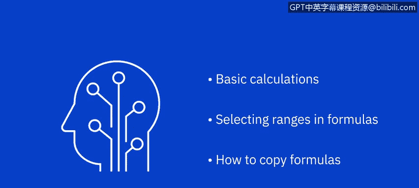
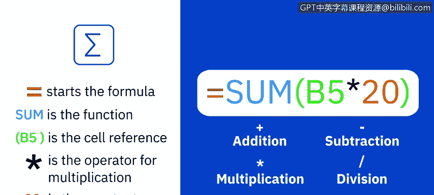
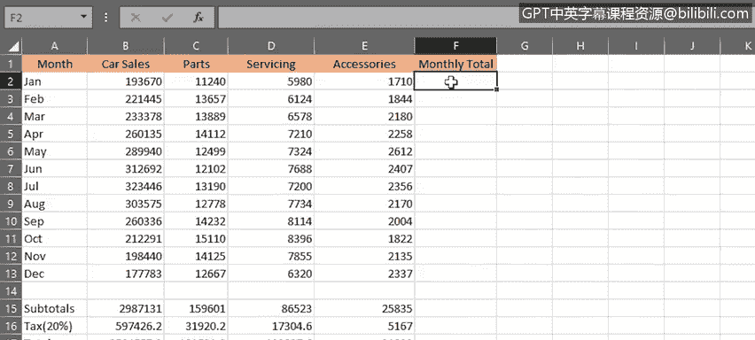
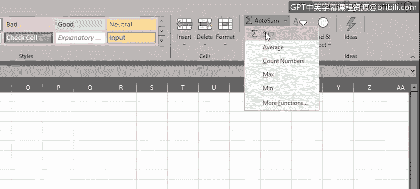
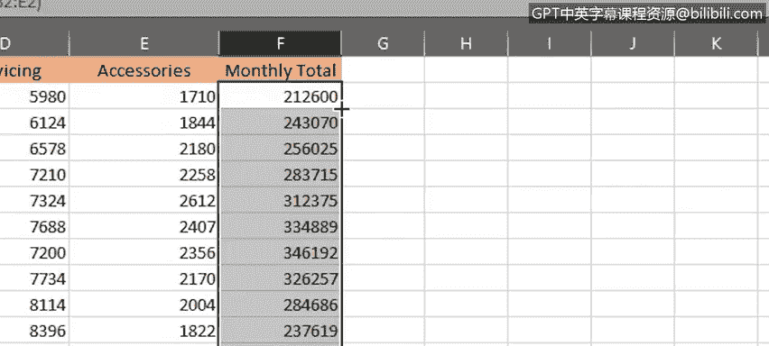
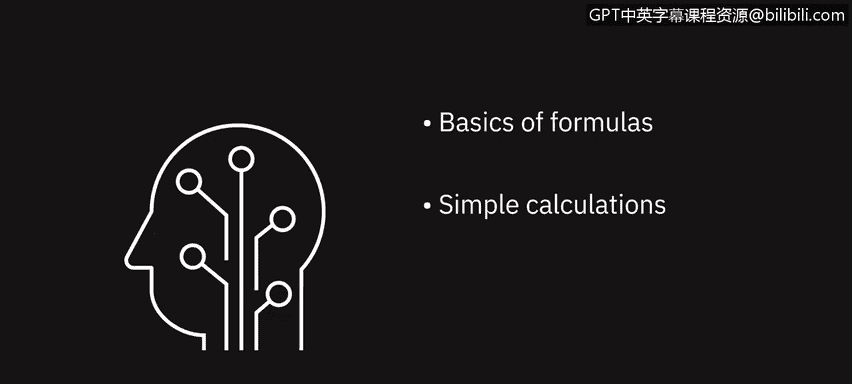
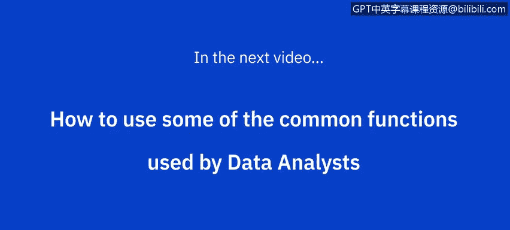

# IBM 数据分析师专业证书课程 2：《数据分析Excel基础》｜excel-basics-data-analysis-ibm｜ - P8：7_公式基础.zh - GPT中英字幕课程资源 - BV1zu4y1Q7dR

嗯。Now that we have learned how to move， copy and fill data and how to format cells and data， next。

 we will take a look at the basics of formulas， including some basic calculations。

 selecting ranges in formulas and how to copy formulas。

 a typical formula is made of several key components。

 The equal sign starts the formula off and lets Excel know you are creating a formula in this cell。

 The next part is the function， which performs the calculation， For example。

 the sum function adds up the values in referenced cells or cell ranges。

Then comes the reference， which is the cell or range of cells you want to include in your calculation。

 and these need to be enclosed in parentheses。You also have operators which specify what type of calculation to perform Common arithmetic operators include addition。

 subtraction， multiplication and division， and these are represented by symbols。

 the plus symbol for addition， the minus symbol for subtraction， the asterisk for multiplication。

 and the forward slash for division， there are other types of operators2 namely comparison。

 text concatenation and reference you may also use constants in your formulas。

 which as the name suggests are numbers or values which you can enter directly into a formula and which don't change this might be a whole number such as five。

 it might be a percentage such as 10% or it might even be a date。

 so a typical formula might be equal sign sum open parenthesis B5 asterisk 20 close parenthesis which would take the value。

In cell B5 and multiply it by 20。

Let's start with a few basic calculations。 Suppose you want to add up January and February sales of accessories。

 You would start by typing an equal sign， which lets Excel know you are entering a formula。

 Then you type in the function you wish to use。 In this case， the sum function， note the description。

 Next， you type an open parenthesis。 Then you select your cell range。

 which in this case would be E2 to E3， So you could enter that as E2 comma E3。

 then a closed parenthesis and press enter。And if you wanted to add March sales as well。

 then you would have to extend the cell range to include E4， so you could type E2， comma E3。

 comma E4 as your range， and it will work。Remember， to edit a cell。

 you select the cell and either edit it directly in the formula bar or press F2 or double click the cell。

However， it's very cumbersome and not very flexible to do it this way。

 because if you wanted to add up the entire column。

 then you'd have to type every cell reference one after the other。 So thankfully。

 there's a better way。 instead of typing each cell to include in the reference。

 you just put a colon between the first and last values in our range。 So E2 colon E4 in this case。

 And if you wanted the whole column， then you would enter E2 colon E13 in your formula。

 but there's another way of doing it。 and that's by using your mouse to select the range。

 So you still type equal sign sum。 Then open parenthesis。

 But select the range with your mouse or shift plus arrow keys and just press enter Excel will add the close parenthesis for you to total these columns up and add some tax。

 you'll add some headings first for subtotals and tax at 20% then。😊。

formulaula will need to multiply the value in subtotals by 20% if you wanted to add up all the column subtotals and calculate the taxes。

 then you would repeat the previous process for each column but that's very time consuming and you don't need to because Excel has some neat tricks to do this for you Just select the fill handle in the bottom right corner of the cell and drag across to the other cells to copy the formula This is called autofill。

Notice how the formula is copied， but the row references change in relation to the cell's position on the worksheet。

 So what was E2 colon E13 has become B2 colon B13。 These are known as relative references。

 but more on that later in the course。 and you can do the same thing for the tax values in row 16。

Now， you need a row for showing the totals。 The calculation here is simple。

 The subtotal value in cell B15 added to the tax in B16。 And again。

 you can use the fill handle to copy the formula across。

 If you wanted to total the sales of all products by month。 you'd add a column heading。

 Notice how the cell style is copied to the new heading automatically。 Remember， to widen a column。

 either drag the divider manually or double click the divider。

 Then enter the formula in cell F 2 as you've done before。 However。

 Excel has another trick up its sleeve。 It's called autosum and is found on the home tab in the editing group。

 This is a great little shortcut for some simple common functions like some average count。

 max and min。 but you can choose other functions， too。😊。

You want some for this particular calculation， notice that it also has a keyboard shortcut of alt plus equals。

 and then press enter and it's done。

Now， you can use the fill handle to copy down the remaining values， but hold on。

 there is one more Excel trick to show， and it's a good one。

 Suppose your column of data was very long。 You might have to drag the fill handle down over several pages。

 which isn't easy to do and can easily lead to errors when selecting large lists of data values。

 rather than needing to drag down to the rest of the column。

 You can just double click the fill handle， and it will automatically copy the formula to all the remaining cells in that column。

 This one is a real time saveer。😊。

Finally， let's format all these values to use the US dollarllar currency format。

In this video we learned about the basics of formulas， how to perform simple calculations。

 how to select ranges in formulas and how to copy formulas in the next video we will look at how to use some of the common functions used by data analysts and discover some more advanced functions。

😊。

