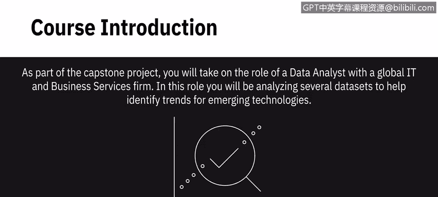
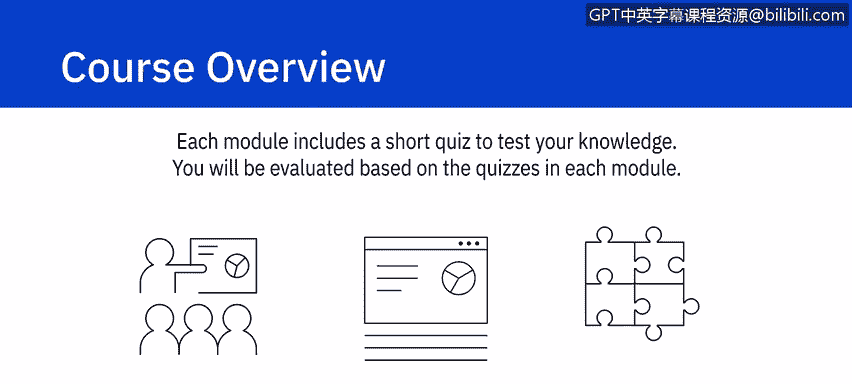
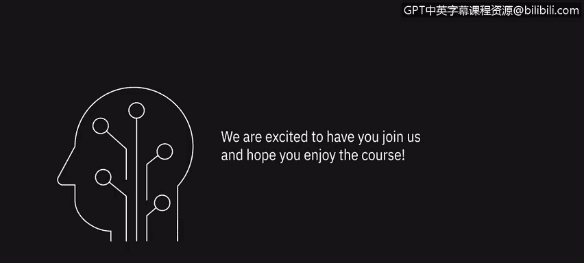

# IBM 数据分析师专业证书课程 9（4-8见投稿IBM数据科学4-8）：《数据分析毕业项目》ibm-data-analyst-capstone-project｜ - P1：0_课程介绍.zh - GPT中英字幕课程资源 - BV1Vz4y1u7Cn

嗯。Congratulations on making it this far！Successfully completing this capstone project will earn you the Data Analyst Professional certificate。

This capstone provides you a practical hands on experience to demonstrate all of the skills you have picked up so far in this professional certificate program。

As part of the Capstone project， you will take on the role of a data analyst with a global IT and business services firm。

In this role， you will be analyzing several data sets to help identify trends for emerging technologies。

In moduledule 1， you will collect data for the technology skills that are in demand from various sources。

 including job postings， blog posts， and surveys。In moduleule 2。

 you will take the collected data and prepare it for analysis by using data wrangling techniques like finding duplicates。

 removing duplicates， finding missing values， and inputting missing values。

 you'll continue to module 3 and apply statistical techniques to analyze the data and identify insights and trends like what are the top programming languages that are in demand。

What are the top database skills that are in demand？What are the most popular IDEs？

And demographic data like gender and age distribution of developers。In moduleule4。

 you'll focus on choosing an appropriate visualization based on the data you want to present。

 using charts， plots， and histograms to help reveal your findings and trends。In moduleule 5。

 you will employ Cgnos to create interactive dashboards to help you analyze and present the data dynamically。

And in the final module， you will use your storytelling skills to provide a narrative and present the findings of your analysis。

 you will be provided with a presentation template to begin the process and to help you create a compelling story and present your findings。

Each module includes a short quiz to test your knowledge。

 you will be evaluated based on the quizzes in each module。

 the dashboard and the storytelling presentation you create will be reviewed and graded by your peers。

To begin， I recommend taking a few minutes to explore the course site。

Review the material we'll cover each week and preview the assignments you'll need to complete to pass the course。

Click Discions to see forums where you can discuss the course material with fellow learners and course team。

If you have questions about course content。Please post them in the forums to get help from others in the course community。

For technical problems with the Coursera platform， visit the Learner Help Center。

We are excited to have you join us and hope you enjoy the course。

Good luck。 And let's get started。