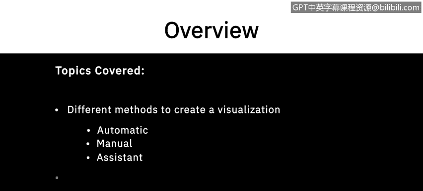
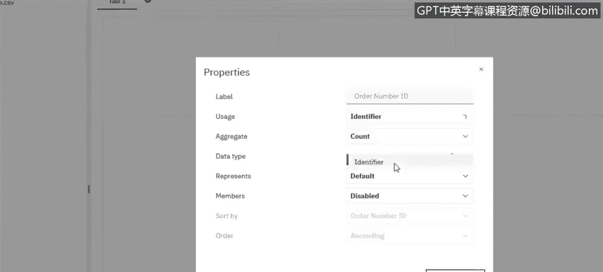
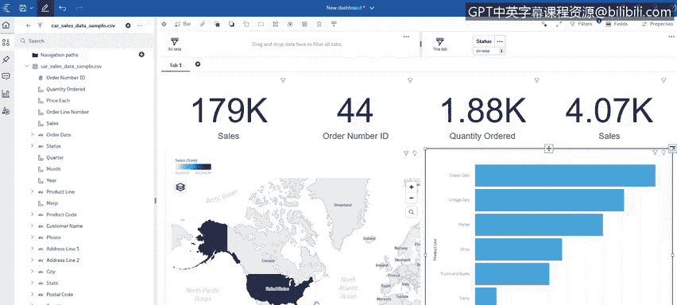
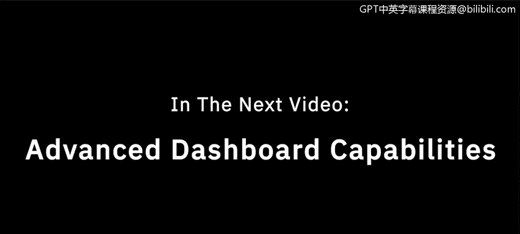

# IBM 数据分析师课程 3：《用Excel、Congos做数据可视化、看板》data-visualization-dashboards-excel-cognos - P12：12_在Cognos中创建简单的仪表板.zh - GPT中英字幕课程资源 - BV1cF41117mJ

嗯。In this video we'll cover off creating some simple dashboards in Cs Analytics。

We'll cover off a variety of different methods for creating a visualization。

 whether it's through our automatic generation， manually populating slots or using our assistant。

We'll also cover off。

How you can filter within a Cognis Analytic dashboard。As I mentioned， as the data was uploaded。

 we took a look at the data and tried to understand what types of data were included。

 and that's denoted by the icon in front of each of these elements now in the case of order ID we actually want to switch this up and change the properties from a measure to an identifier。

With that done let's go ahead and start to create some visualizations so I can simply grab from my tree and drag it onto the canvas now in this case if I drop on top of the box what it'll do is it'll fill the space available as denoted by the template。

😊，Next look at the number of orders that we've had by counting the number of order IDs that we have in this case it determine the best visualization for an identifier to be a list。

We can go ahead and take a look at what other recommended visualizations in this case there aren't any。

 but we know we want to turn this into a summary so we can just go and manually select it。Next up。

 let's look at the quantity ordered。And we'll finally finish with the average sale。 So in this case。

 I'll drag sales onto the canvas。But what I'll do is I'll change our summarization from sum to average。

And so just like that， I now have a few KPIs to be able to monitor and track。

The other way we can start to create visualizations is by selecting the specific visualization we want and dragging it onto the canvas。

In this case I'm interested in looking at our sales across the world based on countries。

 so in this case I can find country， alternative if I have a lot of data。

 I can simply start to type at the top and I'll see country comes to the surface。As we said。

 we wanted to take a look at sales。In this case， we look specifically at country， but as you can see。

 we can go further down in terms of latitude and longitude。 Now with this。

 I can manually drag and drop to make this as big or as small as I want。

 and you'll see that we show percentages of how much real estate it's actually taking up。

Of course each of our visualizations has a number of properties。

 we won't get into those in too much detail， but if there's something that you're looking to do。

 take a look in the properties and it's likely there。

The final way that we'll show creating visualizations is through our assistant。Now in this case。

 I may have an idea of what I want to look at or I may not。If I don't。

 I can simply ask it to suggest questions。This will offer up some insight that I may not have been thinking about in this case we'll keep it simple we'll just look at which product line has the top sales。

With a click， I'm now presented with the visualization。

 as well as alternatives based on that particular visualization。If I'm happy with a view。

 I can simply drag and drop this onto my canvas。And it now becomes a visualization alongside the others。

 I can continue to resize this。Now all of our dashboards is designed and meant to be interactive。

 so in this case if I were interested in seeing the rest of my dashboard through the specific lines of classic cars。

 I can click on classic cars and you'll see that all my visualizations are now updating specifically with the filter of classic cars。

Now this is one way that I can do it and I can do it multiple clicks， or alternatively。

 I can take a particular field。😊，And drop it in if I were perhaps interested in a particular status。

 I could drive this into the all tabs or if I just wanted to be specific to this tab in here。

Now with this I'll be able to choose one or many in this case。

 maybe we want to take a look at how much we have in the on hold status。So with that。

 you'll see again， all of these have been updated to reflect simply the on hold。

 so it looks like from a worldwide view we only have holds in a couple of countries which is positive。

The next video will delve deeper into a few of the more advanced capabilities of the dashboard。

