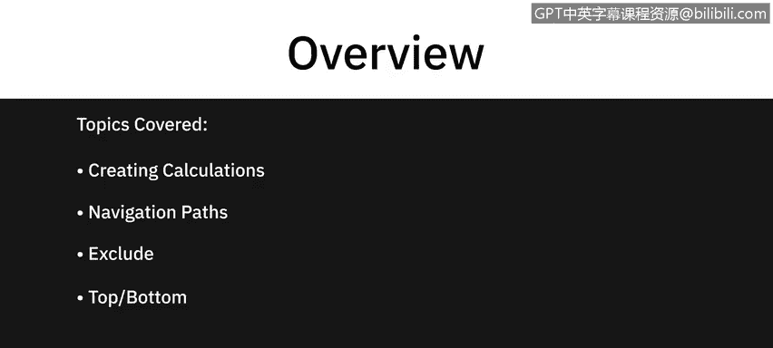
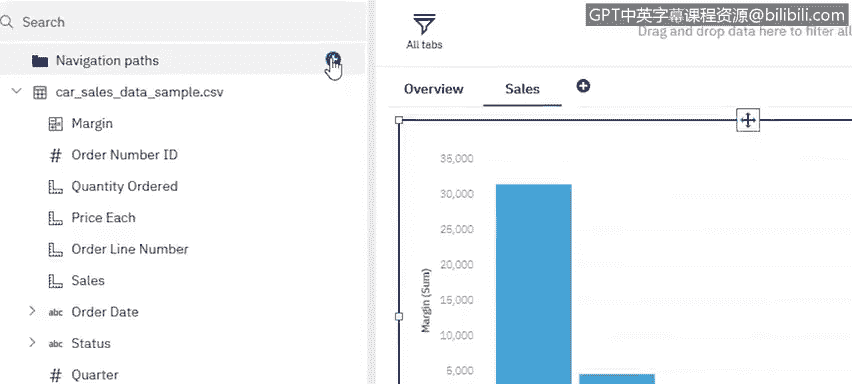
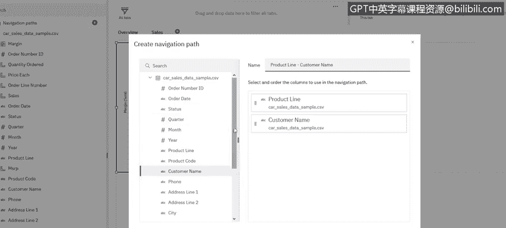
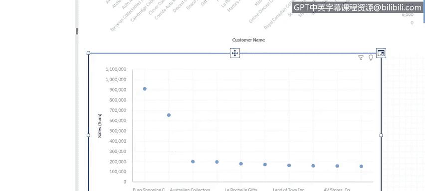

# IBM 数据分析师课程 3：《用Excel、Congos做数据可视化、看板》data-visualization-dashboards-excel-cognos - P13：13_Cognos Analytics仪表板的高级功能.zh - GPT中英字幕课程资源 - BV1cF41117mJ

嗯。In this video， we're going to cover a few of the more advanced capabilities in Cogniz Ana dashboards。

 cover how to create calculations， how to leverage navigation paths。

 how to do excludes from visualizations， as well as how to set top bottom on a visualization。

Much like Excel， our dashboard can create calculations。

We list out a number of different options here that you can take a look at。Or alternatively。

 you can simply start typing。And we'll offer up suggestions。Now， in this case。

 we're interested in looking at our MSRP minus the price that we sell each unit for。

To give us a margin calculation。Now this calculation is treated exactly the same as any of our other fields that we have in here。

 so this case， let's select our margin。And we'll look at product line。And bring that in。

Now in this case， we can see that trains is not doing very well。

 it's actually a negative margin for us。Now we may want to drill into this a little bit more so we can create what we call a navigation paths。

 in this case， I can choose any field from my data to be able to drill up and down on In this case。

 we want to start with product line。

And perhaps we want to see customers。

And ultimately， if there are specific orders。Now I can right click on trains and I can start to drill down。

In this case， I can see that we have a few offenders who are in the negatives when we look at this particular field。

So if we go ahead and look at。就俾mic。Manyinni gifts， again， we can drill down a little bit further。

To see that， while they have one which is positive， their other ones are in the negatives。

Let's take another look at something a little bit different。 So were to look at sales。By status。

And by product line。Now in this case， we're still filtered on trains， so we may want to go back。

And that we get up。In this case， we're still filtered on just trains's。

Unclick that to get back to our initial starting point。Now in this case。

 we can see that our shift is really dramatically having an impact on this。

 so we can go ahead and we can choose to exclude our shipped items now we get a much better view of everything else that's going on。

For the other statuses。Another thing that we could do is if we have a large number of data points。

 in this case， perhaps customer sales。Customer name and sales。We may want to。

Filter down on only our most important ones， so in this case I can to sales， right click。

And I can ask you to show us a top X number， in this case， by default， we have 10。

So now we can see these are our top 10。Customers。

And one last one， just for fun。We can actually create infographics on the fly。So this case。

 if I've got sales， I can take any one of my shapes here， perhaps a piggy bank。

Drop it on top and just like that， we've now created an infographic。

