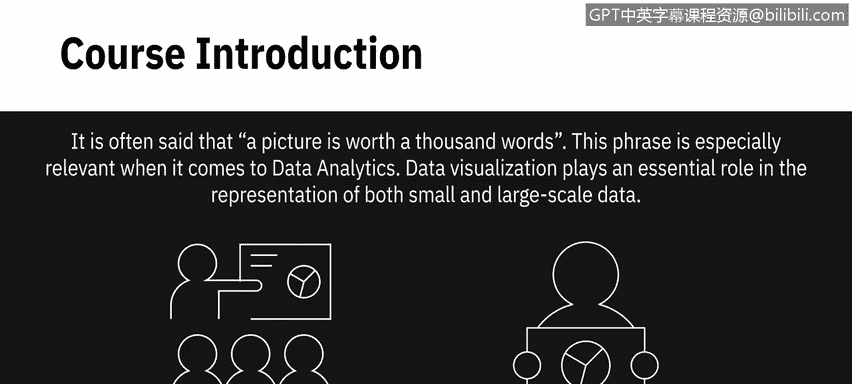
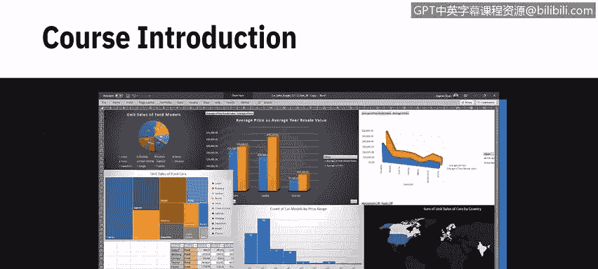
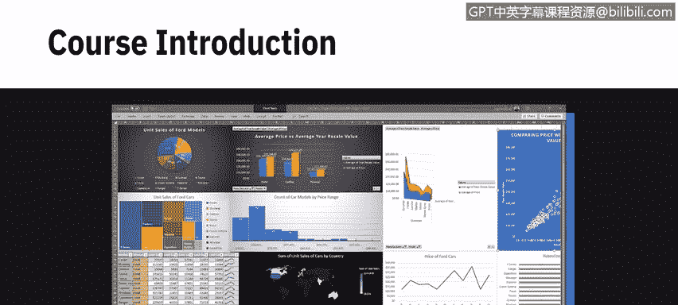
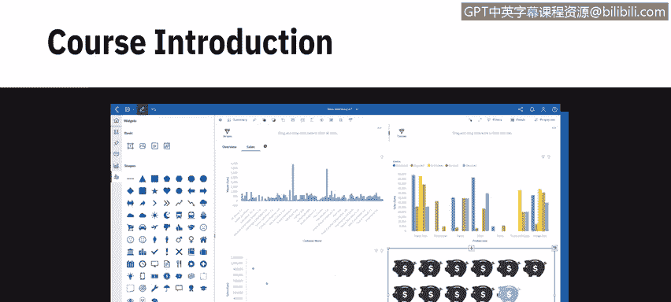
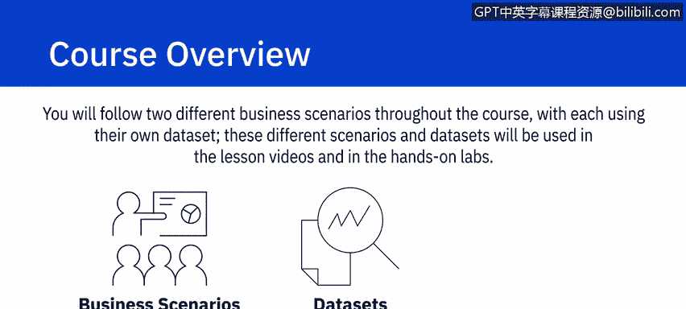
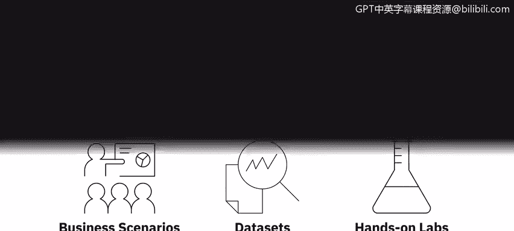
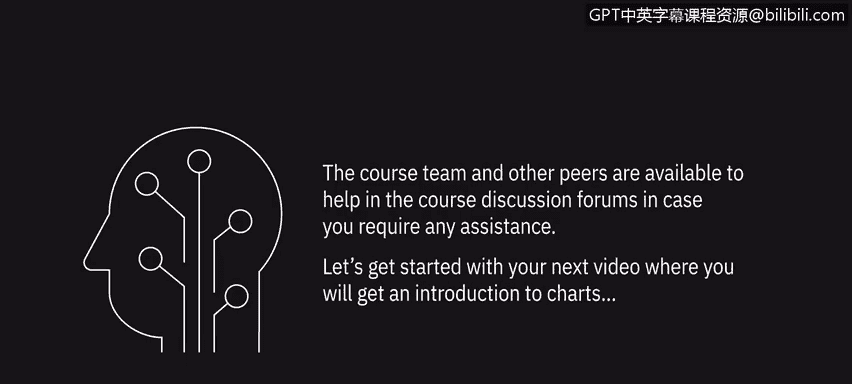

# IBM 数据分析师课程 3：《用Excel、Congos做数据可视化、看板》data-visualization-dashboards-excel-cognos - P14：0_01_course-intro-video.en_subtitled - GPT中英字幕课程资源 - BV1cF41117mJ

。It is often said that a picture is worth 1000 words。

 This phrase is especially relevant when it comes to data analytics。

 Data visualization plays an essential role in the representation of both small and large scale data。

 This course from IBM is designed to help you tell a compelling story with your data using various visualization techniques。

You will work with both Excel and Cgnos Analytic to acquire the basic skills needed to create different types of plots。

 charts， and graphs， and build interactive dashboards which are important parts of the skillet required to become a data analyst。

You will not only learn data visualization techniques using Excel and Cgnosse Ana。

 but also practice using multiple hands on labs and assignments throughout the course。

In moduleule 1， you will learn about different types of charts and the Excel functions that are used to create basic charts and pivot chart visualizations by learning how to manipulate these features and by creating visualizations you will begin to understand the important role charts play in telling a data-drin story In module2。

 you will learn about creating advanced charts and learn the basics of dashboarding and how to create simple dashboards in Excel you will also learn how dashboards can be used to provide real- time snapshots of key performance indicators。

In module 3， you will learn about Cgnose analytics， including how to sign up for it。

 how to navigate around it， and how to easily create stunning dashboards。

 you will also learn some of the more advanced dashboarding capabilities of Cgnos Ana and make your dashboards interactive。

In the final module， you will complete a twopart hands-on final assignment lab。

 which will guide you on how to create visualizations in Excel and how to create visualizations and dashboards in Cgnos Ana This will involve you understanding what the scenario requirements are and then creating visualizations and a dashboard to fulfill those requirements。

You will follow two different business scenarios throughout the course with each using their own data。

These different scenarios and data sets will be used in the lesson videos and in the handson labs after completing this course。

 you will be able to explain the role visualizations play in conveying a story about data。

 create basic charts， pivot charts and advanced charts in Excel spreadsheets。

 create a simple dashboard using Excel。

Provision an instance of Cgnosse analytics in the cloud。

Navigate around the Cgnos Analytic interface and leverage its rich visualization capabilities。

Build interactive dashboards using Cgnos Ana with a variety of basic and advanced visualizations。

You will also perform some intermediate level data visualization and dashboard creation tasks to address a business scenario。

 The course team and other peers are available to help in the course discussion forums in case you require any assistance。

 Let's get started with your next video where you will get an introduction to charts。

