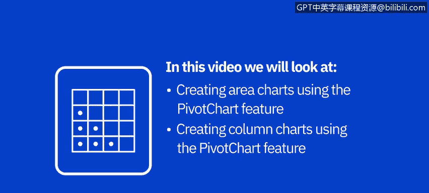
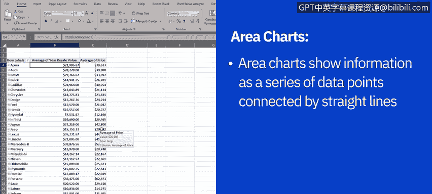
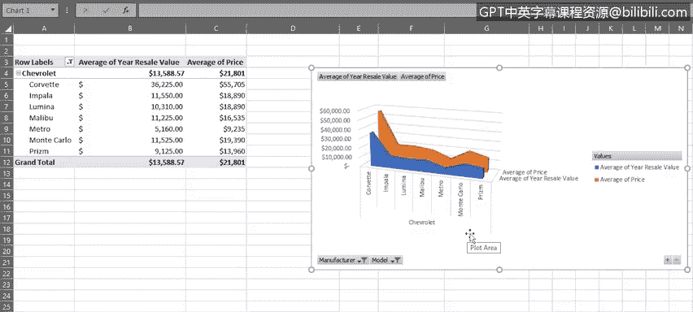
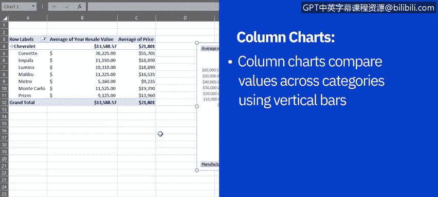
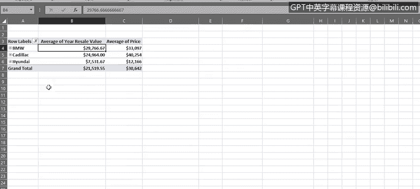
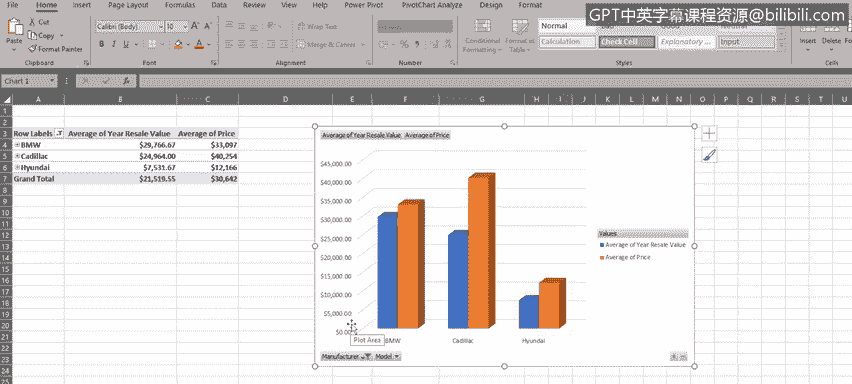

# IBM 数据分析师课程 3：《用Excel、Congos做数据可视化、看板》data-visualization-dashboards-excel-cognos - P18：4_06_using-the-excel-pivotchart-feature.en_subtitled - GPT中英字幕课程资源 - BV1cF41117mJ

嗯。Now that we've learned how to create a few basic types of charts in Excel in this video。

 we'll look at how to create some other basic charts using the pivot chart feature from a pivot table in Excel。

We'll first create area charts and then column charts from a pivot table。

 Please note that the price and resale values in this sample data set are not real data and are merely used for explanatory and demonstration purposes。

A pivot chart is used to show the data series， categories and chart accesses the same way a basic chart is used。

 but connecting a pivot table with it。Simply put a pivot chart is nothing more than a graphical representation of a pivot table in Excel。

 It's useful when we have a pivot table containing complicated data。

 A pivot chart can help us make sense of such data。Let's start with area charts。

 An area chart is a type of graph used to show information as a series of data points connected using straight lines with a filled area below it。

Area charts can handle both positive and negative values， like line charts。First。

 let's create a copy of the Pi one worksheet of the car sales workbook。

 In this copied worksheet of the car sales workbook。

 let's first filter the data of the pivot table to display only Toyota car models。

If we expand the field Toyota， we can see the details of different models from Toyota。

 such as the average price of each model and the average year resale value。

Now let's create an area chart using the pivot chart feature with this data here。

 let's select the area chart type and choose the 3D area chart。

Here we see a floating chart containing our area chart， which displays the trend of average price。

 as well as average year resale value of Toyota cars across its models。

Note that we can also filter the data in the pivot chart itself， rather than in the pivot table。

 This is one of the key differences between a standard chart and a pivot chart。So in our pivot chart。

 let's filter the data to display only Chevrolet car models。When we expand the field。

 the pivot chart displays our data here。 We can see that it seems that the higher priced models don't retain their value after one year compared to the lower priced models。

We can also use the model filter dropdown in our pivot chart to filter on models too。

Now we are only displaying seven of the nine Chevrolet models in our pivot chart and its associated pivot table。

So we can see that when we make a change， such as adding a filter directly in our pivot chart。

 those changes are immediately reflected in our pivot table data。

And the reverse is obviously also true。If we make a change in our pivot table。

 that change is immediately viewable in our pivot chart。Now let's have a look at column charts。

 A column chart is a type of graph used to compare values across categories using vertical bars In a column chart。

 the categories are typically arranged on the horizontal axis and the values are displayed on the vertical axis。

To create our column chart， let's first create another copy of the Pivo one worksheet of the car sales workbook。

In this copied worksheet of the car sales workbook， let's again filter the data of the pivot table。

 but this time to display only BMW， Cadillac and Hyundai car models。

Now let's create a column chart using the pivot chart feature with this data。

Here， let's select the column chart type and choose the 3D clustered column chart。

The new floating area contains our column chart， which displays comparative values for the average price。

 as well as the average year resale value for BMW， Cadillac and Hyundai cars using vertical bars。

From this chart data， we can see that it seems that both the Hyundai and BMW ranges retain their one year resale value better than the Cadillac models do。

Now， let's view all the BMW models in the table and chart by expanding the cell in the pivot table。

 but note that we can also use the plus and minus buttons in the chart to expand and collapse the data view2。

These buttons can drill down and drill up through multiple category levels if you have multiple fields in the axis or category section of the pivot chart fields pane。

For example， if we had the models further categorized into model variants and then into engine capacities and then into colors and so on。

Now， we can see all the models for all three manufacturers displayed in our column chart。 Note。

 however， that these buttons can only be used to expand or collapse all fields。

 If you want to expand or collapse just one field， then you need to do it in the pivot table rather than the chart。

 as we did in the previous step。Let's change the chart style to customize the look of the column chart。

 There are numerous styles to choose from in the gallery。 For example， here， we've chosen style 9。

 which gives us a nice， dark， contrasting background color。In this video。

 we learned how to create area and column charts using the pivot chart feature from a pivot table in Excel。

 We also learned how to filter data using either the pivot table or the pivot chart。

 And we learned how to expand and collapse data levels using both the pivot table and the pivot chart。

In the next video， we'll look at some advanced charts available in Excel。

