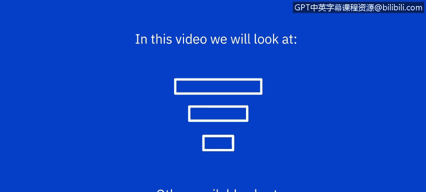
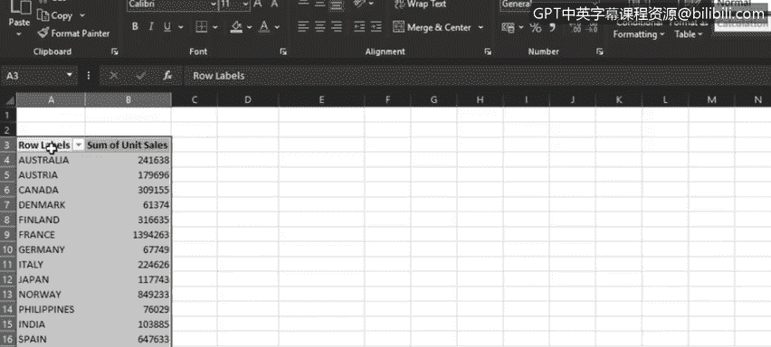
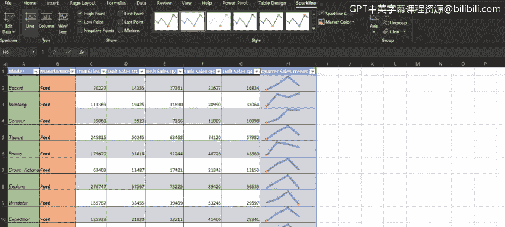

# IBM 数据分析师课程 3：《用Excel、Congos做数据可视化、看板》data-visualization-dashboards-excel-cognos - P20：6_02_creating-filled-map-charts-and-sparklines.en_subtitled - GPT中英字幕课程资源 - BV1cF41117mJ

嗯。In this video， we'll look at some more advanced charts in Excel。

 We'll first create a filled map chart and then add spark lines to our data。 And lastly。

 we'll briefly discuss some of the other charts available in Excel。😊。

Let's start with filled map charts。 A filled map chart is a type of chart used to compare values and show categories across geographical regions。

This chart is suitable for data which contains geographical regions like countries。

 states or postal codes。In the map chart worksheet of the Car sales workbook。

 let's first copy data from the pivot table containing country of sale and sum of unit sales。

Then we'll paste the copy data beside the table。Now let's create a filled map chart with this data。

After selecting the data， we selectBuild Map chartt from the map category of the charts group。

The new floating chart area contains our filled map chart。

 which displays the sum of unit sales of cars across different countries of sale。

Let's change the chart title to some of unit sales of cars by country。

 which we can do by simply double clicking the chart title text box and editing the text。

Let's change the chart style to customize the look of the filled map chart。

 There are numerous styles to choose from in the gallery， to suit your preference。

We can see from this filled map visualization that the darker blue color。

 which denotes the larger number of unit sales， is covering the United States。

 While the paler blue colors， which denote medium numbers of unit sales。

 are covering areas such as Canada， Western Europe and Scandinavia。And the almost white color。

 which denotes the lowest number of unit sales， is predominantly covering Eastern Europe， India。

 Japan and Australia。Next， let's have a look at spark lines。

 Spark lines are mini charts placed inside single cells to represent a selected range of data。

 They are typically used to show data trends such as seasonal increase or decrease economic cycles and share rate or price fluctuations。

 They can also be used to highlight max and min values。

A spark line provides the greatest impact when it is placed close to the data it represents to create our spark lines。

 Let's first select data from the four adjacent columns。 unit sales Q1。

 unit sales Q2 unit sales Q3 and unit sales Q4 in the Sp lines worksheet of the car sales workbook。😊。

Now， let's create spark lines with this data。 We'll select the line type of spark line from the spark lines group。

 We then need to specify where we would like our spark line to appear on the worksheet。

 We can do this by either typing in the cell reference in the location range box or better still。

 just click the cell in the workshe where you want it to appear and Excel will fill it in for you。

Note that it uses an absolute reference by adding dollar symbols to the cell references。

And then we can copy that spark line down the rest of the column。

We now see a column containing our spark lines， which displays the trend of the unit sales of Ford cars over the four quarters of a year。

Let's name the column header of the column with the spark lines as quarter sales trends。

 We'll adjust the column width and also adjust the row height to display spark lines more clearly。

Let's also display maximum and minimum values on the spark lines。

Then change the chart style to customize the look of the spark lines。

 There are several styles in the gallery for you to choose from。And finally。

 let's adjust the weight of the lines in the spark lines to make them stand out of it。

These spark lines show us that Ford escort unit sales started low in the first quarter and then increased in quarter 2 and 3。

 then declined again in quarter 4。 We can also determine that generally across the majority of the range of Ford car models。

 Q3 is the best quarter of unit sales over the year， with a couple of exceptions。

 such as Mustangs in quarter 4 and focus models in quarter 2。Lastly。

 let's have a look at some other available charts in Excel。

The waterfall chart type is used to show cumulative effect of a series of positive and negative values。

 This is suitable for data， which represents inflows and outflows， like financial data。

The funnel chart type is used to show progressively smaller stages in a process。

 This is suitable for data， which shows progressively decreasing proportions。

The stock chart type is used to show the trend of stocks performance over time。

 This is best suited to data with a series of multiple stock price values like volume， open， high。

 low and close。The surface chart type is used to show trends and values across 2 dimensions in 3D surface areas or 2D contour charts。

This is most suitable when categories and data series are both numeric。And lastly。

 the radar chart type is used to show values relative to a center point and is most suitable when categories are not directly comparable。

In this video， we looked at how to create filled map charts and spark lines in Excel。

 and we reviewed some of the other charts available。

