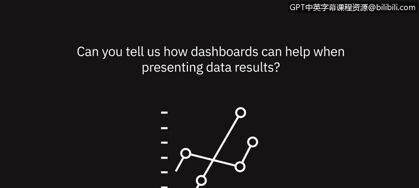
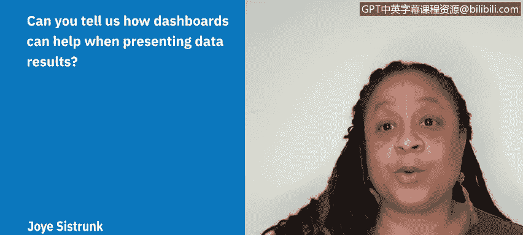
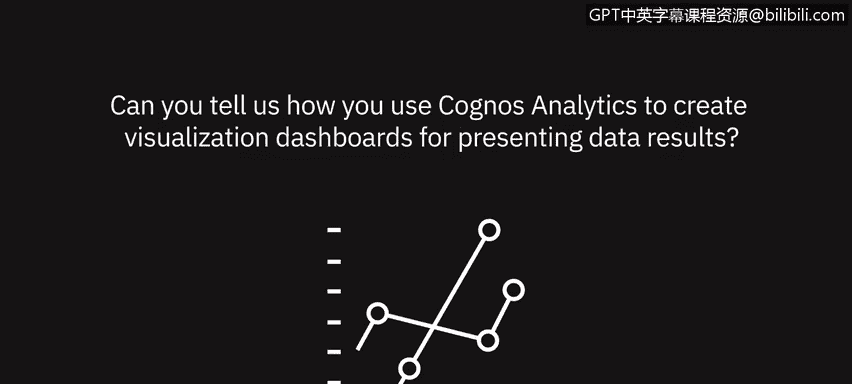

# IBM 数据分析师课程 3：《用Excel、Congos做数据可视化、看板》data-visualization-dashboards-excel-cognos - P22：8_02_interview-using-dashboards-to-present-data-results.en_subtitled - GPT中英字幕课程资源 - BV1cF41117mJ

嗯。In the first part of this video， we will listen to several data professionals discuss how dashboards can help when presenting data results。

Can you tell us how dashboards can help you when presenting data results？

One thing I particularly love with data are dashboards。

 they take the fluff out and they show you the most important things that you want to see often in real time and you can make them as pretty as you want I've seen some dashboards that are frankly an ISOR because of trying to cram so much data into one dashboard so it's important to be specific and be succinct in what it is that you're looking for so that you can avoid those sorts of things a lot of times dashboards are great for executives or business owners on the go who are maybe looking at dashboards from a mobile device and they don't really have the space or the capacity on a mobile device to look at so much data and dashboards can really be highly effective and the short amount of time as long as you understand the deliverables and what it is that your stakeholder wants to see and what's important。

To them for purposes of making decisions The reason why presenting the information in a way that is palatable to your audience is important is because you have to you want to make sure that people are getting value out of what you're doing a lot of times I think that's why data analysts in general good of bad rep because people think we're just number crunchers I think the bigger problem is we haven't done as good of a job as we could to really explain the numbers and so that's where PowerPoint presentations with graphs graphs we love graphs key performance indicators maybe that break out the information in a different way and highlight what's most important that will help and also just making sure that you're reading the room so if you are in a meeting and everybody's eyes are glazed over because you're talking numbers maybe you need to ask them what information are you looking for what is most important to you so that when you go back and you create your next data。

board create your next report you can highlight things that are important to your audience because we always need to be reading the room。

 we need to make sure that we are showing our value， showing people。

 helping people to understand educating them so that they can bring up their knowledge base and so that starts to help the fear dissipate of the fear of the number starts to go away if we would just show them what the numbers actually me and we can do that not just by throwing in numbers at them so they'll get overwhelmed but by helping them to see it graphically and with dashboards and KPIs and other ways just to bring it to them and make it real to them。

Dashboards in a spreadsheet is an indicator for action。 Just like on your car dashboard。

 If you see a low fuel light， that means you need to put gas in your car。

 So a dashboard in a spreadsheet should be just that simple。

 It should tell the person what they need to focus on immediately or any indication that things need to change because it's either going up in the wrong direction or it's going down。

 But don't put information that's nice to know on a dashboard， It's on a need to know basis。

 especially if you want to get action。 In the second part of this video。

 we will listen to a data professional， discuss how cgnos analytics can help you create outstanding visualization dashboards for presenting data results。

 Can you tell us how you use cgnos analytics to create visualization dashboards for presenting data results。

 IBM cgnos analytics can really help you create a better visualization and dashboards In a number of different ways。

 starting off， we have。😊。

Our templates allowing you to quickly select from a template and simply drag and drop your visualizations into the slots to help you create something that's visually compelling effectively and easily we also have what we call our visualization recommender if you grab a couple fields drag them onto the canvas we'll recommend a visualization if you don't like the one we recommend right off the bat then you do have the ability to go in and start to select some different visualizations from our recommendations。

On top of this we also have started to infuse AI into the offering so from this you can start to have the system actually generate an entire dashboard for you you can have a conversation with our assistant asking questions and once you focus in on the particular area that you're interested in simply say。

Generate dashboard and at that point you'll get a beautiful dashboard created laid out nicely that you can start to use as your starting point for further discussions and help you really understand the data that's your in your system。

 a couple of the things that we wanted to highlight one is the advanced analytic capabilities。

 whether this is through our visualizations like our key driver analysis or through our AI infused forecasting。

🎼The last thing would be the ability to share your visualizations and your dashboards in just a few clicks。

 whether that's sharing it in the system through a link。

 whether it's pushing it to email or even pushing it into a Slack channel where you can start to have a discussion there。

