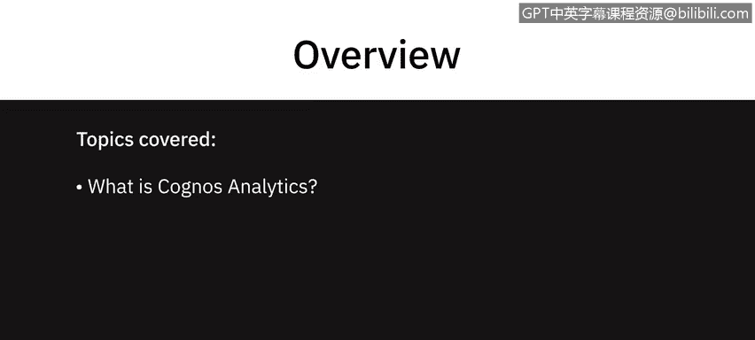
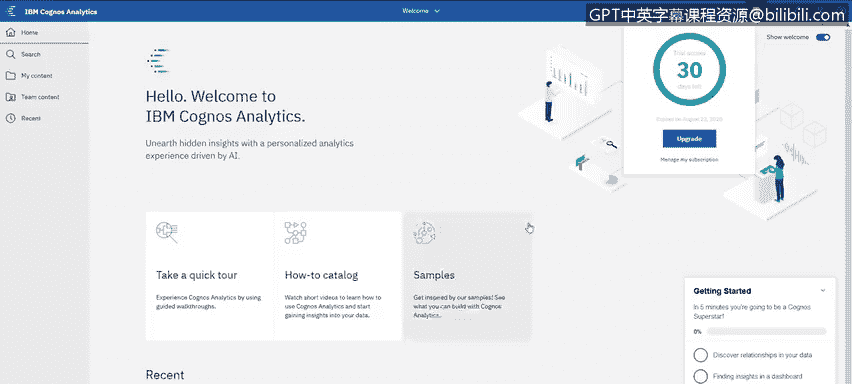
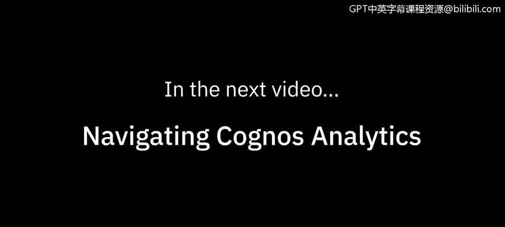

# IBM 数据分析师课程 3：《用Excel、Congos做数据可视化、看板》data-visualization-dashboards-excel-cognos - P23：10_01_cognos-analytics-introduction-and-how-to-sign-up.en_subtitled - GPT中英字幕课程资源 - BV1cF41117mJ

嗯。This video we're going to cover a couple of things The first is quick overview of what cognitivez analytics is and we're going to show you how to sign up for the trial Cogniz Analy is a multifaceted tool allowing you to perform both mode1 and mode two type of analysis all in one product it contains a number of different tools such as the ability to model your data。

 explore your data， create compelling advanced analytic visualizations like our key driverriver analysis。

 display natural language generated based off of your data and create reports which are specific and tailored to your individual users either through filters or through the ability to create bursts。

We also have the ability to create fantastic dashboards。

 which will be the main focus of this particular course。Now to sign up for the trial。

 we're going to go to the IBM。biz/try_cgnos if you already have an account。

 you can log in here and you'll simply have to fill out part of this form。If you don't。

 then we'll go ahead， fill out this form quickly， and the key one to take note of is to a data center which is close to you in your particular geography。

Now the system is being spun up for us and we can go ahead and actually launch this directly from this workflow now that you're in。

 you can go ahead and either manage subscription through this button。Or alternatively。

 you can always re accesscess the system through this URL。

In the next video， we'll take you through a little bit around how to navigate and use Cgnos and its dashboard capabilities。

