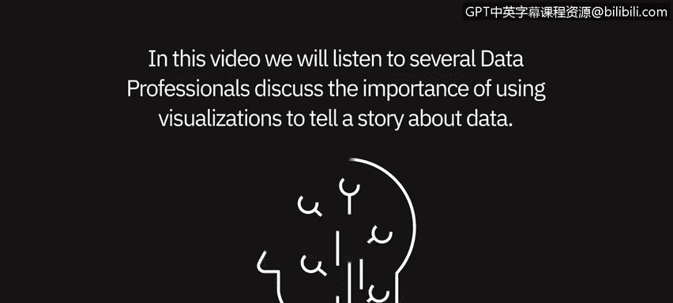
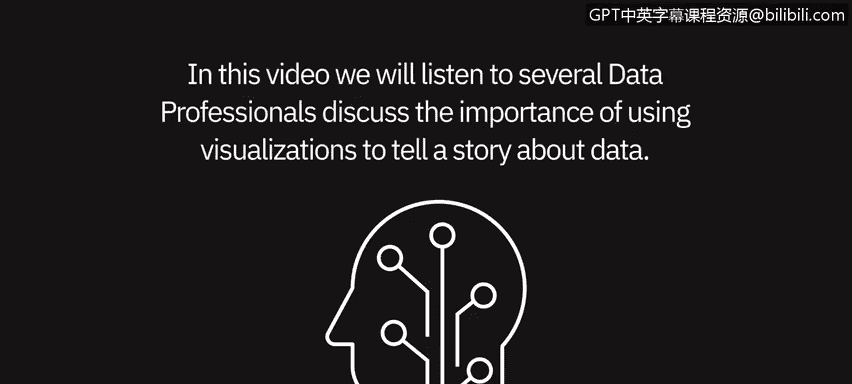
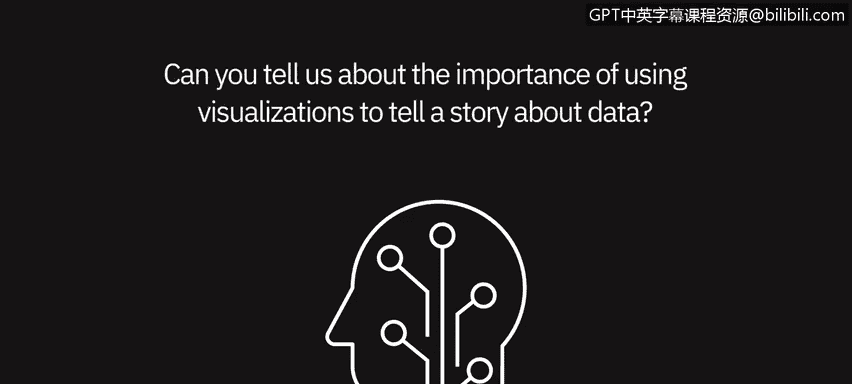

# IBM 数据分析师课程 3：《用Excel、Congos做数据可视化、看板》data-visualization-dashboards-excel-cognos - P3：2_使用可视化讲述数据故事的采访.zh - GPT中英字幕课程资源 - BV1cF41117mJ

嗯。

In this video， we will listen to several data professionals discuss the importance of using visualizations to tell a story about data。

Can you tell us about the importance of using visualizations to tell a story about data？

Visualizations are critical to storytelling with data。

I think you're familiar with the phrase a picture is worth a thousand words and that's really true here you can get a much clearer picture of what's going on with your data if you have clean and clear data visualizations I also think data visualization is super helpful for the analyst that creates them because it forces them to make choices about what's really important to show and what isn't important to show for example。

 if you're debating whether you should look at things temporarily you can debate like。

Am I is the overall trend the most important Okay， then I should do a time series data visualization Do I think comparing one group versus another is more important than you're more likely to do a bar column chart So it's really important in clarifying the data analyst thinking and visualization is really important in telling a clear concise story to stakeholders humanss are visual creatures you are more likely to tell a compelling story and get by with visuals I once got a job offer was a visualized resume created by Tableau So one of the best ways to present data is visually numbers by themselves for the most part。

 will tend to overwhelm people So if I walk up and I just and I'm talking in a company meeting and I say last year in 2019 we did $100000。

Or I could give you a graph and say 2018， we did $75000， 2019， we did 100。

000 in 2020 we're projected to do $125，000 if I put that in the graph and make it stand out and make it pretty people will non-accountants will and non data people will kind of gravitate towards it and it'll prompt them to ask different questions and have different ideas and so by using maybe a PowerPoint to or even Excel in Excel you can create graphs from the data。

 make it pretty， make sure that it made not just pretty but make sure that it highlights the important information of what you're trying to say it will create and drive the conversation around what needs to be done and how best to maybe run the business or make different decisions data visualization is a very important part of being helping people to understand the numbers that you're trying to present The reason we want to。

towards visualizations is that's how the brain really works the brain is much more able to process a high bar versus a low bar as opposed to looking at 100 rows or 100 lines in a spreadsheet using the visualizations and especially using the appropriate visualization for the given task can really help make sure that the user gets the easiest way to understand this。

As we talked about， storytelling is really an important way for us to do this and so through the visualizations that's really how we tell a story we can augment it with。

Text， whether that's user generated or system generated。

 tell people really drill down further to the understanding。

 but starting with the visualization is the easiest way to help people quickly。

 effectively understand what's going on and then you can have the further discussions around what exactly you're doing。

