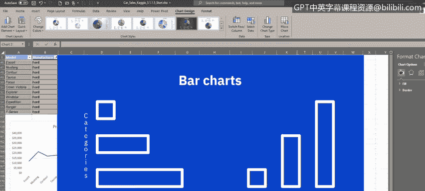

# IBM 数据分析师课程 3：《用Excel、Congos做数据可视化、看板》data-visualization-dashboards-excel-cognos - P4：3_在Excel中创建基本图表：线图，饼图和柱状图.zh - GPT中英字幕课程资源 - BV1cF41117mJ

嗯。In this video， we'll look at how to create a few basic types of charts in Excel。

 we'll first create line charts， then pie charts， and lastly， bar charts。

First， let's start with line charts。 A line chart is a type of graph used to show information as a series of data points connected by straight lines。

In a line chart， the horizontal axis typically represents time or a similar category。

 and the vertical axis typically represents numerical values。

Because line charts can display continuous data over a given time period。

 they're perfect for showing trends in data at equal time intervals such as days， months。

 quarters or years。😊，Line charts are ideal for scenarios where you have data that's arranged in columns or rows or where your data contains multiple data series。

On the car sales worksheet of the car sales workbook。

 let's first filter the data to display only four car models。Now。

 let's create a line chart with this data。 We'll select the data from two non adjacent columns。

 In this case， model and price。 Then we select line chart from the 2 D line category of the charts group。

Let's change the chart title to price of Ford cars。

 which we can do by simply double clicking the chart title text box and editing the text。

We now see a floating chart area containing our line chart。

 which displays the price trend of Ford cars across its models。

 Let's move this line chart to the left side of the worksheet， below our data。😊，Okay。

 now let's move on to pie charts。A pie chart is a type of circular graph used to show the relative contribution of different categories。

 which we see as slices to make an overall total， which we see as a pie。

Data points on a pie chart that is， the slices are represented as percentages of the complete pie。

Pie charts provide a very simple visualization of differing data results。

 which we humans find very easy to comprehend。Pie charts are best used when you only have one data series。

 and when your data contains no more than maybe a dozen categories， otherwise。

 the pie chart can start to look too busy and become difficult to read。For the pie chart。

 we use the model names manufactured by Ford， along with their unit sales。To create our pie chart。

 we'll select the data from two non adjacent columns， in this case， model and unit sales。

Then we select pie chart from the 2 D pi category of the charts group。

The new floating chart area contains our pie chart。

 which displays the relative contribution of unit sales from individual Ford car models。

 which are the slices of the pie。 And they combine together to make an overall total of unit sales of Ford cars。

 which is the whole pie。 Let's change the chart style to customize the look of the pie chart。

 There are numerous styles to choose from in the gallery。

 And you can even make combinations of multiple styles。 For example。

 here we've chosen style 3 and style 7， which gives us the percentage values displayed in each slice and a nice。

 dark contrasting background color。😊，Let's again move that chart this time to the center of the worksheet below our data。

Lastly， let's have a look at bar charts。 A bar chart is a type of graph used to compare values across categories。

 either using vertical bars or horizontal bars in the case of column charts。

 which are a variety of bar charts。In a bar chart， the categories are usually arranged on the vertical axis。

 and the values are on the horizontal axis。 whereas in a column chart。

 the categories are typically arranged on the horizontal axis and the values are displayed on the vertical axis。

To create our bar chart， we'll select the data from two non adjacent columns again。 In this case。

 model and retention percentage。 Then we select a style of bar chart from the 2 D bar category of bar charts。

The new floating chart area contains our bar chart。

 which displays comparative values for the retention percentage of the different forwardd models using horizontal bars。

 Again， we can change the chart color to customize the look of the bar chart。

 If you just want to choose a color scheme based on the palette of colors rather than a style。

 You can click the change colors button and then select a color palette from the list。

Let's also move this chart this time to the right side of the worksheet below our data。In this video。

 we learned how to create line， Pi and bar charts in Excel。 In the next video。

 we'll look at how to use the pivot chart feature in Excel。

