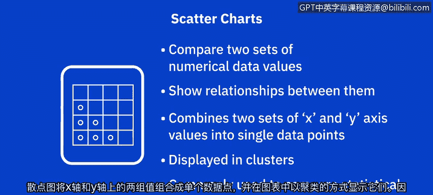
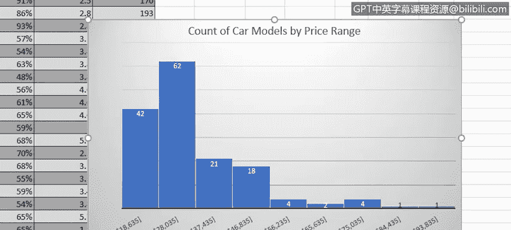
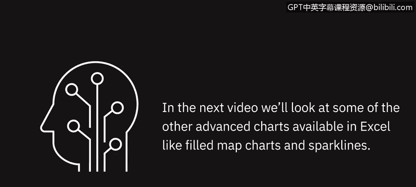

# IBM 数据分析师课程 3：《用Excel、Congos做数据可视化、看板》data-visualization-dashboards-excel-cognos - P6：5_创建树状图，散点图和直方图.zh - GPT中英字幕课程资源 - BV1cF41117mJ

嗯。Now that we've learned how to create basic charts in this video。

 we'll look at how to create some advanced charts in Excel。 We'll first create tree maps。

 then scatter charts and lastly histograms。Please note that the price and resale values in this sample data set are not real and are merely used for explanatory and demonstration purposes。

Let's start with tree maps。 A tree map chart is used to compare values across hierarchy levels and show proportions within hierarchical levels as rectangles。

 T maps are a good way of displaying lots of data in one graphical asset。

 because they use the color and closeness of proportional shapes within the chart to represent hierarchical data categories。

 which is a difficult thing to achieve with most other types of chart。

In the TMap worksheet of the Car sales Workbook， let's first select the data from two non adjacent columns。

 model and unit sales。Now， let's create a tree map chart with this data。

 We select tree map chart from the hierarchy category of the charts group。

 We now see a floating chart area containing our tree map chart。

 which displays the proportion of the unit sales of Ford cars within hierarchical levels as rectangles。

Let's change the chart title to unit sales of Ford Car。

 which we can do by simply double clicking the chart title text box and editing the text。

Let's change the chart style to customize the look of the treem chart。

 There are numerous styles to choose from in the gallery。 For example， here we've chosen style too。

We can easily see from this tree mapap chart that the F series model is by far the biggest proportion of our Ford car sales。

 followed by the Explorr and touristus models which constitute a similar proportion of our Ford car sales。

 while the contour model shows the smallest proportion of Ford car sales。Next。

 let's have a look at scatter charts。 A scatter chart is a type of graph used to compare two sets of numerical data values and show relationships between those sets of numerical values。

 a scatter chart combines the two sets of values on the X and Y axises into single points of data and then displays them in clusters in the chart For this reason。

 you will also sometimes see them referred to as X Y charts。

 Common uses include the comparison of statistical scientific or engineering data values。

 To create our scatter chart， let's first select the data from two adjacent columns。

 price and year resale value in the scatter worksheet of the car sales workbook。 Now。

 let's create a scatter chart with this data。 We select scatter chart from the X。

 Y scatter category of the charts group， which compares the price of cars from all manufacturers with their year resale value。

 Let's。

The chart title to comparing price with year resale value。

 which we can do by simply double clicking the chart title text box and editing the text。

 Let's change the chart style to customize the look of the scatter chart。

 There are numerous styles to choose from in the gallery。 For example， here we've chosen style 8。

 Now， let's add some axis titles for both the horizontal X axis and the vertical Y axis。

 We'll call the horizontal retail price。And the vertical year resale value。

We can see from this scatter chart that as the retail price increases。

 so does the differential between the retail price and the year resale value， General speaking。

 the lower priced cars retain their resale value after one year better than the higher priced cars。

Lastly， let's have a look at histograms。A histogram is a graph that shows the distribution of the data grouped into bins。

 although a histogram may look like a column or bar chart， it's totally different。

 While a bar chart is used to compare data。 A histogram is used to display distribution of data to create our histogram。

 Let's first select the data from two nonadjacent columns model and price in the histogram worksheet of the car sales workbook。

 Now， let's create a histogram with this data。 We select histogram from the statistical category of the charts group。

 The new floating chart area contains our histogram。

Which displays frequency distribution of the price of cars from all manufacturers。

 Note how Excel automatically puts the different price ranges into 9 equally sized。

 separate bins for you。The first bin contains cars priced between $9235 and $18635。

 The second bin contains cars priced between $18635 and $2835 and so on up to a maximum price range of $84435 to $93835。

 Let's change the chart title to count of car models by price range。

 which we can do by simply double clicking the chart title text box and editing the text。

 Let's change the chart style to customize the look of the histogram。There are numerous styles again。

 to choose from in the gallery。 For example， here we've chosen style 3。

 This style shows the count values of the individual rectangles for each price range。

 rather than using a vertical scale on the Y axis。 So from this histogram chart。

 we can easily see that the largest proportion of car models are in the $18635 to $2835 price range。

 with count of $62 models in this range， followed by the cheapest price range， of 9235 to $18635。

 which has a count of 42 models。 and the fewest count of models in a price range is shared by the two most expensive price ranges with only one model in each bin。

😊，Although Excel chooses your bin ranges automatically when you create a histogram。

 you can change the bin sizes to suit your needs。 This is done by opening the formatting pane for the relevant chart element。

 In this case， the horizontal axis in the access options section。

 you can choose to display bins by several factors， including bin width and by number of bins。

 For example， when we change the bin width value， you can now see 15 bins in the chart。

 because the price ranges are much narrower。

Bins 2 and 3 have the two highest counts of 34 and 33 respectively。

 and bin 14 shows no models in this price range at all。

 And if we change the access options to display a set number of bins。

 then the histogram updates again to show the price range is split into the number of bins specified。

That is 10 bins， and once again we can see that bin 2 has the largest proportion of models in its price range。

And if we choose automatic， then the histogram reverts back to the format we started with。

In this video， we learned how to create tree maps， scatter charts， and histograms in Excel。

In the next video， we'll look at some of the other advanced charts available in Excel like filled map charts and Spk lines。

