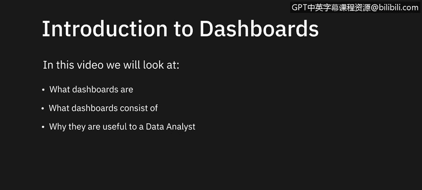
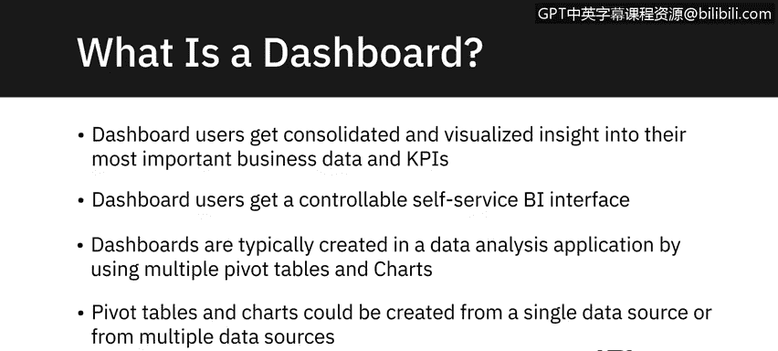
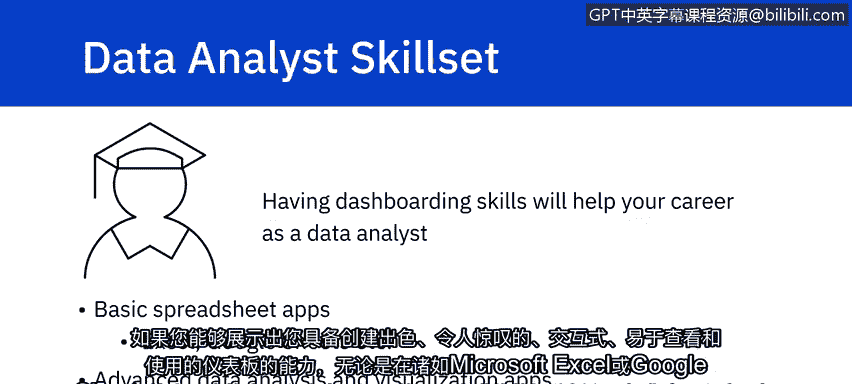
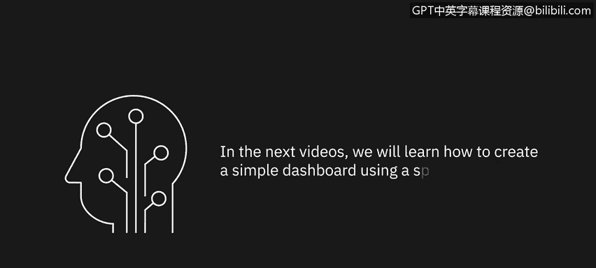

# IBM 数据分析师课程 3：《用Excel、Congos做数据可视化、看板》data-visualization-dashboards-excel-cognos - P8：7_仪表板入门.zh - GPT中英字幕课程资源 - BV1cF41117mJ

嗯。In this video， we will have a brief introduction to dashboards， including what they are。

 what they consist of why they can be a useful component in a data analysts toolkit and an essential skill in a data analysts skill set。

The term dashashboard comes from the automotive industry where car designers have put the most important gauges and other display information such as engine oil temperature。

 current speed， current RPM， amount of fuel left and so on in a handi graphical display that is easy for the driver to view and understand。

Originally， these displays were analog， but most are now digital and used varying forms of visualization。

 including digital meters and minigraphs。You can take that same idea and apply it to a dashboard in a data analysis application。

Designers of these types of dashboard want to put key business information in one place in the form of graphical displays to make it easier for the viewer to understand them。

Dashboards can take this a step further by also allowing the user to interact with the dashboard and modify exactly what information they see by using tools supplied on the dashboard。

Users of a dashboard therefore not only get a consolidated visualization of their business data and key performance indicators or Kpis。

 but also get a controllable self-serv business intelligence or B interface through the use of filters which enable them to control precisely what information they see。

 Dashboards are typically created in a data analysis application by using multiple pivot tables and charts。

 Viualizations such as map charts and spark lines and filtering tools such as slicers and timelines。

 These pivot tables and charts could be created from a single data source or from multiple data sources。

😊。

When you use dashboards in your data analysis application， you get the following benefits。

 They offer insights into your key data。 They can alert you to patterns and trends in your data。

 They provide an interactive experience for the user， allowing them to filter what data they see。

 They are updated dynamically as the source data changes。

 They provide a centralized and consolidated view of business data。

 A dashboard can be a very useful tool in areas of the business。

 such as fiscal forecasting and reporting， project management， executive reporting， human resources。

Customer service， help desk issue tracking， healthcare monitoring， call center analytics。

 social media marketing， and many more。

For a budding data analyst， dashboards can be a vital skill to add to their arsenal。

 as the majority of employers see the dashboarding skill as a must have rather than a nice to have。

If you can show that you have the skills to create accomplished and spectacular， interactive。

 yet easy to view and use dashboards， whether in a spreadsheet application such as Microsoft Excel or Google Sheets。

 or using a more advanced data analysis and visualization application。

 such as Boquet or Dash and Python， ourSt shinyhiny， Tableau or IBM Cgnos Analytics。

 then that will greatly help you in your future career as a data Ana。

In this video， we had a brief introduction to dashboards， including what they are。

 what they consist of， why they can be a useful component in a data analyst's toolkit。

 and an essential skill in a data analyst skill set。In the next videos。

 we will learn how to create a simple dashboard using a spreadsheet application。

