# IBM《机器学习（数据探索、监督学习的回归和分类）｜machine learning》中英字幕 - P104：15_K最近邻优缺点.zh_en - GPT中英字幕课程资源 - BV1xM4m1D7kY

Now let's discuss an overview of the pros and cons of K nearest neighbors。

 so starting off with the pros it's simple to implement。

 it doesn't require estimation of any panders just which neighbors are closest。

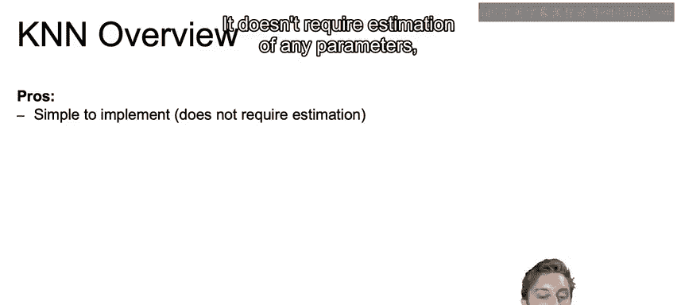

TheModel will adapt to well as new data is introduced for trying to predict churned versus not churned。

 and the recent data changes so will the nearest neighbors。

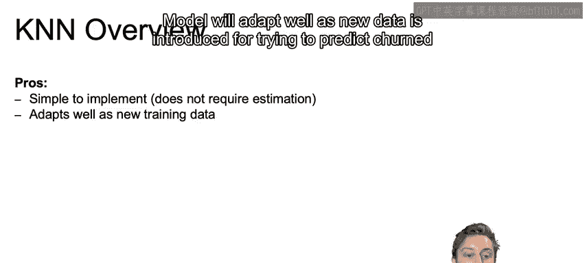

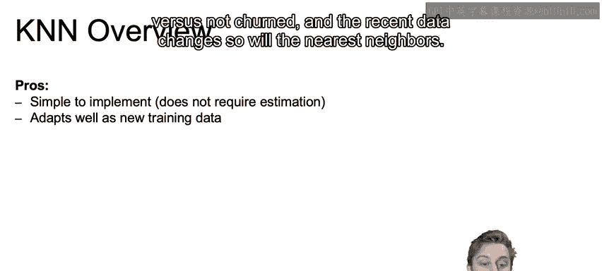

And then finally， a pro that's often overlooked when discussing machine learning。

 but is of aboutmost importance when we're leveraging machine learning for business is that it's easy to interpret。

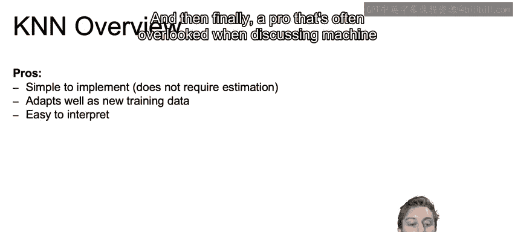

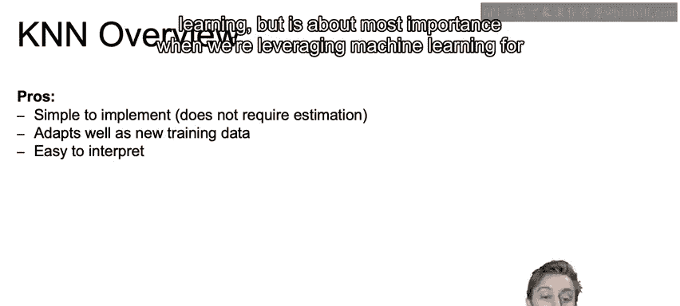

When a model is easy to interpret and makes intuitive sense to the decision makers。

 that model becomes that much more powerful。

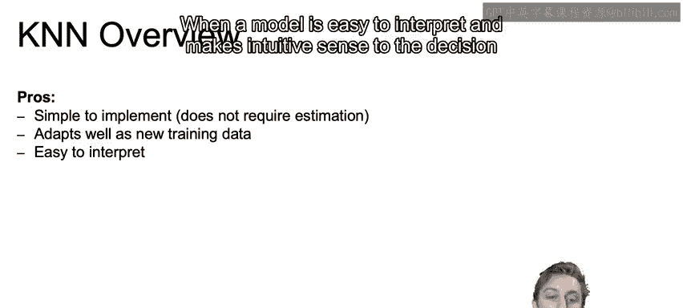

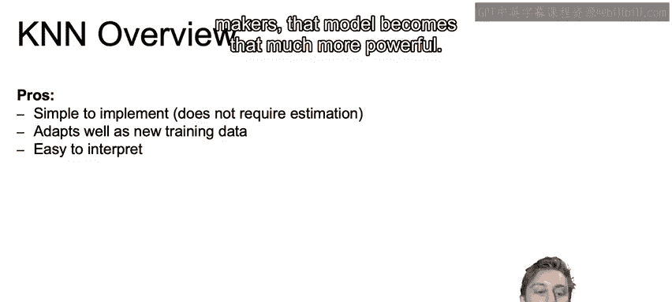

Let's think through another business example besides churned or not churn where K&N can be extremely powerful。

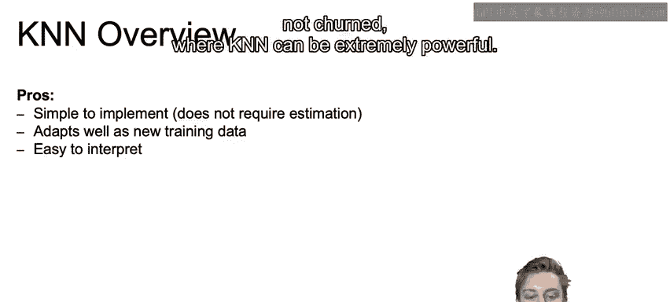

IfFor're looking for example， new potential customers。

 we can use Can nearest neighbors to find the profiles of our most lucrative customers and then predict whether certain new customers are likely to be lucrative as well so we know which customers to pursue and again think about how nice this is to interpret we can say these are the profiles of the customers which are most lucrative and we can start there。

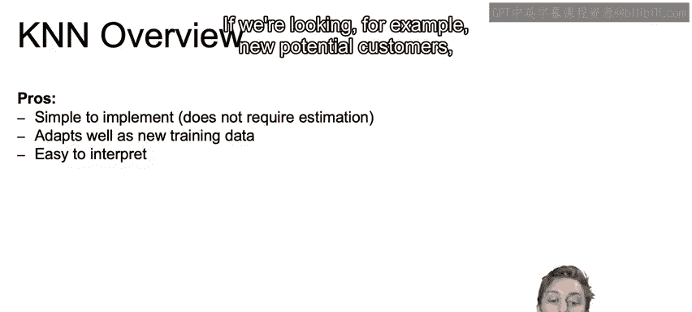

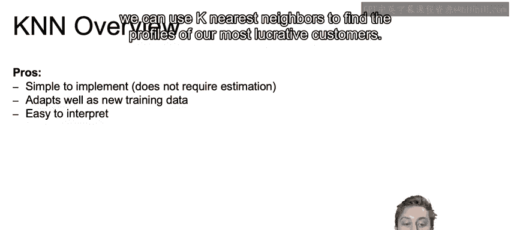

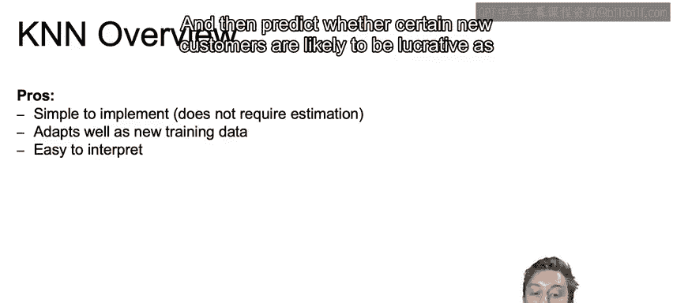

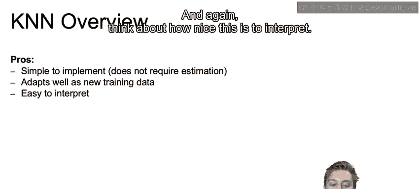

Now， there are also going to be many cons using the Can nearest Neigh classifier。

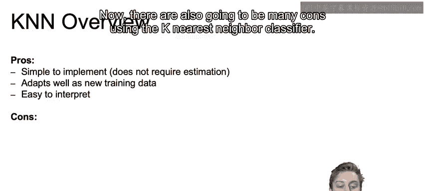

It can be slow to predict， not fit， fitting just requires storing the data， but for prediction。

 we have to start to calculate the distance to so many different data points if we have larger data sets。

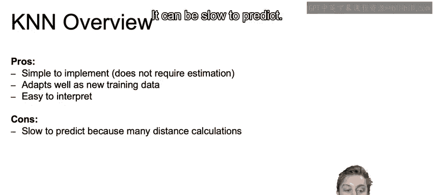

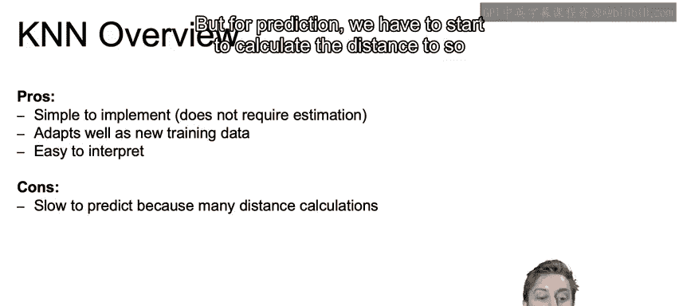

Also does not actually give us a model， like say， logistic regression where we can say certain amount of feature 1 and feature 2 will make it that much more likely for a certain target variable to fall into a certain class so we don't have that generative process so that we can easily understand how we can generate certain labels。

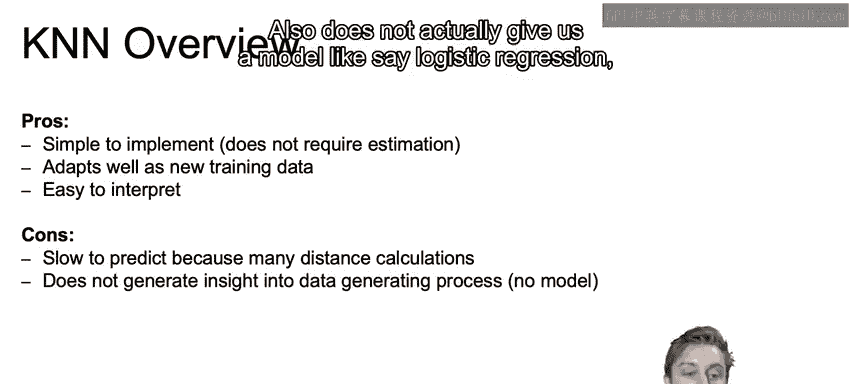

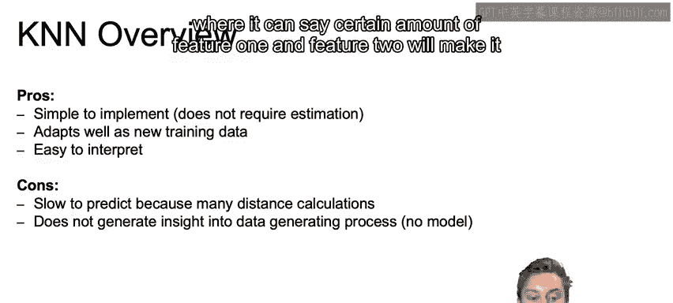

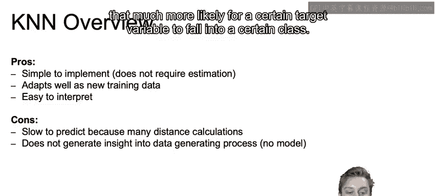

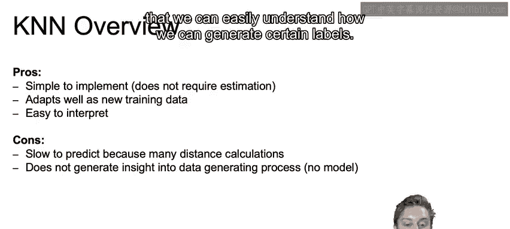

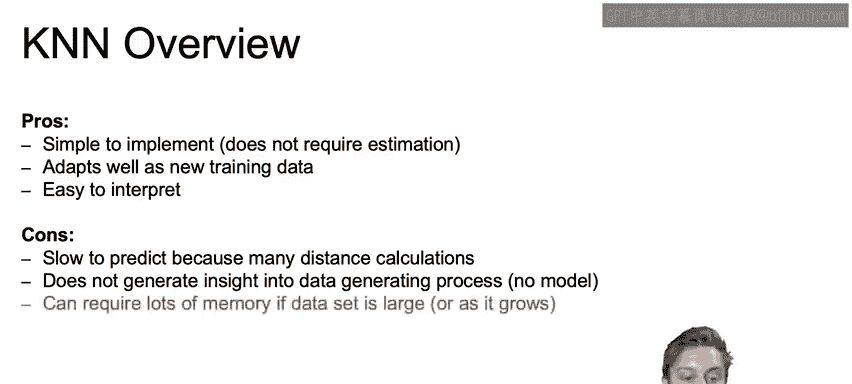

Also can require a lot of memory， the model needs to store all the values in the training set every time it fits the model。

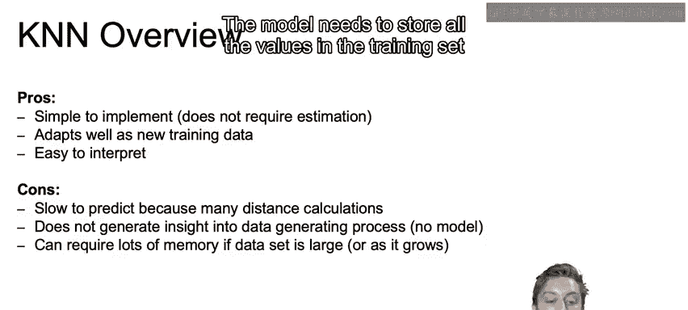

Then also when we have a lot of features， can nearest neighbors will begin to break down as distances are generally further and further away as we increase the number of dimensions。

 and remember the number of dimensions will increase as we increase the number of features。

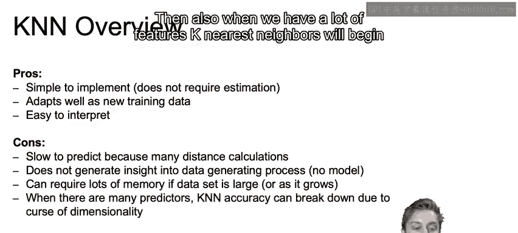

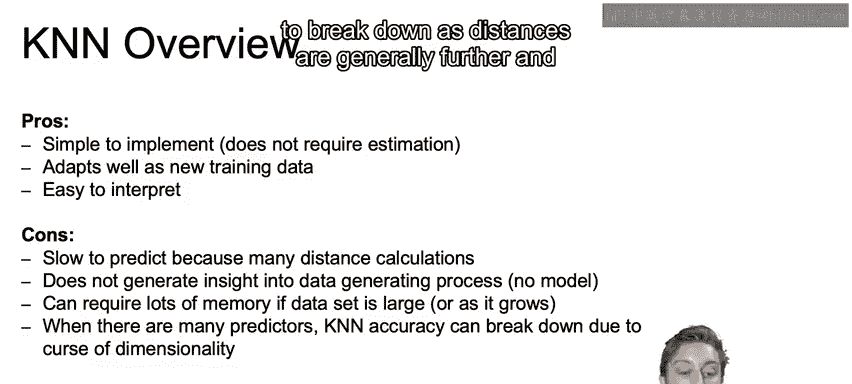

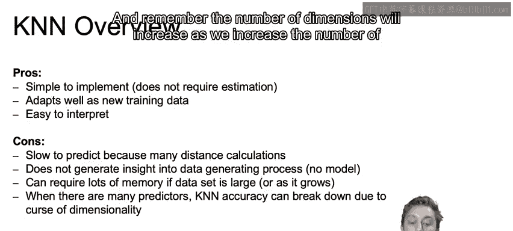

The next video we'll close out our discussion on Can nearest neighbors with a quick comparison of these pros and cons in relation to linear Russian and walk through some of the code as we prepared to use Can nearest neighbors in our next notebook All right。

 I'll see you there。

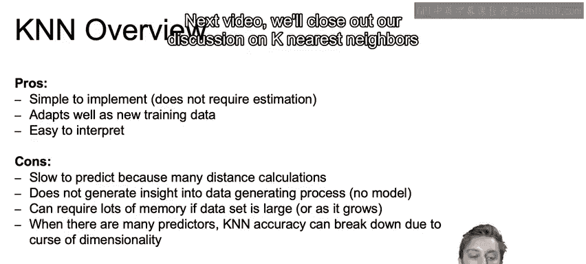

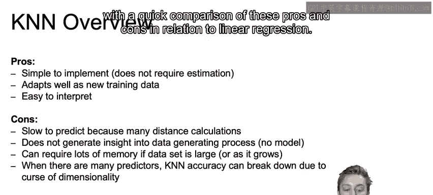

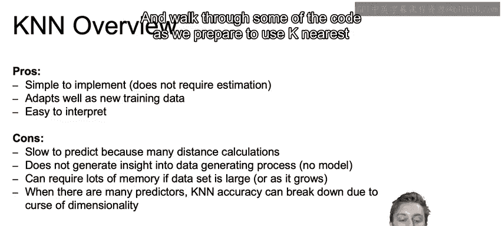

