# IBM《机器学习（数据探索、监督学习的回归和分类）｜machine learning》中英字幕 - P113：24_高斯核支持向量机简介.zh_en - GPT中英字幕课程资源 - BV1xM4m1D7kY

In this section， we're going to show the true power of support vector machines by extending them to nonlinear classifiers using the kernel trick。

Now， let's go over the learning goals for this section。 In this section。

 we'll see what we mean by kernels and how we leverage them for our support vector machines。

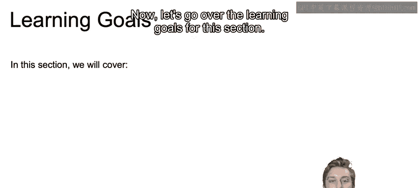

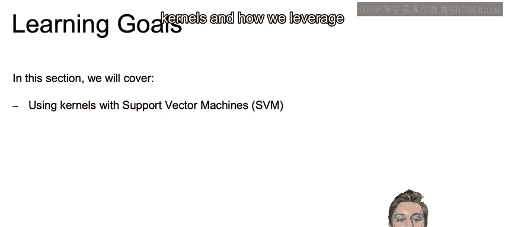

Then we'll see how these kernels will allow us to create nonlinear decision boundaries for our support vector machines。

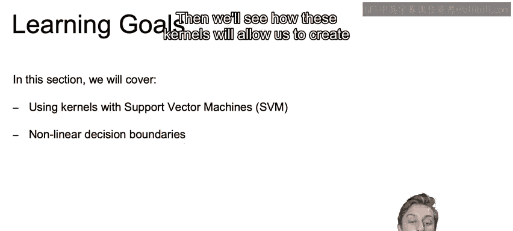

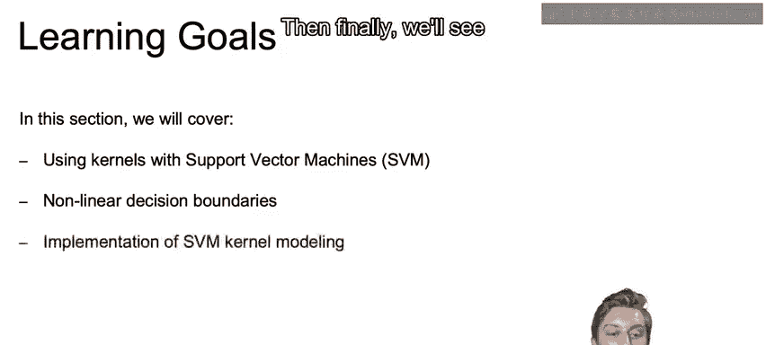

And then finally， we'll see a few different implementation techniques for SVM kernel modeling in Python。

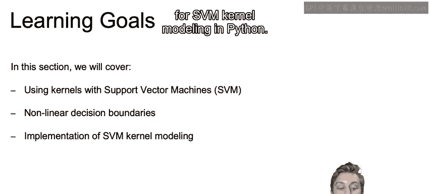

So what we have seen so far is this linear version of support vector machines。

 and this is the support vector machine in its simplest form。

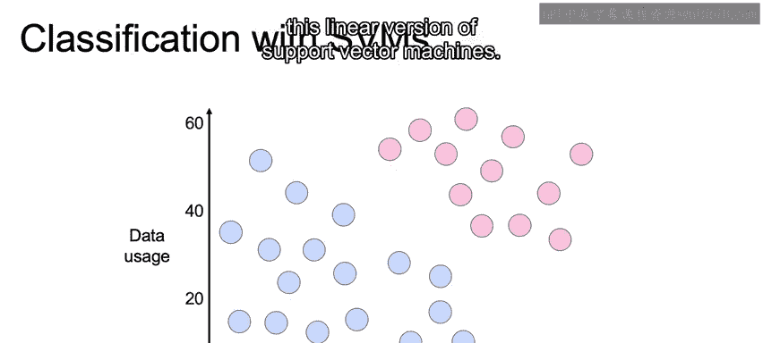

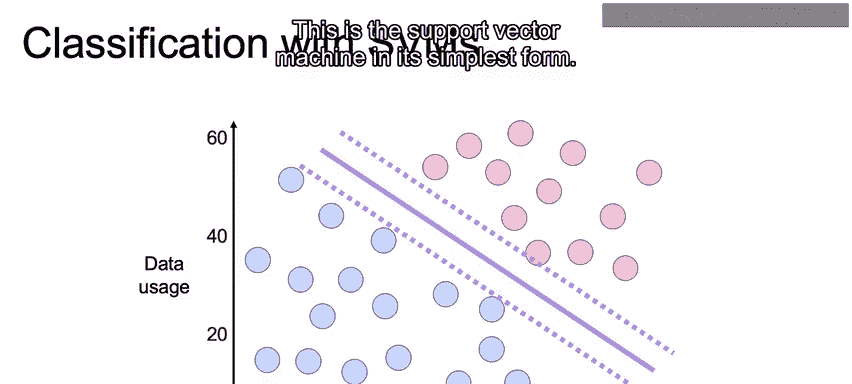

Now there's a way the kernel trick to achieve nonlinear decision boundaries using support vector machines。

 we'll just have to change our objective function up a bit。

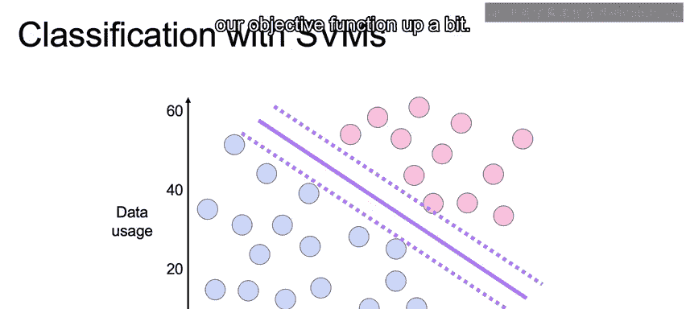

What seems like a nonlinear curve in our current two dimensional space may actually be related to a linear curve or a hyperplane in another universe。

 in another dimension。

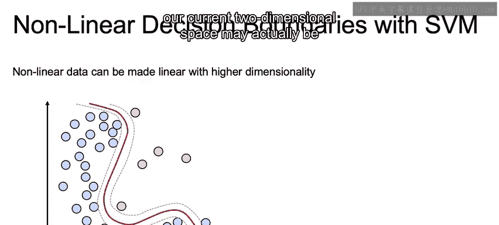

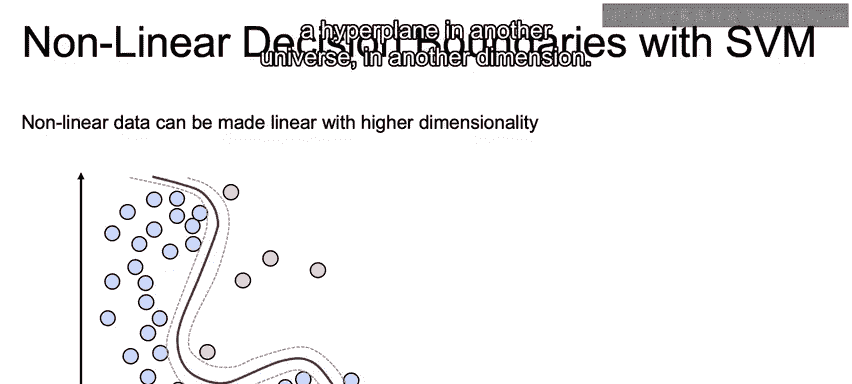

So under the right transformation of our space， we can find a linear separation Hyplane。

 which maps back to our nonlinear decision boundary。 Now。

 this picture here is a bit misleading because this is only possible once we're mapping from one dimension to a higher dimension。

 So from two dimensions to three or four dimensions， for example。😊。

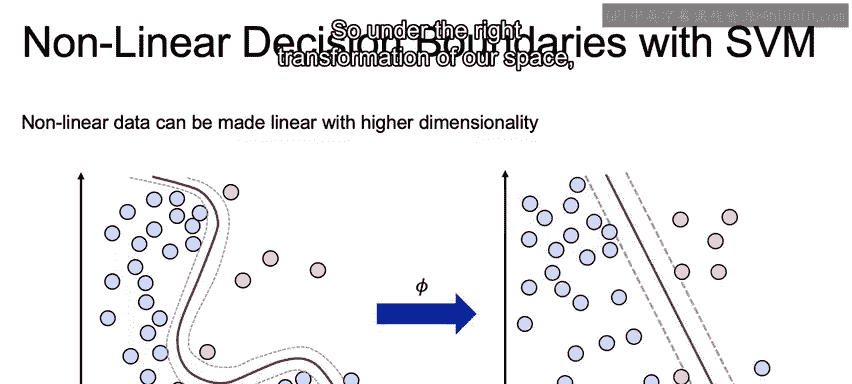

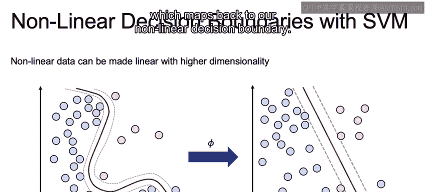

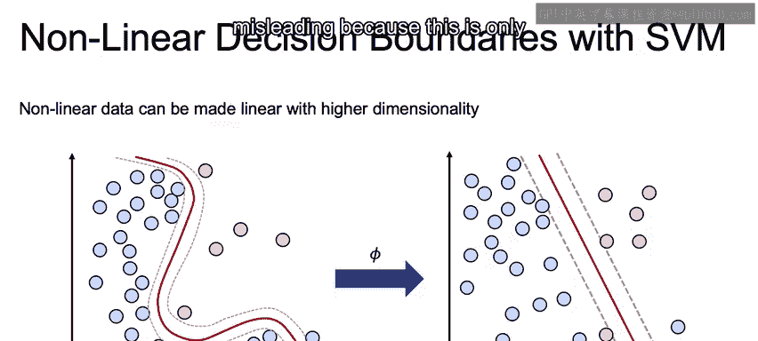

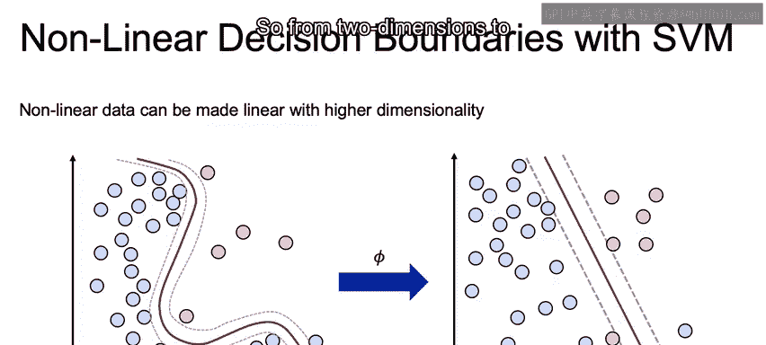

So if this is going to be a better illustration， this complicated looking curve will actually map to this hyperplane in three dimensional space。

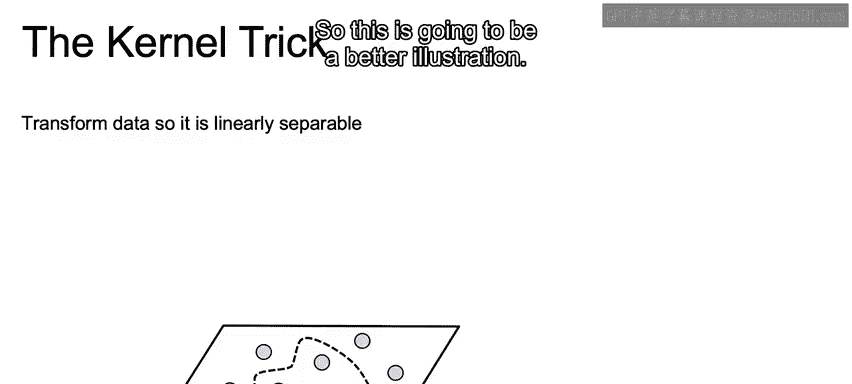

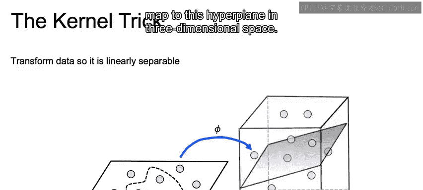

This mapping is providing that magic。

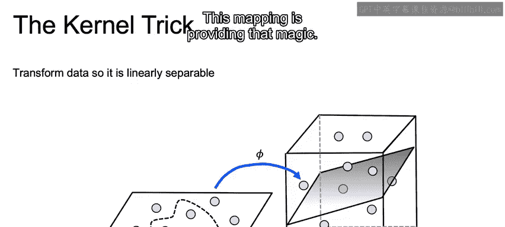

That is going to be the main idea behind how we come up with a nonlinear classification。

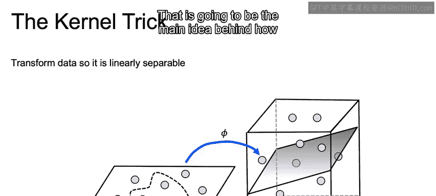

Built off of a linear classifier such as support vector machines。

 so support vector machines will still be linear where you're just coming up with that linear decision boundary in a higher dimensional space。

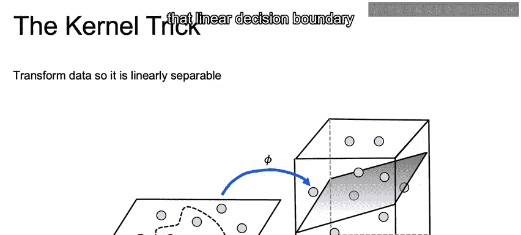

🎼We will essentially map our original data to higher dimensions with the knowledge that as we increasecc dimensions。

 we should be able to eventually find some linear decision boundary。

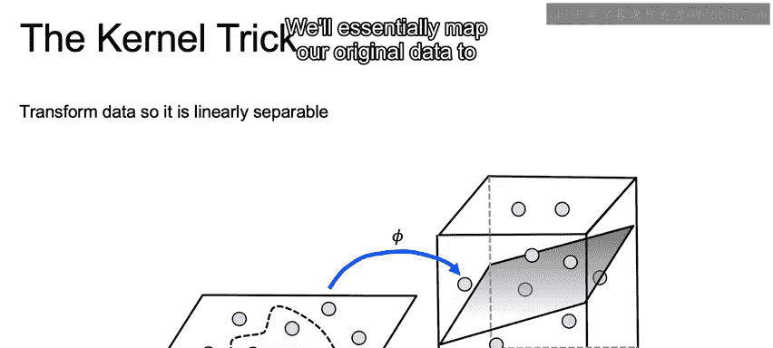

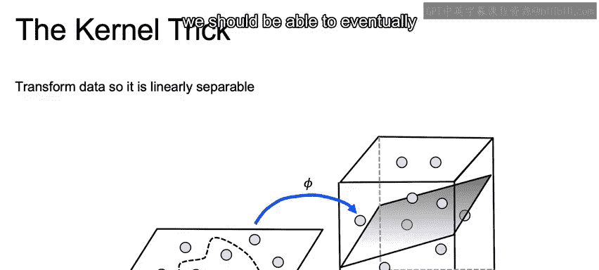

We'll go further into the details into how this is done in the next video。

