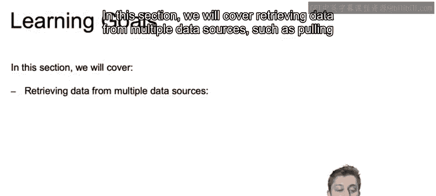
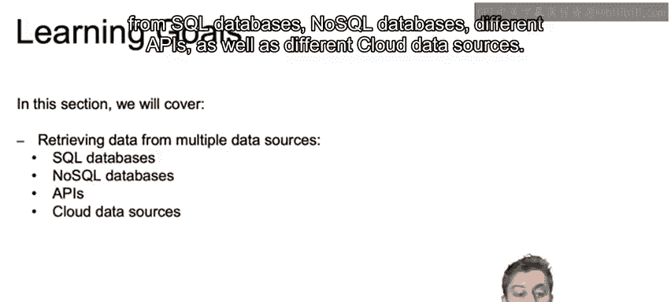
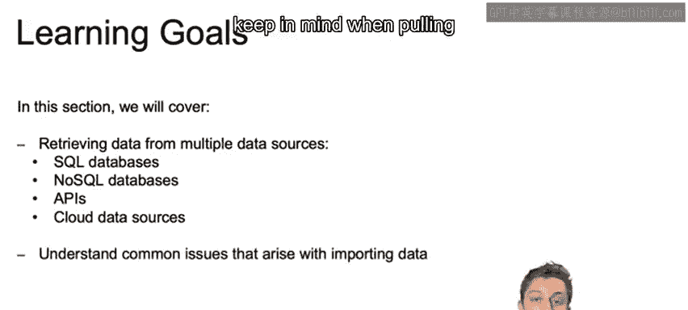
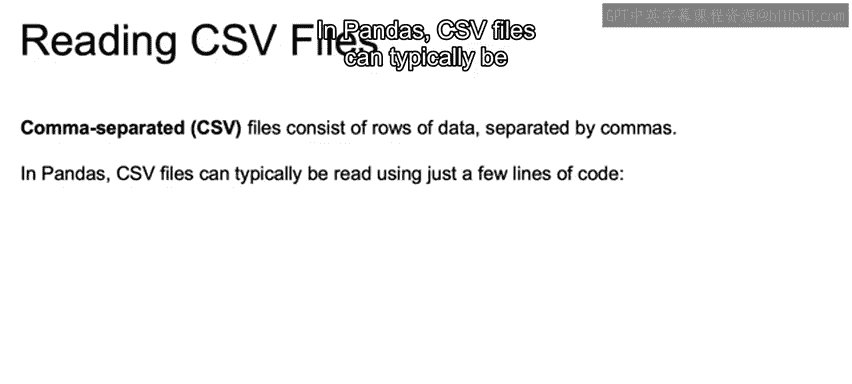
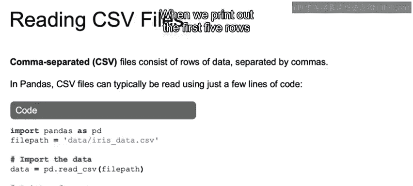
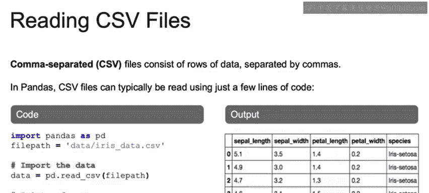
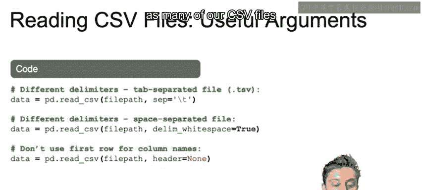
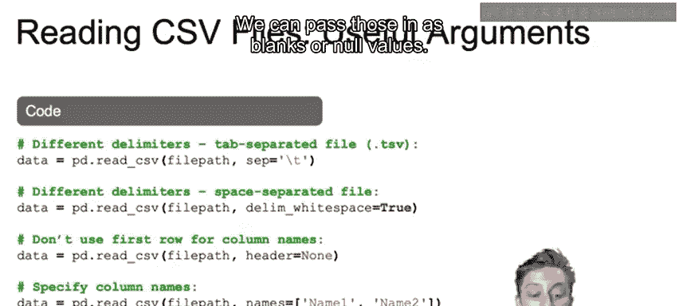
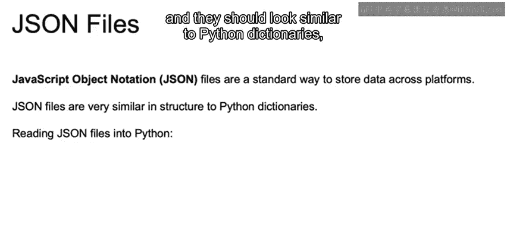
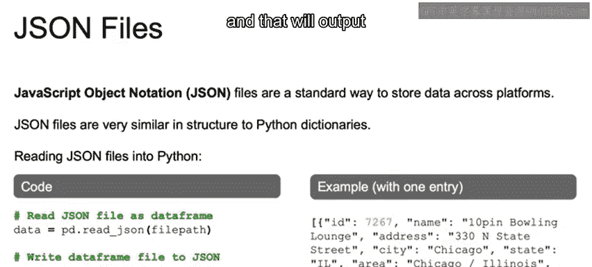

# IBM《机器学习（数据探索、监督学习的回归和分类）｜machine learning》中英字幕 - P11：10_从CSV和JSON文件中检索数据.zh_en - GPT中英字幕课程资源 - BV1xM4m1D7kY

Starting at the beginning of our journey， let's discuss ways of retrieving data from different data sources。

So let's go over the learning goals for this section in this section we will cover reing data from multiple data sources。

 such as pulling from SQL databases， no SQL databases， different APIs。

 as well as different cloud data sources。

And with that， we'll go over a lot of the practicalal issues that we want to keep in mind when pulling from these different data sources。

So let's start off with reading in CSV files， CSV just standss for comma separated values and that's going to consist of rows of data that are just separated by commas where the values are just separated by commas。

In pandas， CSV files can typically be read using just a few lines of code， which we'll see here。

The code that we have is first we're going to import pandas SPD， which is just common practice。

 we're going to set the file path variable to the path for the CSV file。

 so here it's going to be in a folder called data and the file is going to be called Iis_coda。

csv and then all we have to do is pass that into the PD。read CSsv function。

 so we pass in our file path specifying where the file exists。We save the output of that as data。

 that's going to be the variable that now contains our pandas data frame。

And when we print out the first five rows using David do Ioc through 5。

This is the output that you should see within your Jupyter notebook with your sepple length。

 sepel width， pal length， pedal width， as well as your species for the first five rows。

Okay， let's go over some useful arguments you may want to be aware of when working with the Read CSV function。

Right at the start， we see here if we are working with the tab separated file， we use PDd。readcsv。

 we pass in our file path that we're trying to get to and we can say what type of separator we want to use so instead of using a comma or're using backslash T which is just going to be the pythonic way of writing a tab。

 so it's a tab separated file。Maybe we have different delimiters and they are space separated so maybe the spaces aren't the same size。

 and that's the way that each value is being separated。 So instead of specifying a space or a tab。

 we can say anytime there is a white space using Dlim white space， then we have a new value。

We also have the option to not use the first row or decide which row is actually going to be the header for our column names。

 as many of our CSV files may have blank columns right at the top。

We'll also be able to specify our column names by setting in the argument names and passing in a list of the names of our columns。

 and we'll have to ensure that those are the same length as the actual columns of our data frame。

And then finally we can specify which values should be brought in as null values。

 so here we have NA values and maybe within our CSV file。

 we have values that are strings that say NA or the value 99， and we know that those are errors。

 we can pass those in as blanks or null values。

Now let's move on to JSON files， JSON just stands for JavaScript Object notation and those files are going to be a standard way to store data across platforms。

 you'll see them a lot for NoSQL databases as well as pulling in from different APIs。

They're meant to store information in an organized， easy to access manner。

 and they should look similar to Python dictionaries， which I'll show you here。

We have here with our example the dictionary with the key and value pairs representing。

This is just for one row。The key being the column name and then the value just being that value for the first row。

 and that's how we see its similar to the Python dictionary。In order to read in a JSON file。

 we're just going to use from Padas the read underscore JSON function。

 and then we just have to pass in our file path similar to read CSV， there are going to be arguments。

 I would say that。If you're having trouble pulling in your JSON files。

 I would start with looking at the Or arguments and there's many different options， split， records。

 index， columns， values， and that will tell you how the JSON files actually organized。

 I would say look at the documentation there， if you're having trouble wrangling your JSON file。

And then for the writing JSON files， all you have to do is data。2 underscore JSON。

 and that will output the file given the file name that you define。

