# IBM《机器学习（数据探索、监督学习的回归和分类）｜machine learning》中英字幕 - P120：31_支持向量机笔记本（选修部分）第3部分.zh_en - GPT中英字幕课程资源 - BV1xM4m1D7kY

All right。 Now for part 3 of our SVM notebook， we're going to wrap what we just discussed inside a function by passing in as well。

 this estimator option in our function。

So that we can pass in different SVC models with different gammas and different Cs。

And we're going to loop through each one of these hyperparameters， the gammas in the seas。

 so that we can start to actually visualize what the effect of regularization is when we increase or decrease our gammas and when we increase or decrease our values for C。

So all we're going to do is take this function， this lines of code that we just went through。

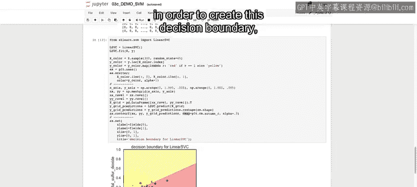

In order to create this decision boundary。And we're going to pass in。

As part of our function， our estimator。 so rather than having linear SVC here initiated。

 we're going to pass in our estimator and we're going to call estimator dot fit。

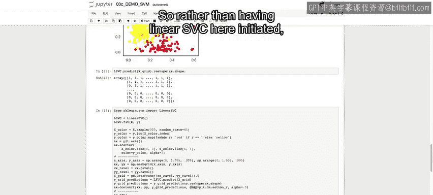

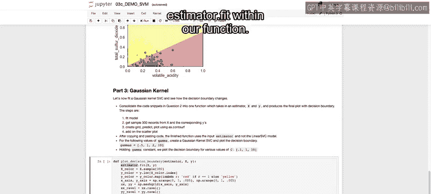

Within our function， so we're running it each time within our function。

 we're then going through all the different steps we did before in regards to defining x color。

 the corresponding Y color， making sure that their maps are red and yellow。

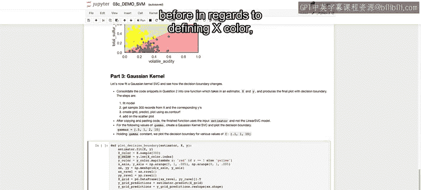

Running that mesh grid in regards to coming up with the X and y values。

 predicting across every single one of those x's and y's。

 and then outputting eventually that plot that we want to see with the decision boundary。

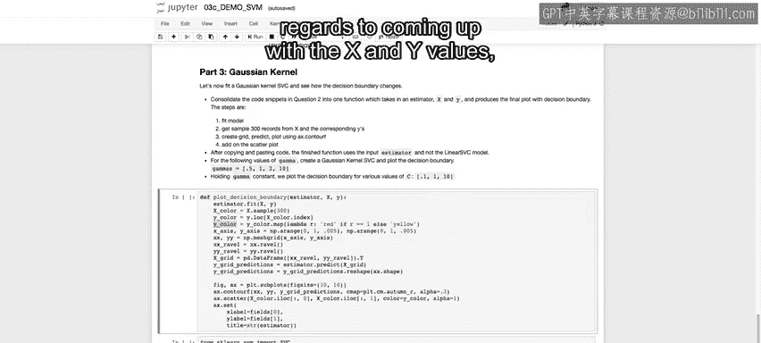

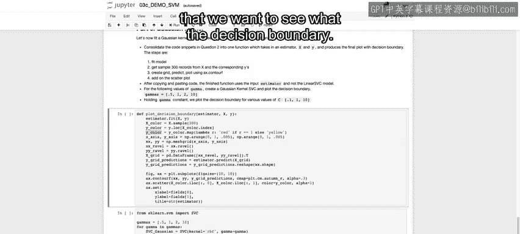

So we're going to create that function called plot decision boundary。

And then we're going to set gammas equal to a list of four different gammas that we're going to run here。

 and for each one of those gammas， we're going to first initiate an SVC model called SVC Gaussian。

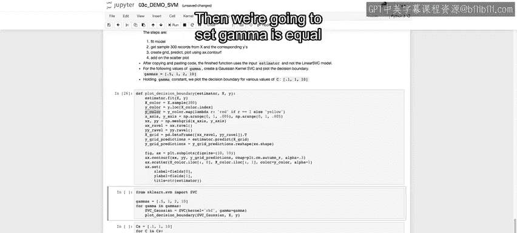

The kernel that we're going to use is going to be that radial basis function that we discussed during lecture。

And the gamma value is going to be 1。5 then 1 then 2 then 10。 And for each one。

 we're going to use that plot decision boundary function that we just defined above。

And plot out each one of the decision boundaries。 And before I do this。

 I want you to think which one will have a more complex model versus a less complex model。

 Which one will have more regularization， More regularization means less complex and which one will have less regularization。

 meaning a more complex model。

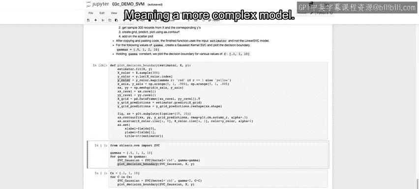

So we run this。And so you'll start plotting out our different gammas in just a second。And similarly。

 we're going to run through each one of our Cs in just a second。 So with the Cs， we're going to have。

 again， increasing from 01 to 1 to 10。 and we're going to call。

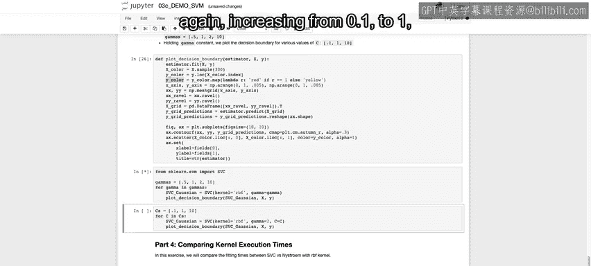

SVC， we're going to say gamma equal to a constant here being two。

 and then we're going to loop through each one of these different C values。 And again， for that。

 I want you to start thinking which ones are going to have higher versus lower values in regards to the amount of regularization。

 So remember， more regularization for， and I want you to think for higher value of C versus lower value of C as well as think about the complexity of the model once you reduce or increase the regularization term。

So we see here。That our gamma is equal to for the first one。

 sorry going back up here should have been 0。5， and we see that here in our model。

 if you look at line 2 here of SVC， we see that gamma is equal to 0。5 towards the end of that line。

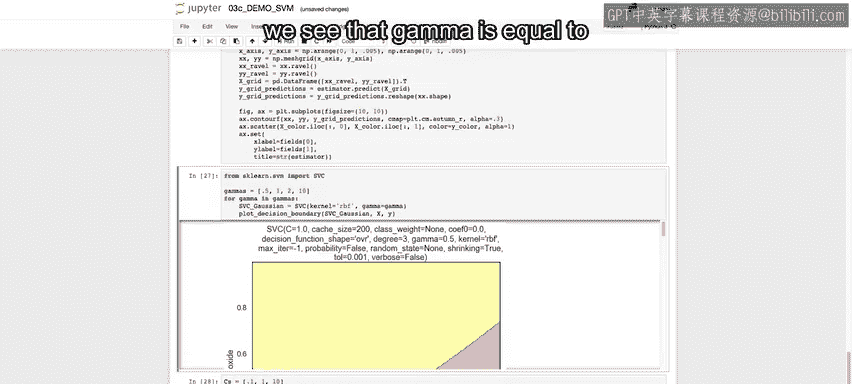

And we see that theres not there's pretty high regularization。 We have a pretty non complex model。

 Remember， high regularization means a not so complex model。

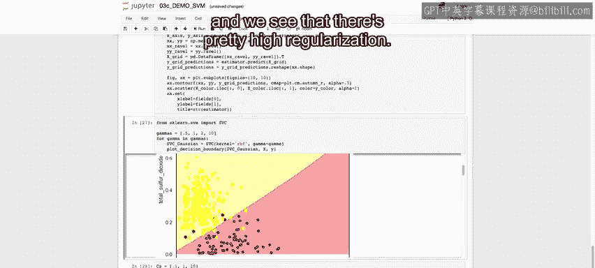

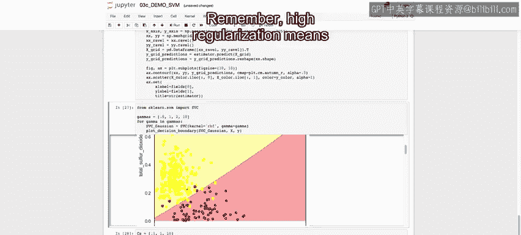

We then increase gamma to one， and we see a bit more curvature in our line。

 so it's a bit more of a complex model。

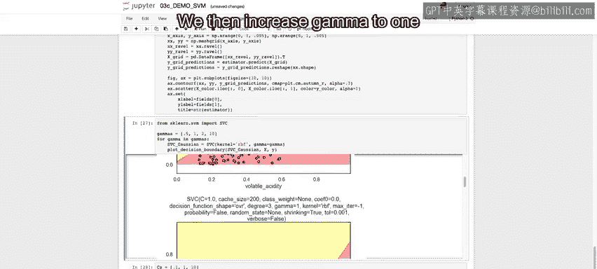

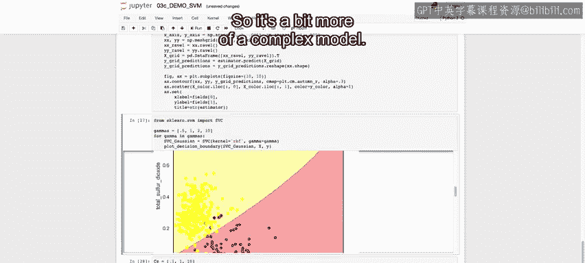

Then when gamma is equal to 2， again， increasing gamma。

 So we're reducing regularization by increasing gamma and therefore coming up with a more complex model because it's less regularization。

 we have even more curvature。 And then when we say gamma equal to 10。

 we see this wavy decision boundary that's getting closer and closer towards overfitting。

 Perhaps this is still a decent decision boundary。 But as we keep increasing gamma。

 we see that we increase the complexity because we're reducing the penalty that we'd have for our regularization terms。

😊。

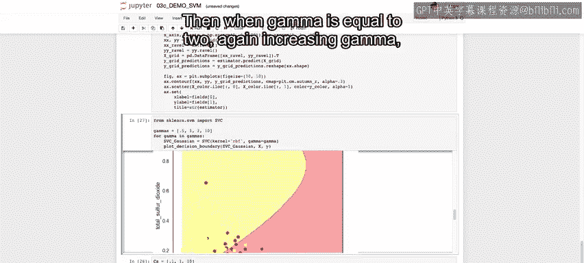

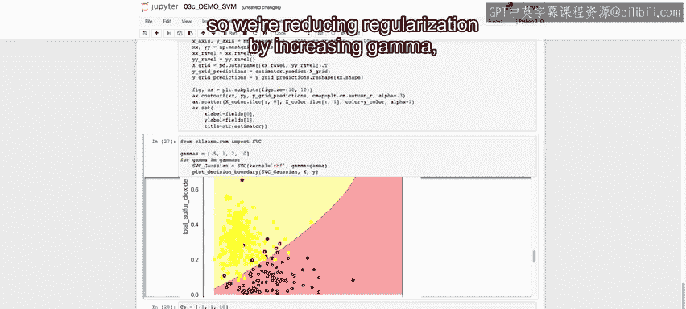

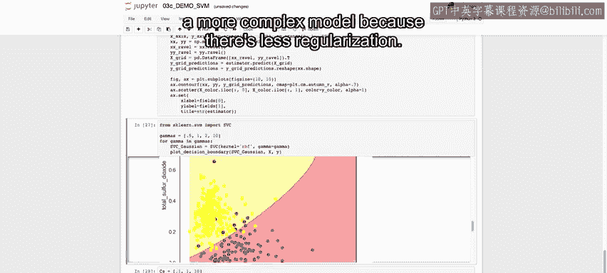

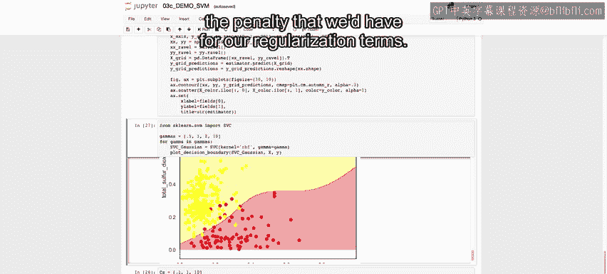

And then the same holds ver C， so it's the same inverse relationship where the lower value of C。

 so here we're starting off with C equals 0。1。

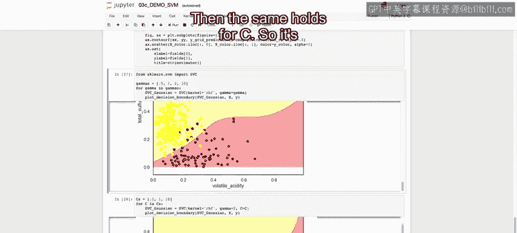

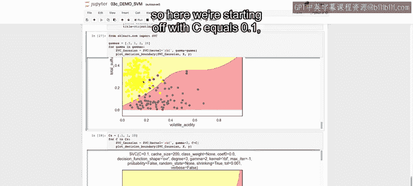

Lower value of C means that we're going to have higher regularization。

 High regularization means a less complex model。 And then as we increase C。

 we see how it gets more and more complex， more and more curvature to our model。

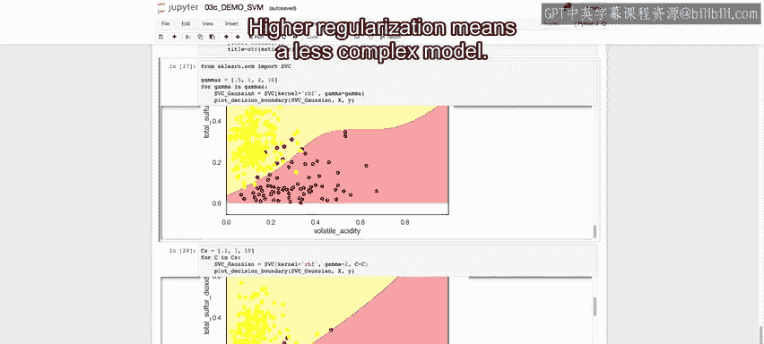

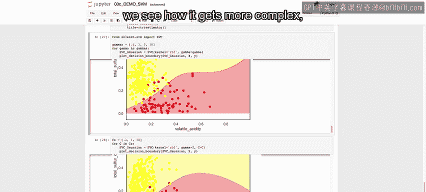

So that's how we're going to see how this distance from boundaries is actually created when we're creating our linear SVC。

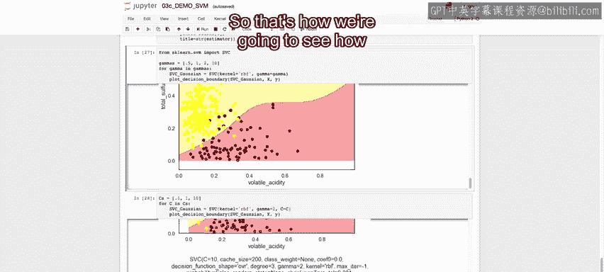

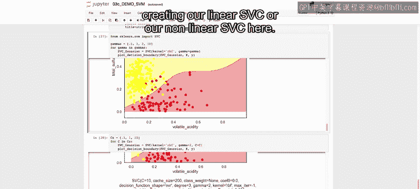

Or our nonlinear SBC here。

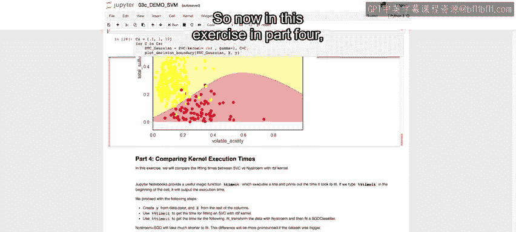

So now in this exercise in part4。We want to start talking about the timing of working with our datasets。

 and we discussed the different options when we have either a lot of features or if we have a large data set and whether we should use just the plain linear classifier or if we should use the SVC。

 which we just did， or if ultimately we have such a large data set。

 that we should instead use a kernel approximation。

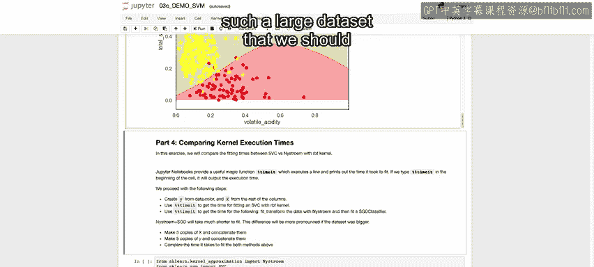

So we're going to run through each one of these， and we're going to time how long it takes for it to run when we're just using the plain linear SVC。

 not the linear SVC， but the SVC with an RBF kernel， as well as using a nicero approximation。

So first， we are going to import Ntroom。Import our SVC。

 and then this SGD classifier is going to be a way of even speeding up our linear classification。

 so not only are we approximating our mapping to higher dimensions。

 but are also going to come up with a bit of an approximation to our linear classifier as well。

So we have y equal to data do color equals equals red， that's going to be our true or false values。

And then our x is just going to be all of our columns except for that red。

 So now we're using all of our columns for x， rather than just using those two columns that we had defined for x before。

We're then using。KW A R GS， and we can pass that in。

 That's just something that you pass in within Python。 as long as you pass in a dictionary。

 you're saying for the kernel argument， I want to pass an RBF。

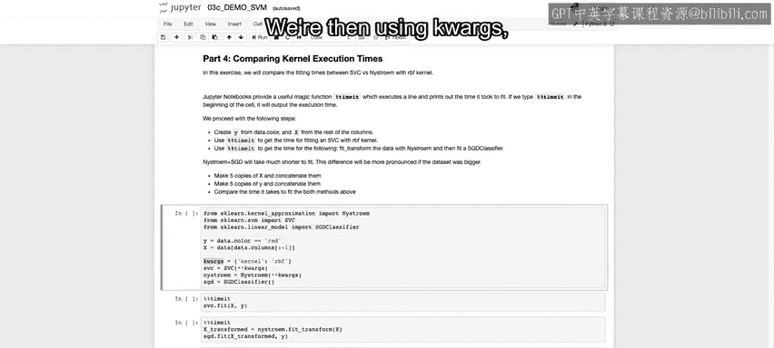

And then the same holds for nitro。So we run this。

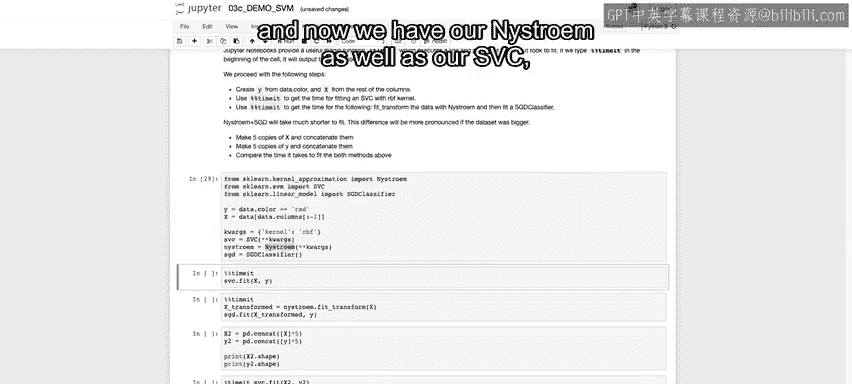

And that we have our nice room as well as our SVC， and we can call SVc。fit。

And see how long that takes， we have this timeit functionality here running and it' taking some time。

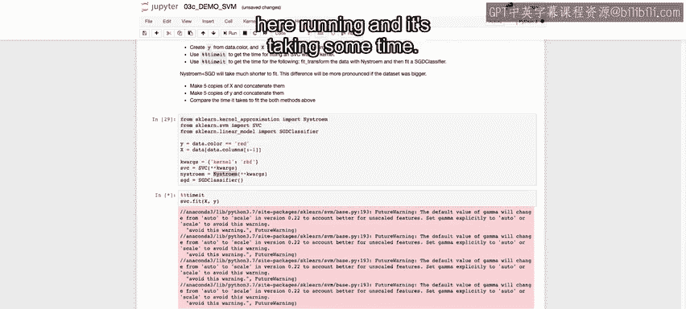

And then and this should take some time and this is the point that we're trying to get across that we're getting。

 it takes about 1。3 seconds with a confidence interval of plus or minus 252 milliseconds。

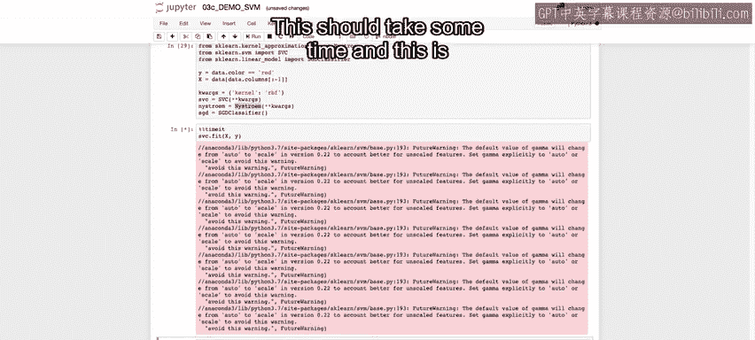

And now， if instead we use nice shown and then transform our X into a higher dimensional space。

And we pass in。Our x transformed and our Y into our SGD classifier that we defined earlier。

We can see the timing here。And we're going to hold on just a second， it should be a bit faster。

And we see it's 102 milliseconds plus or minus 21。3 milliseconds。

 It runs through a couple of times to get a comp interval on how long it'll take。

 This may be a bit different for you， but what we see here is that it's running about 10 times faster than our initial data with just SVC。

And then what we're going to do here is expand that out by five times as much and the idea being when we have a very large data set。

10 times something thing， 10 times the amount of time。

Can end up being a huge difference if you're thinking about something that may take a full data run versus a full 10 days to run and then a full week versus 10 weeks to run。

 these things can happen once you come up with more complex models。

 so you want to ensure that you're using something like an approximation to make sure you're on the right track。

So here we're just creating a data set that's five times as large as the initial。

 and this will take some time to run。And then we can time it here as well。

Now I'm going to pause here and we'll come back and we'll see the times in just a second and then we'll close out this video。

Now if we look at the results here。We see that4 S DC on its own。 It took 23 seconds to run。

Whereas when we were looking at the nice showm。 So first transforming our data to higher dimensions and then running SGD as our linear classifier。

 it took less than a second to run。 So you see this vast difference between the timing of just using SVC versus using the kernel approximation along with the linear classifier。

So if you're using larger data sets， we generally advise that you should be using a kernel approximation first。

Now， just to make clear the steps that go into coming up with a kernel approximation。

We see here that we are either just running our regular SVC。

Or we're doing it in two steps， running nice drone in order to map the higher dimensions and then SGD as our linear classifier。

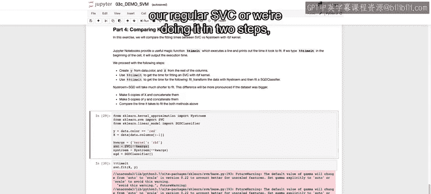

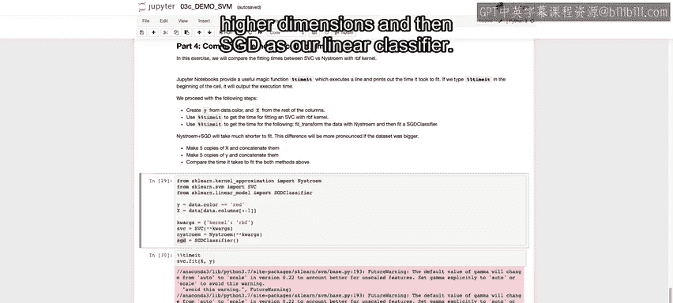

And if we look down here at our。Transform data。Let's just run this first let's look at。Just X。

When we see original x has 12 columns， and then when we look at x transforms。

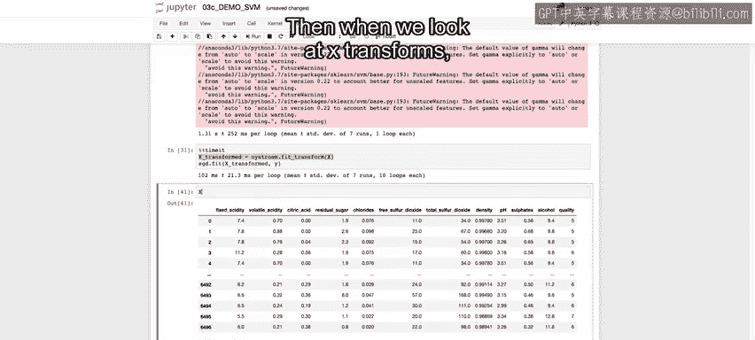

And let's look at the shape here。

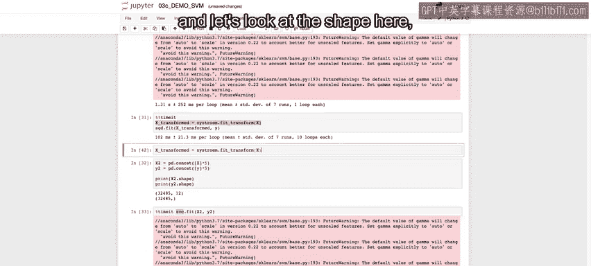

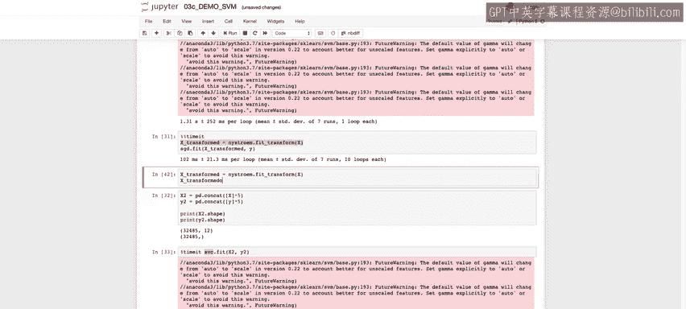

You see that we now have 100 columns， and that's because the default for those number of components。

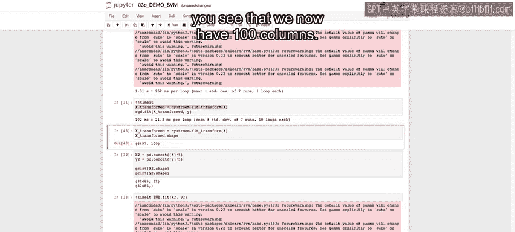

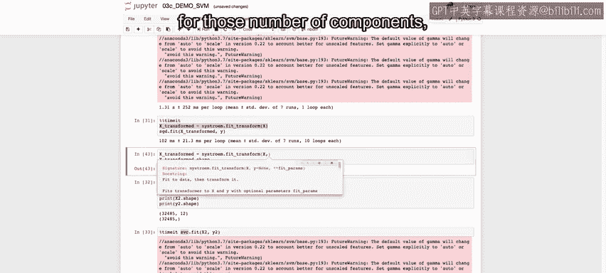

Oh， this is going to be when we actually initiate Ntro。 the defaults is going to be。

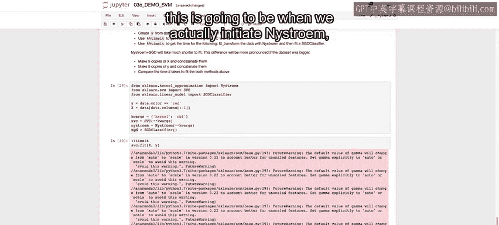

Number of components equal to 100， so we're going to end up with 100 columns。

 so our data set is going to be that much higher dimensional space， 100 columns。

 and then we would go from there。So that closed out our section on working with support vector machines。

 and I look forward to seeing you back in lecture where we'll pick up with our next classification method decision trees。

 All right， I'll see you there。😊。

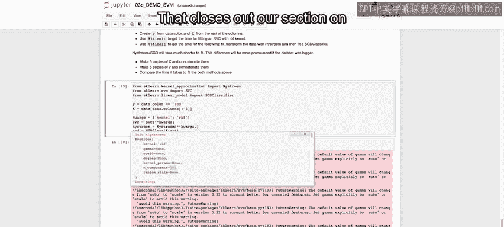

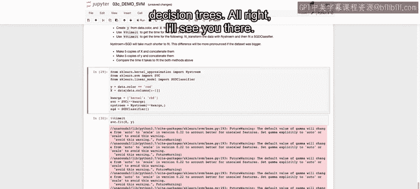

