# IBM《机器学习（数据探索、监督学习的回归和分类）｜machine learning》中英字幕 - P121：32_分类器概览.zh_en - GPT中英字幕课程资源 - BV1xM4m1D7kY

In this section， we'll move on to discussing our next machine learning model decision treat。

So let's go over the learning goals for this section in this section we're going to cover a brief overview of the classification problems that we discussed earlier。

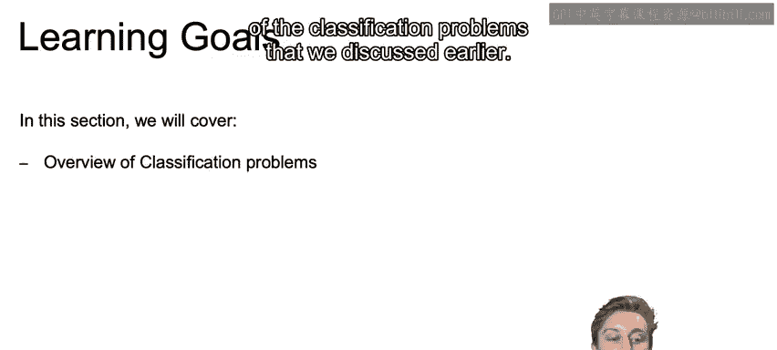

We're going to go over the actual decision tree classification algorithm and how it works。

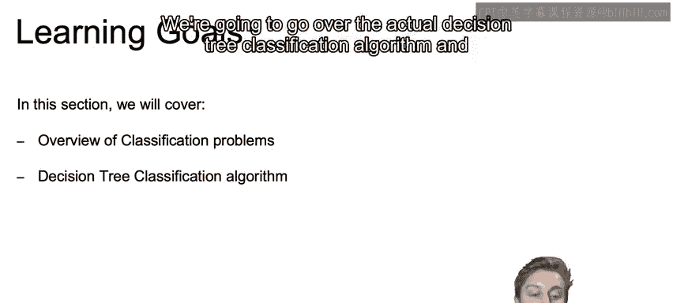

Were they going to dive deeper into how the splits are actually performed when we do decision trees using both entropy and information gain？

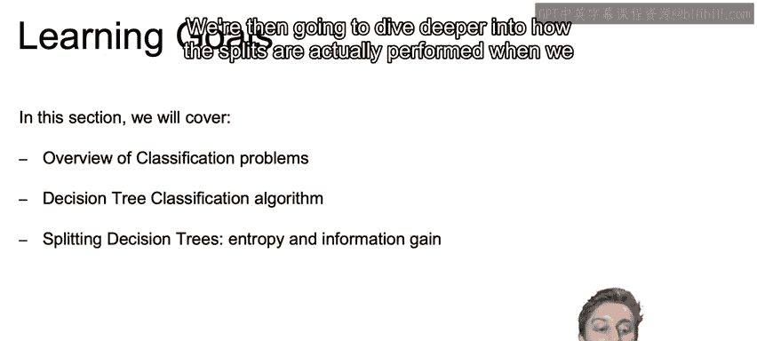

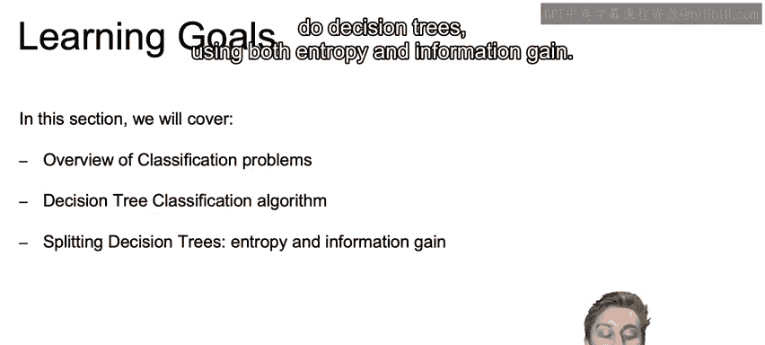

And then finally， we're going to discuss how to regularize our tree using something called pruning in order to address overfitting。

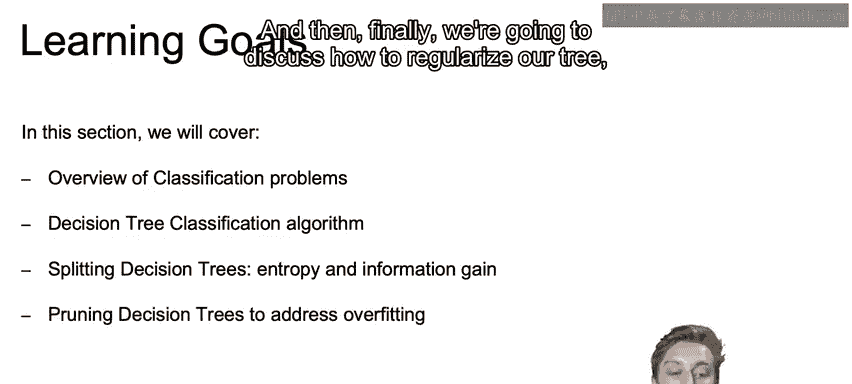

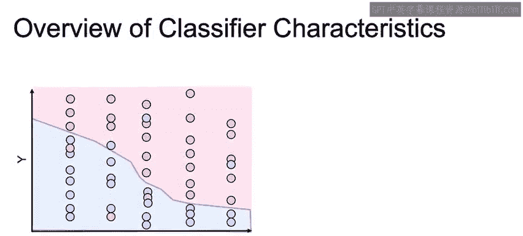

Let's start with a brief review of some classification algorithms we've discussed thus far and give a brief overview of their pros and cons。

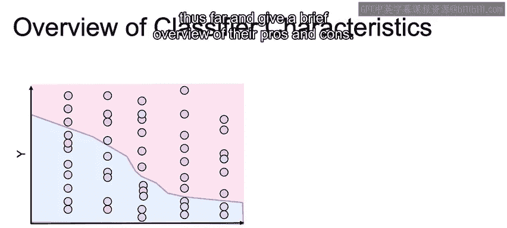

So with K nearest neighbors， the fitting is fast since with K andN。

 the training data is the model and there's going to be no computation needed at fit time again。

 the training data is the model so there's no extra computation needed。

 you just have it fit as soon as you call fit。

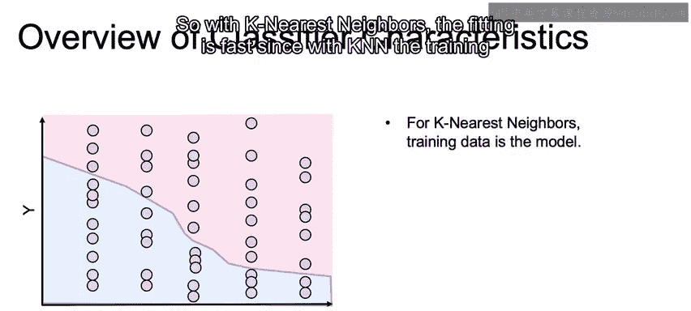

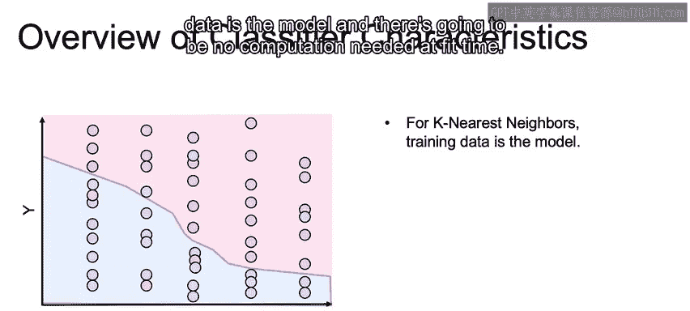

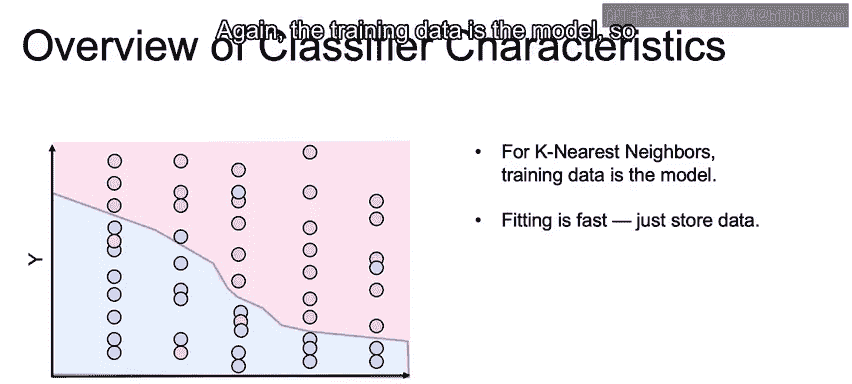

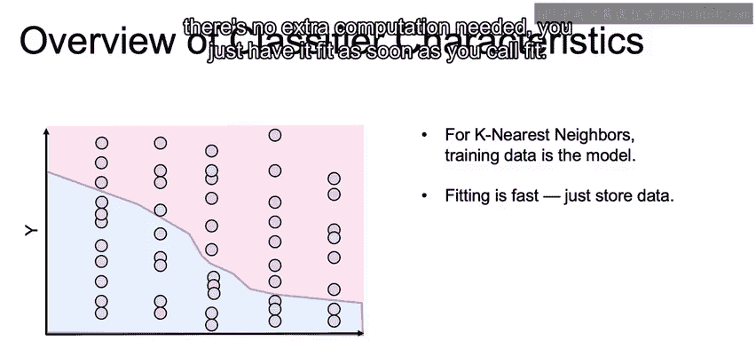

But predicting the class for a new record can be very slow， since as we discussed。

 it involves identifying the CA nearest neighbors for a certain record。

 so we have a lot of different distances to compute so this can really slow down the algorithm。

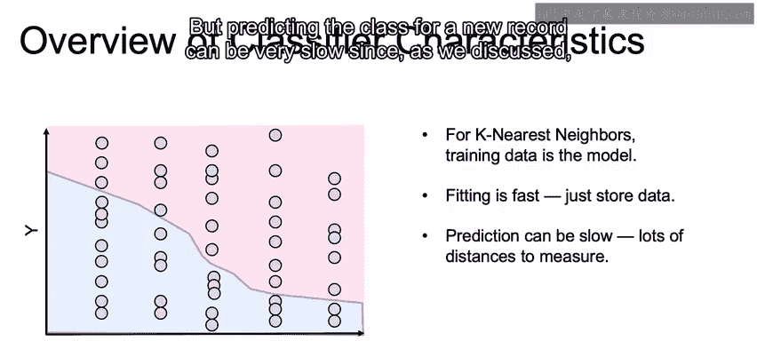

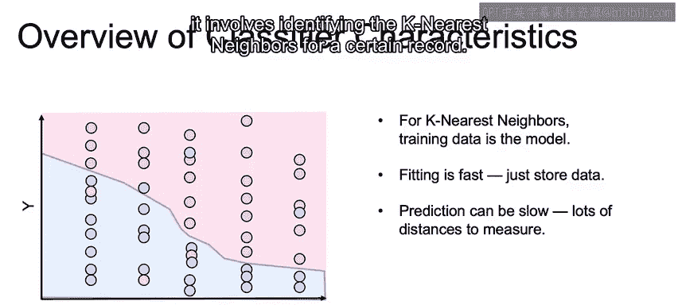

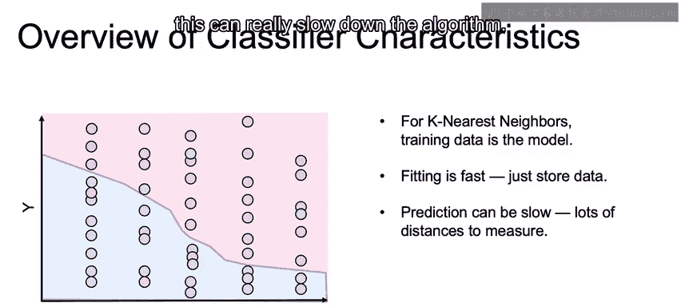

And then our decision boundary is very flexible， so most likely not some easily visually recognizable shape such as say a straight line that we'd get with a linear support vector machine or linear logistic regression。

 probably something a bit curviier like we see here to the left。

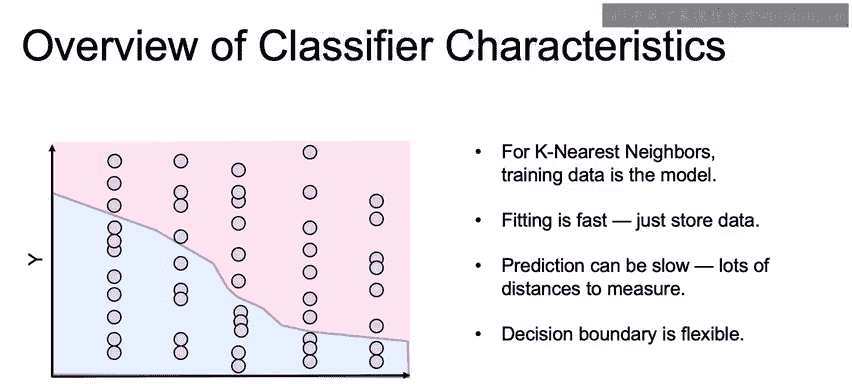

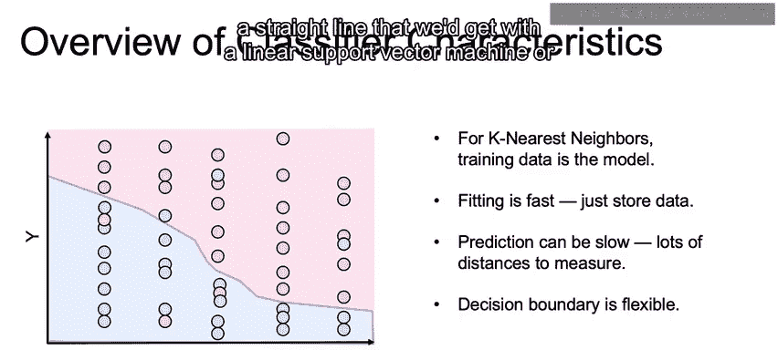

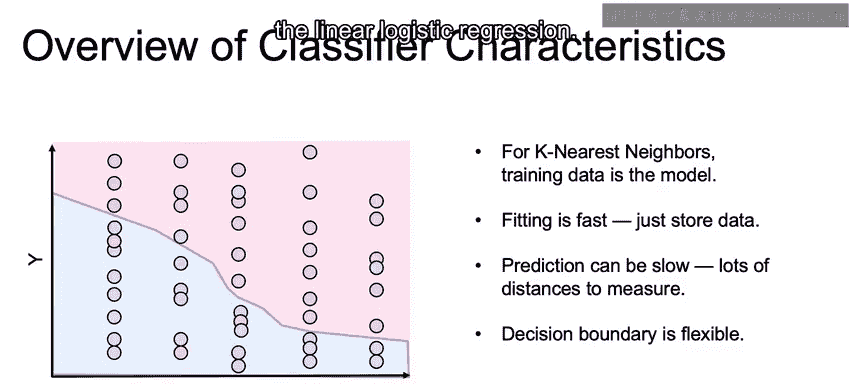

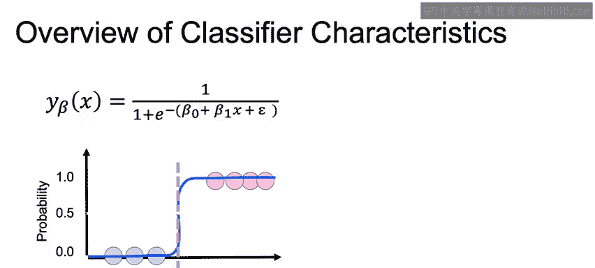

Now moving to logistic regression。With logistic regression。

 it's going to be learning a bunch of parameter values， so beta beta 1。

 so fitting is going to involve solving equations and running iterations， etc cetera。

 to find those parameters， and that fitting process can be very slow。

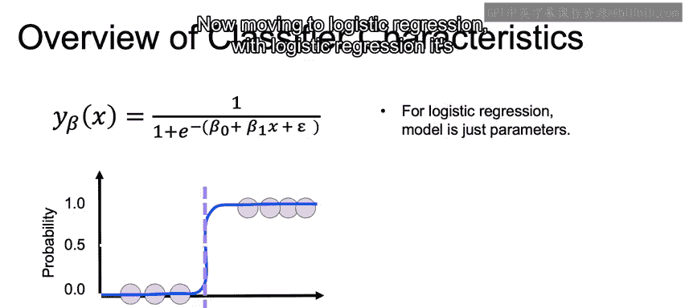

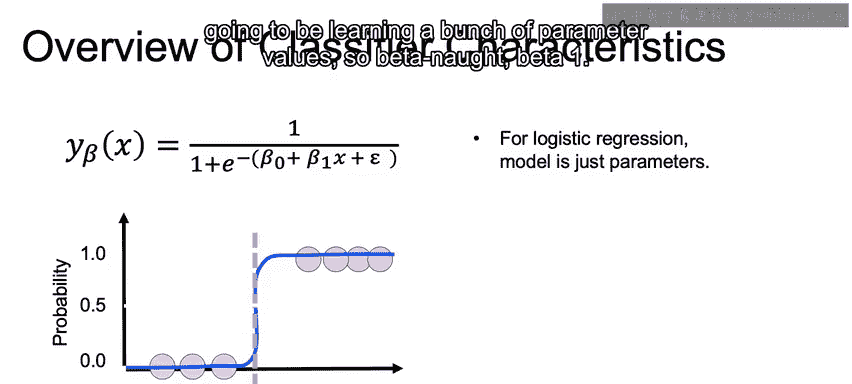

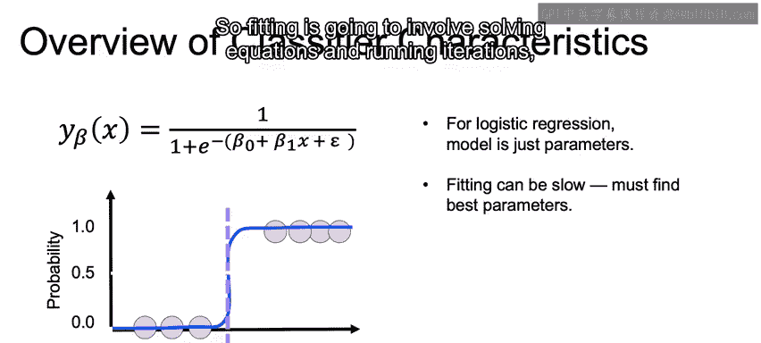

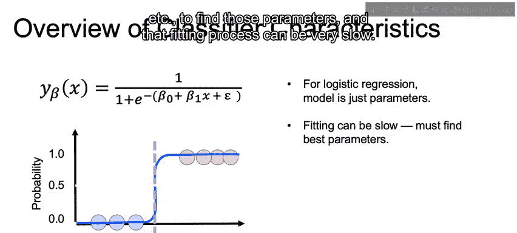

But predicting on the other hand， is just a short sequence of multiplications， additions。

 and exponnunciation depending on what your parameters are。

 so it's pretty fast to actually predict the value。

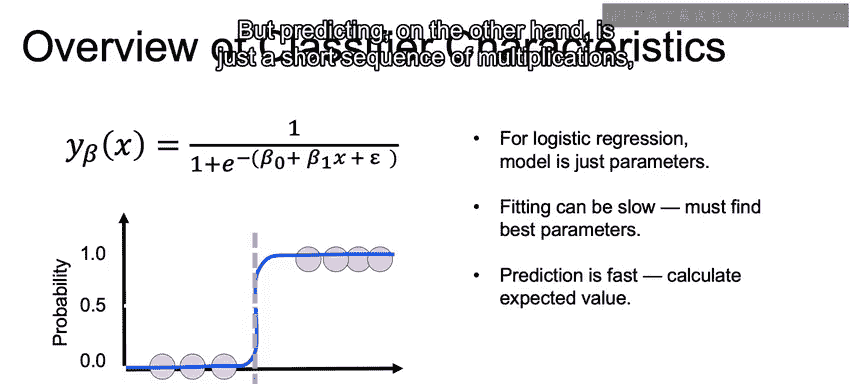

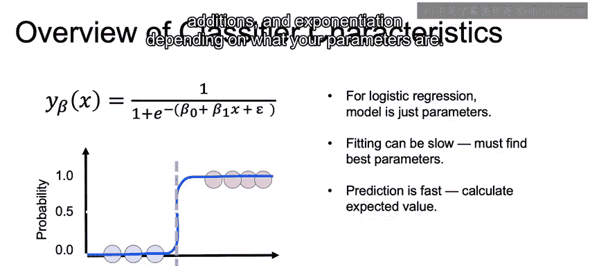

And then our decision boundary is going to be linear。

 and we also again introduce the support vector machines。

 which are linear classifications that are either simple and linear， so pretty simple boundaries。

 linear and probably fast compute or require the kernel trick to come up with a nonlinear classification。

 which will take a lot longer to actually fit the model。

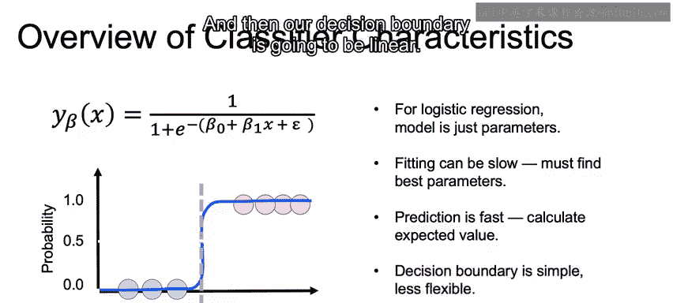

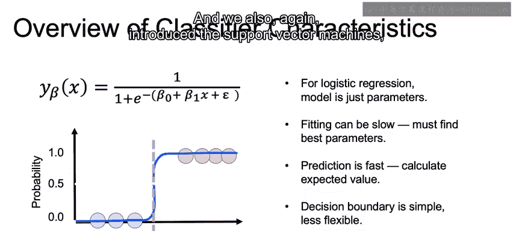

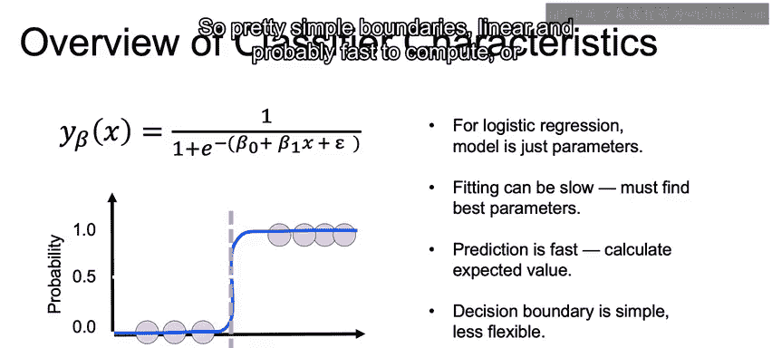

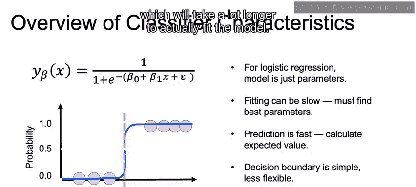