# IBM《机器学习（数据探索、监督学习的回归和分类）｜machine learning》中英字幕 - P124：35_基于熵的分割.zh_en - GPT中英字幕课程资源 - BV1xM4m1D7kY

Now， we're going to introduce a new ametric called entropy。

 and our new ametric to find the best split will be defined by this equation。

H of T equals the negative sum of I given T times of log of probability of I given T。

 and similar to before P of I given T is just going to be the probability of a class。

 given the certain subset of data we are currently working in。

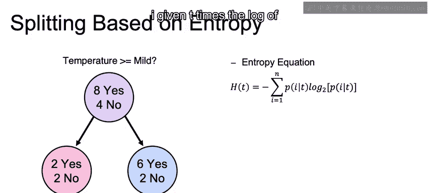

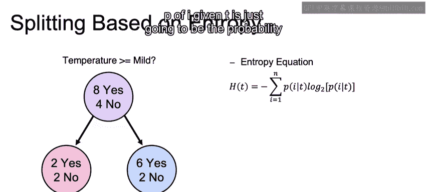

So this equation becomes the sum of8 over 12。

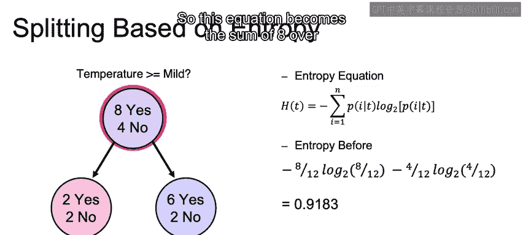

Times log 2 of 8 over 12 for the positive class。

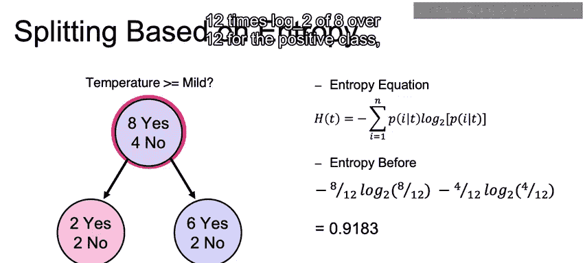

And 4 over 12 times log  to a 4 over 12 for the negative class。

 So that's just working with that top node there and giving each of the two possible outcomes。

 So we have the 8 over 12 for one proportion and 4 over 12 for the other proportion working within that top node。

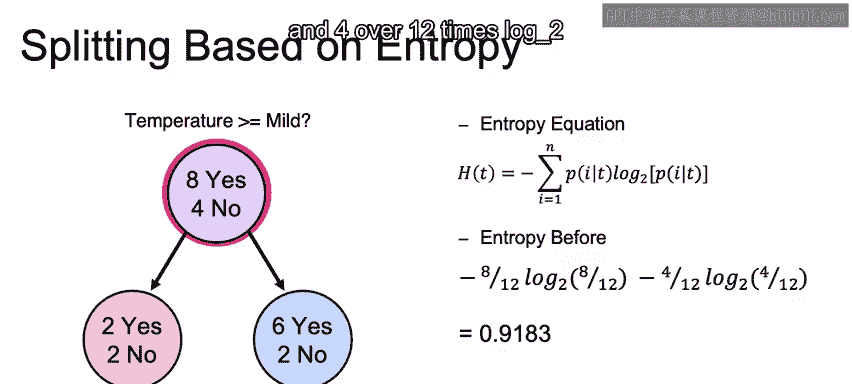

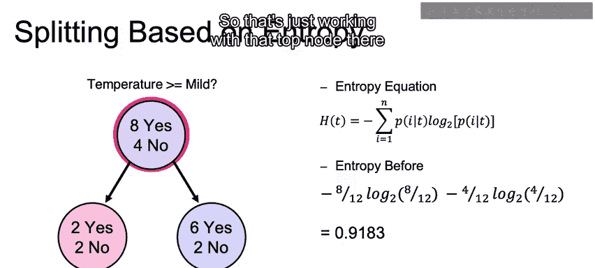

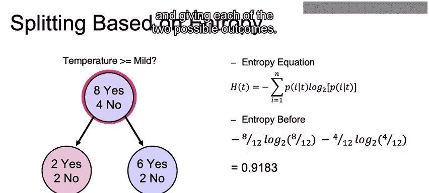

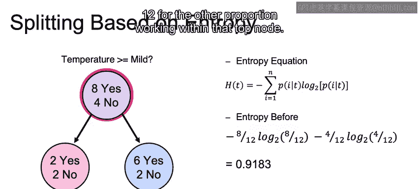

We then multiply that sum by negative one as the equation states。

 and we have an initial entropy of 0。9183。 Nena eventually reduced that by going down nodes and getting the weighted average of each of the entroies。

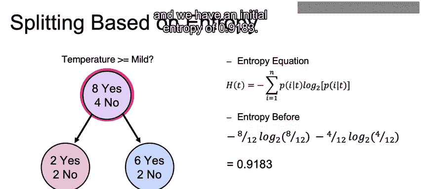

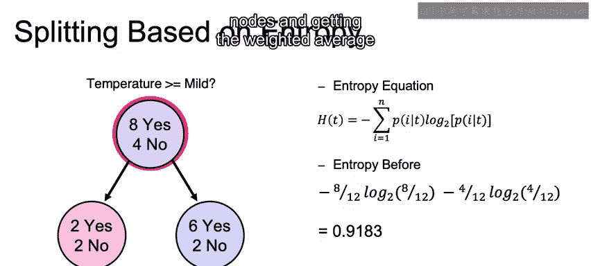

So now let's get the entropy of our two child notes。

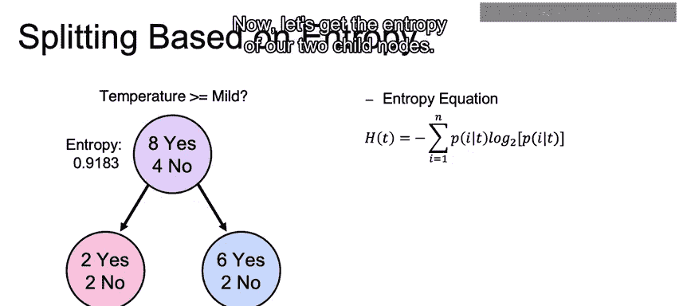

On the left， we have negative two fourth times log 2 of24 minus again。

 two fourth times log2 of two fourths， because they're going to be equal for both the positive and negative classier。

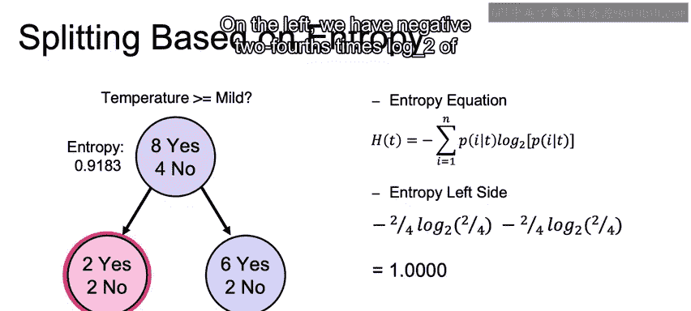

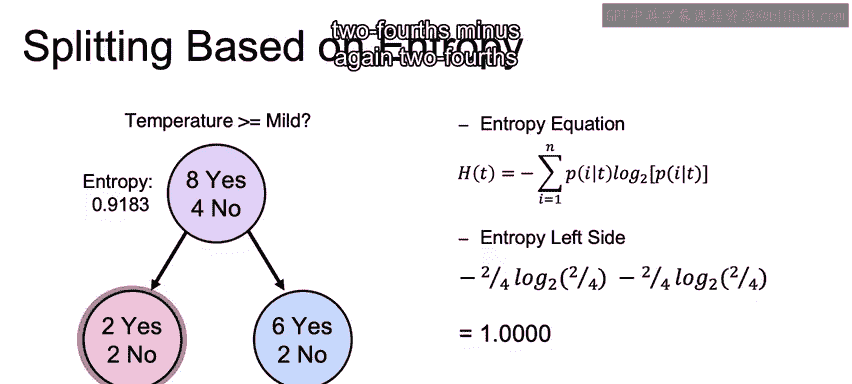

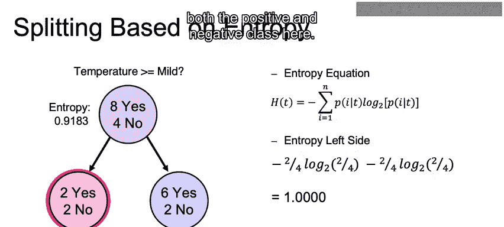

Then on the right。

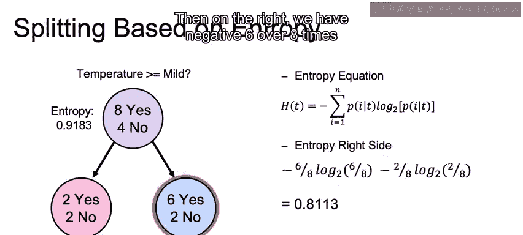

We have negative 6 over 8 times log 2 of 6 over 82 over 8 times log 2 of2 over 8。

 and the entropy on the right side will be equal to 0。8113。

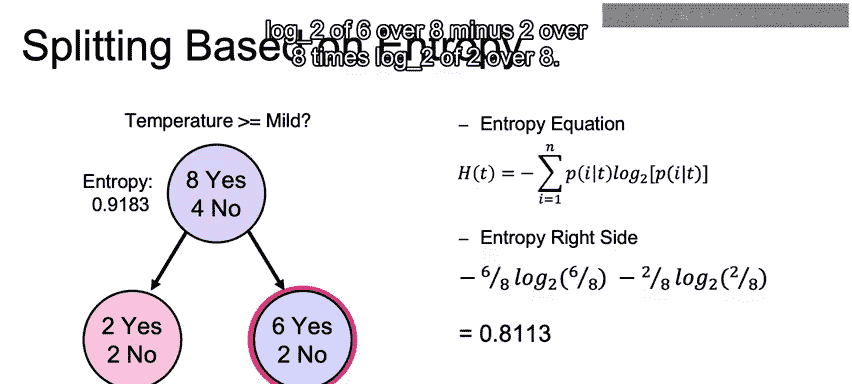

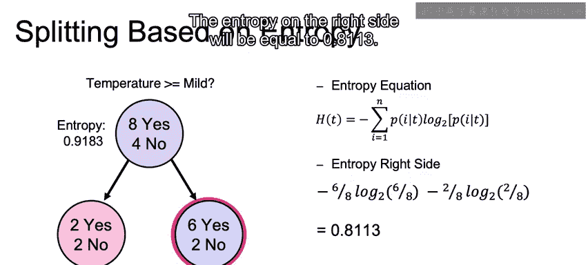

We can then take the weighted average of each， as we did with that classification error。

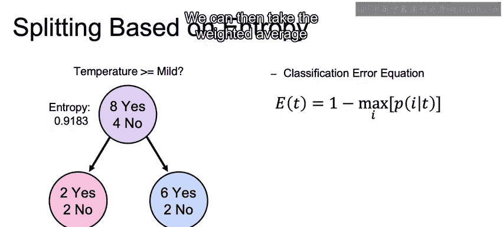

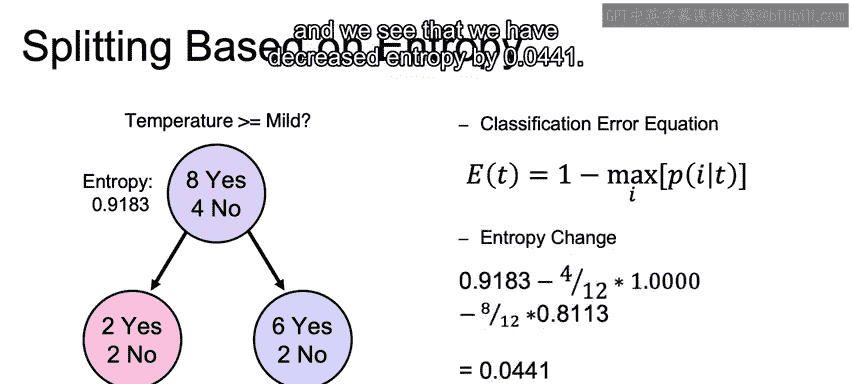

And we see that we have decreased entropy by 0。0441。

 So here rather than the entropy being exactly the same。

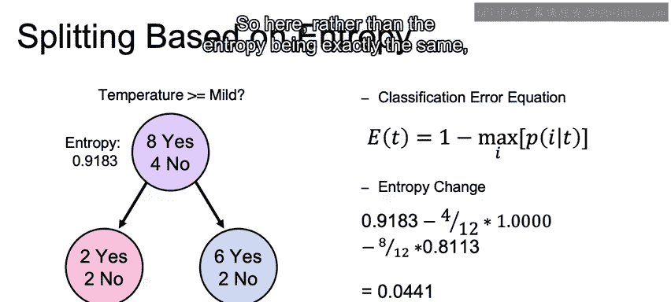

When we take the weighted average， according to how much of the subset from our parent node went into each one of the child nodes。

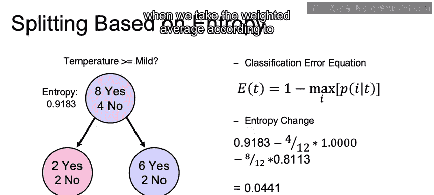

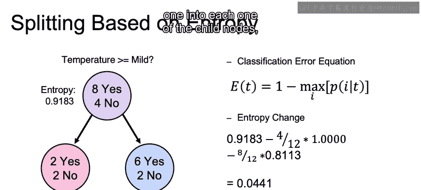

We see that the entropy has decreased by 0。0441。

Since we were able to have information gained when we use entropy。

 we now can allow for further splitting down the line。

 rather than that early stopping that we saw with the classification error。😊。

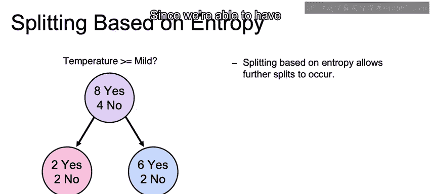

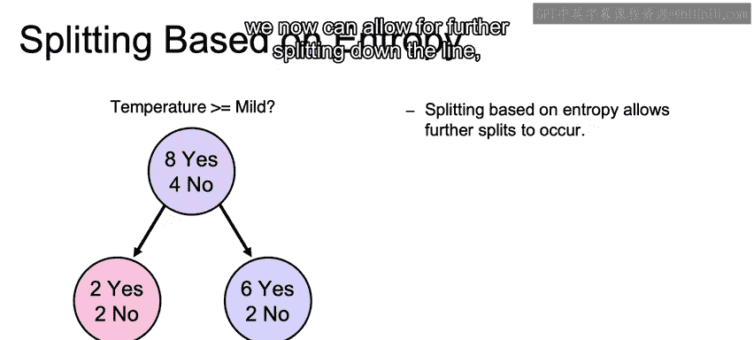

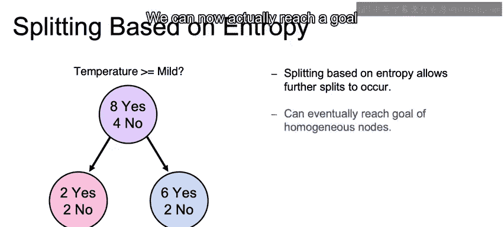

And we can now actually reach a goal of having all homogeneous notes。

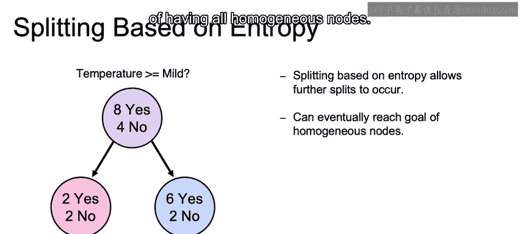

Now in the next video， we're going to dive deeper into why entropy actually works where classification tends to fail。

All right， I'll see you there。

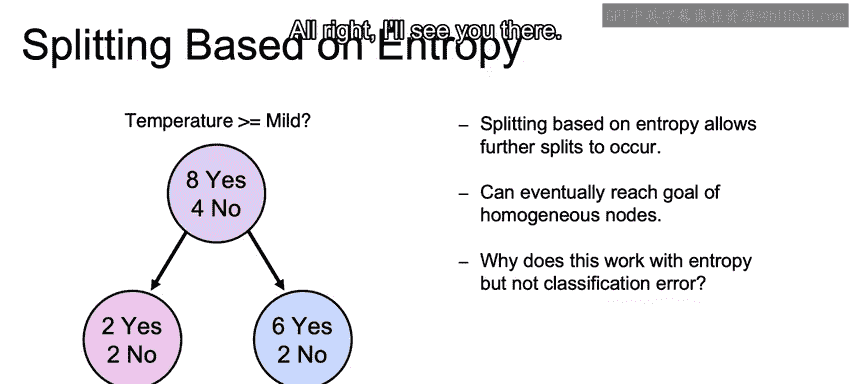

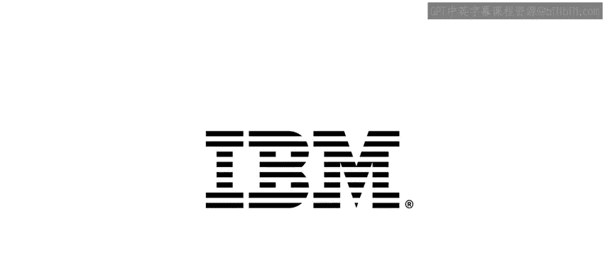