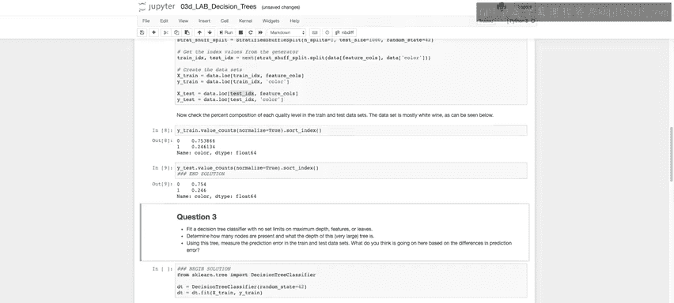

# IBM《机器学习（数据探索、监督学习的回归和分类）｜machine learning》中英字幕 - P127：38_决策树笔记本（选修部分）第1部分.zh_en - GPT中英字幕课程资源 - BV1xM4m1D7kY

Welcome to our notebook here on Decion trees Once again we're going to be using the W quality data CSV file。

 so we're going to use our classification algorithm in order to predict red or white wine and then later on we're also going to show how we can use a decision tree for regression or regression tree and there we're going to predict residual sugar and we'll see that later on。

So as usual we import the necessary libraries we're again going to change our directory to data so that we can import our color scheme as well as quickly access the file that we have within that data folder。

So again， we pass into winequalitydata。csv as the CSsv that we want to read in。

We can then look at the top five rows， and we see that we have， as before， the fixed acidity。

 the volatile acidity， citric acid， so on and so forth， as well as at the way end， we have the color。

 which is either currently red or white， and nor were going to have to transfer that to either zeros and ones。

So then when we look at the data types， we see that the majority of them are going to be floats。

 one of them being an integer， but almost all of them numerical except for that color variable。Now。

 now we discussed in lecture how we need to ensure when we run a decision tree using SK learn that we are doing a binary split。

 So it's going to take something that is a float and then create a binary variable。

 either true or false out of that float column。 So how does it do that in practice。

 We're not going to have to transform each of these and come up with each one of those binary variables。

Instead， it's going to search through each one of our floats and see which one of those is going to increase information gain the most。

And using the either genie index that we discussed or entropy that we discussed in order to measure how much we are increasing our information gain。

And then it will decide using that binary split， searching through all the different thresholds for that split。

 which one has the greatest increase in information gain。

So we're then going to convert our color to either 0，1， depending on whether we have white or red。

 Here we see that we set white equal to 0 using the dot replace。 So similar to before。

 there's different methods to doing this。 you do dot replace for white 0。 And then for red。

 we replace it with one。We call as type integer， that's just in case we didn't cover all our bases。

 it would have aired out if we still have， say yellow or something else that's falling into this category。

We run this， everything runs cleanly， so now we should have only zeros and ones。

Or at least all integers， but they will be just zeros and ones。

Next thing that we want to do in question number two。Is split our data into train and test sets。

And we're going to stratify that by our wine color to ensure that our outcome variable has the same proportion in both our training set and our test set。

 And we saw how to do this when we worked through the logistic regression notebook using that stratified shuffle split within that model selection library in Escalar。

So。And then afterwards， we're going to confirm that we have that split。

 so that's the second portion of question two is to ensure that after we do our train and test split。

 that both our train and test set have the same proportion of the color of that Y variable。

So we're saying our feature columns are every single column， x for x and data。 columns。

 as long as that columns not color because that's going to be our outcome variable。

We're then going to。Initiate after we。First， import our stratified Cheuffel split function。

We're going to initiate our strap shuffle split object。

We're going to say that that object only has one split， we only want to split once。

We're setting our test size here equal to 1000， often we've been using a percentage and that would have worked as well 0。

2。1， but you can also set out an actual integer greater than one， and that will be the actual size。

 the actual number of rows that will be held out for our test set。And then again。

 our random states are that me and you are looking at the same data as we move forward。Now， now。

 once we have our objects， our str shuffle split， we can call on it the split method。

 And within that split method， we pass in our X， each one of our features， as well as our Y。

 which will ensure that we're stratified on this y。

And that will output both a train index and a test index， just being those indices。

And then in order to create our X train Y train and X test Y test。

 we just call dot Lo or dot I Lo and get our train index as well as our feature columns。

So train index is going to be our rows， which is what we just pulled out。

By calling next on that stretch subtlele split dot split on our x and Y variables。

 So that's going to be our row index。 And then we just want for x train for our x to have all of the feature columns。

 And then we want that same index。 So the same rows。 But now specific only to the outcome column。

 only to that color。And then for excesss， we just do the same thing。

 but our rows are going to be the test index rather than that train index。So we run that。

And then we can test for why train what the value counts are。HowWhat proportion of our。

Colors are either zero or one， red or white。So， again， when we call normalized equals true。

 then it will divide by the total。 So we get the actual percentage。

 and then we can see the same for a y test that were around 75。04 to 24。

6 in regards to the breakdown。So we see that it did a good job of actually stratifying our split。

 ensuring that we had the same proportion in both our train and test set。

 and now we're ready to move forward and using these in order to actually fit a decision tree classifier。

 So with that， we will leave it off here。 and we will pick up by actually creating our first decision tree classifier using Ecalar。

😊，All right， I'll see you there。

