# IBM《机器学习（数据探索、监督学习的回归和分类）｜machine learning》中英字幕 - P12：11_从数据库、API和云中检索数据.zh_en - GPT中英字幕课程资源 - BV1xM4m1D7kY

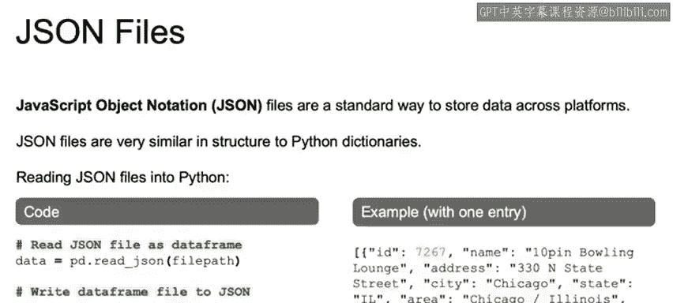

Now let's talk about working with SQL databases SQL stands for structured query language。

 and that's going to be the set of highly structured relational databases with fixed schema Now there are many types of SQL databases and they'll function similarly with some subtle differences in syntax。

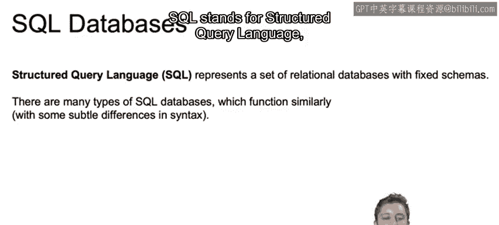

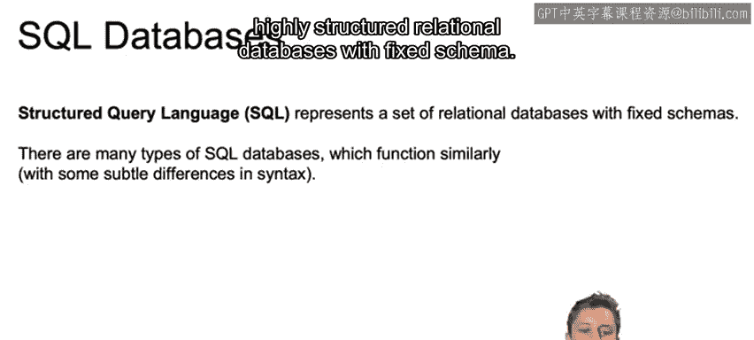

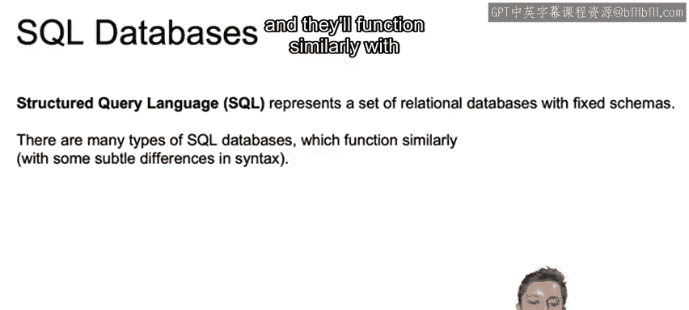

Examples of SQL databases you may be used to are MicrosoftSQL Server， Postgress， MySQL， AWS Redshift。

 Oracle DB， and the DB2 family for IBM， and using the right Python library with some subtle changes。

 you should be able to connect to the database that you use in your workforce and use the example that we see here in order to actually pull out data from your SQL databases。

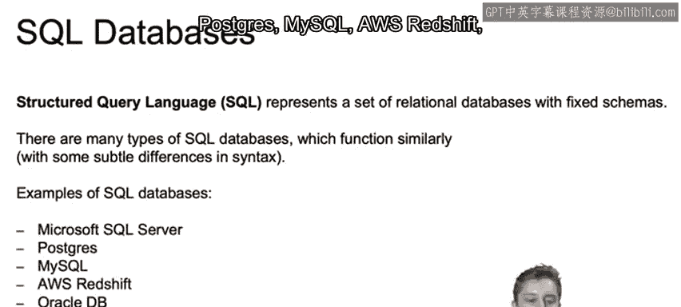

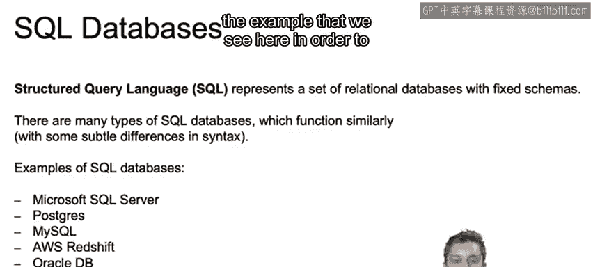

So this example。Is going to be using S Q light 3。 Some other packages that are popular are SQL alchemy。

 which will work for a number of different SQL databases。 Pscho P G2 for Postgres。

 IBM underscore D B for the D B2 family。

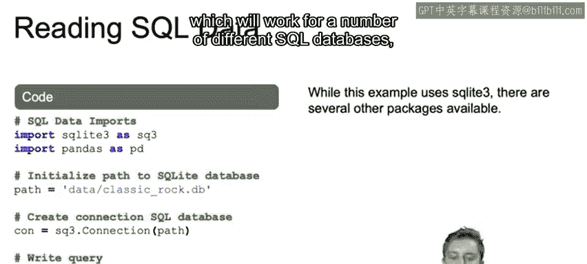

And here we're going to， if we look to the code on the left， import the library specific the EQite3。

 just called EQite 3， as well as importing panda's SPD。

Our next step is going to be to initialize the path to our SQite database。

 We're going to set the variable path equal to the string data that's going to be our folder where our database lives。

 and then the name of the database is classic_ rock。 Db。

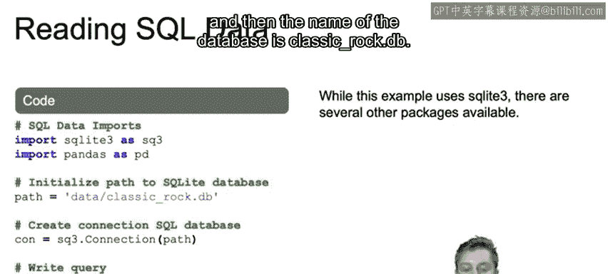

And then using this path， we can then establish a connection to our database。

 so we create a connection to our SQL database by just using our library SQ3 and saying SQ3。

 connectionnection， we're going to use that function that's available within that library and pass in the argument of the path that we just created。

And we're going to set the output of SQ3。 connection to con。

 and now we have a variable that is equal to that connection。

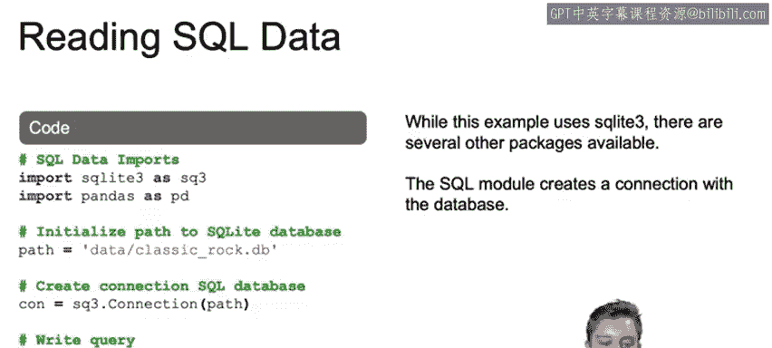

Then we will write the actual query so we can write a SQL query within Python。

 so all we do is write out that string， select star from rockong。

 rockong is going to be a table within our database， we're going to select all the values。

 and we set that string equal to query， and then we pass that into our readSQL function available with pandas。

 and we just pass in the query as well as the connection that we establish earlier。

 and that will output a pandas data frame。

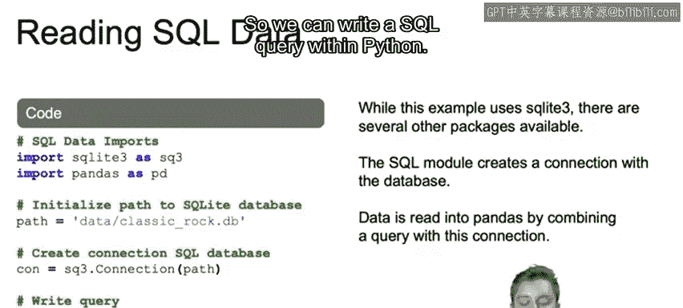

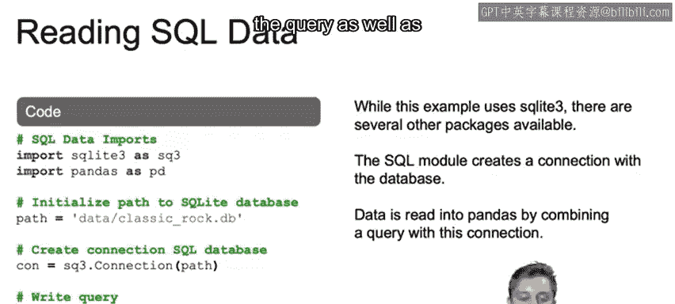

So we've learned how to use SQL， let's now move into working with No SQL databases。

 those are going to be nonreal databases and they'll vary a lot more in structure。

 and depending on the application it may perform more quickly or reduce technical overhead compared to the structure of SQL format。

Most No SQL databases are going to store data in the JSON format that we toucheded on earlier。

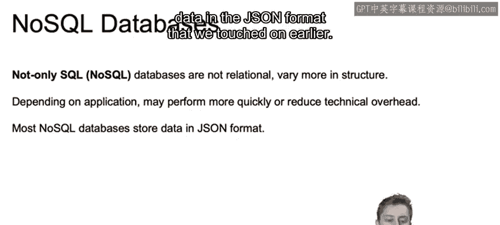

Some examples of No SQL databases are document databases。

 and that's going to contain documents where each document is like one observation。

 you think about the JSON files， those would each be a actual document。

 each one of those dictionaries。

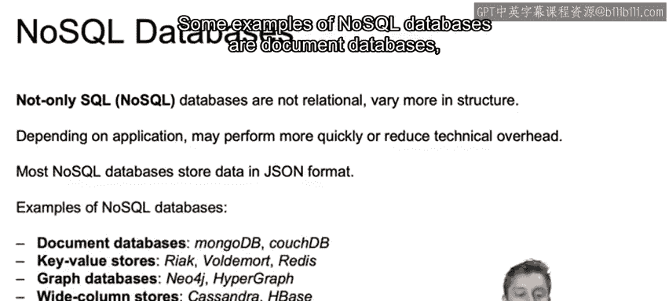

The key value type is going to be key in value where the key is the lookup。

 think of having a primary key such as an ID， and then your values would be if the ID is a person。

 their name， their age， their address， etc we have graph databases which are going to be used for network analysis and is great for maintaining relationships think LinkedIn and you have your first levelve connection。

 second levelvel connection and third levelvel connections and how those are all maintained in order to see the relationship between one person and the other。

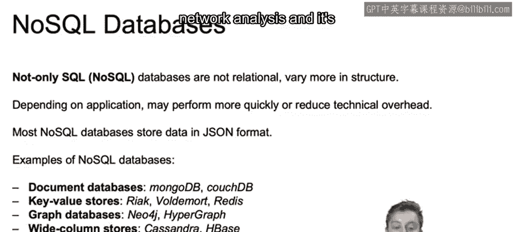

And there are wide column families， and that's going to be where all of your columns are collected together in a certain column family。

 So for a person you may have their personal details in one column family。

 and then their professional details in another column family where the personal would be column such as name。

 location， age， and their professional column family would be something like experience skills。

 whether or not they have a visa， etc ce。

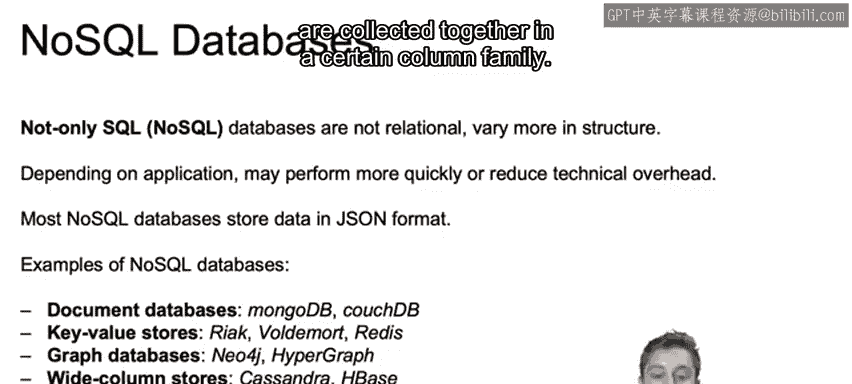

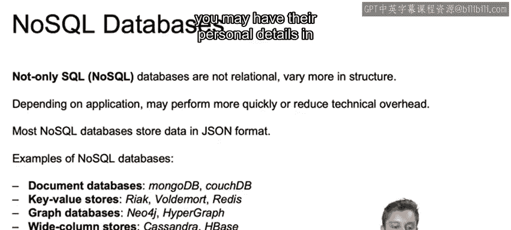

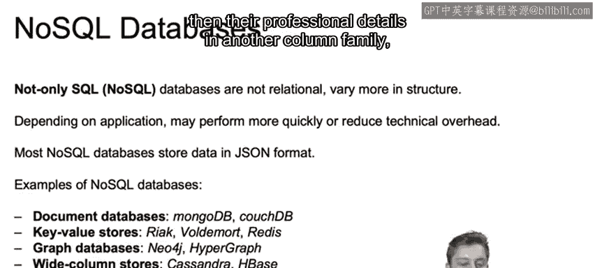

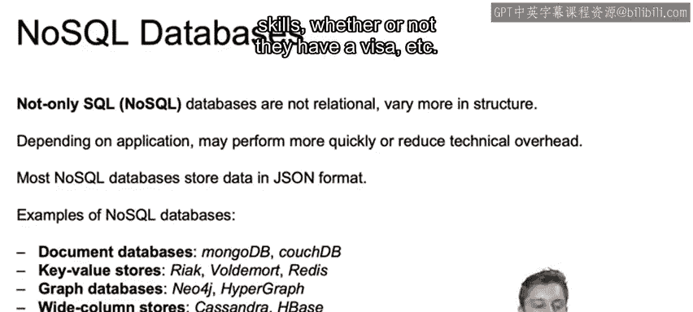

So let's look at the Python code needed to read from a No SQL database。

Now we're going to show here how to pull from a MongoDB database。

 which is very popular database when it comes to NoSQL databases， but as we saw earlier。

 there are many different NoSQL databases that we can be pulling from。

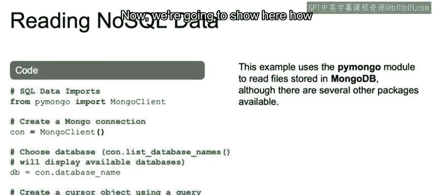

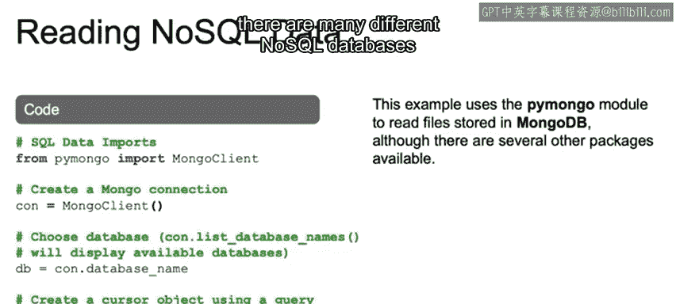

So the first thing we need to do is establish a connection， so if we look to the code now。

 we see that we pulled from the P Mongo Library， the Mongo clients function。

 we're going to create our Mongo connection using con setting our variable equal to Mongo clients。

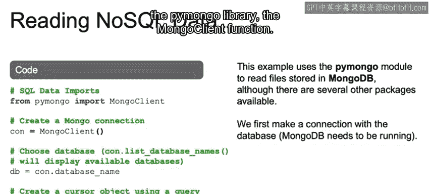

Open and close parentheses within those parentheses， we can pass an argument of the path。

 let's say it's something in the cloud we can pass in that path may need your username and password included in order to specify where that database actually lives。

 where that connection actually lives。

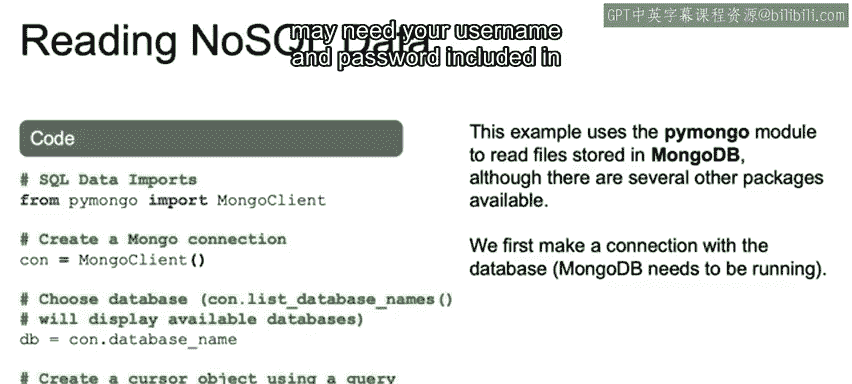

From that connection we can pull different databases。

 we're going to use ConD list database names if we want to actually see what is available。

 one of those databases that is available is going to be database name in our example our connection will have that attribute database name or whatever difference name you have for that database。

And when you set DB equals Con database name， we're just setting the DB variable to a specific database called database name。

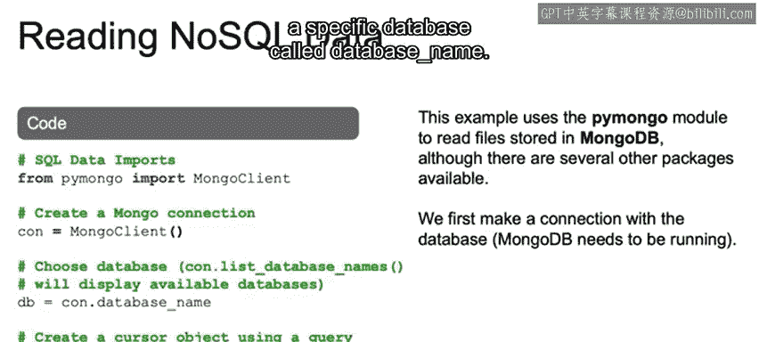

We're then going to read in the data and in order for it to be pulled into pandas。

 we have to specify a query。So we say Db。 So now we're specifying the database。

 The database will have multiple collection names similar to how we have multiple tables。

 and then we say dot find from that table， and it will be a query。

 And that query should be a Mongo Db query string similar to how we have a sQL query string。

 And if we want to do something like select star from that table。

 it would just be these curly brackets passed in。 And that would be all in order to select all and label that as our cursor。

Now our cursor is just going to be a generator object with all of our JSON files in it。

 JSON documents in it。For us to actually pull that into a pandas data frame。

 we're going to say list and then pass in our cursor and that'll give us a list of Python dictionaries Once we have a list of Python dictionaries。

 we can pass that into our pandas data， pandas data frame function and we set that equal to our DF variable and then we'll have it available in that pandas data frame that we are familiar with。

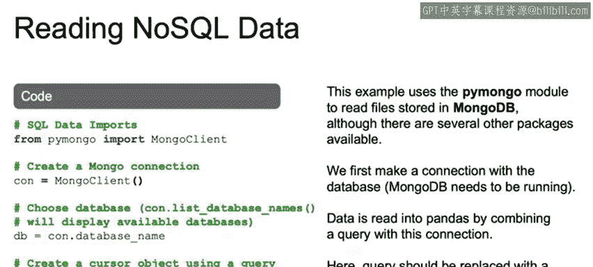

Okay now let's briefly touch on working with APIs and cloud data access a variety of data providers make data available via application programming interfaces。

 APIs， and you can think of Twitter if you want to get the different tweets。

 you can actually plug into Twitter using an API you can do the same for pulling in marketing data from Amazon which we've done in the past for business。

 and that makes it easy for it to quickly connect from the data source into your Python notebook。

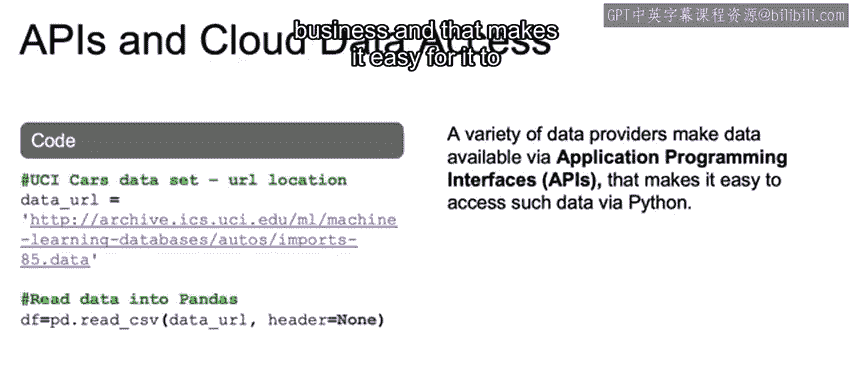

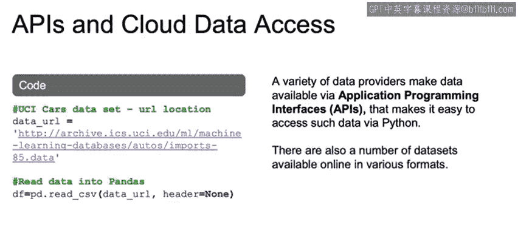

There are also a number of data sets available online in various formats。

We can connect as we see here to the left to an available example from the UC Irvine Maine Learning Library。

 and we see here that all we have to do is define the URL we say data URL equals and this is just a string you can put it in yourself that is the same as just clicking on download for your CSV and then you do PD。

 read CSV using your read CSV function from pandas pass in the data URL and then that'll set Df equal to A pandas data frame that you now have access to。

So let's do a quick recap。 We just went over how to pull in data using SQL databases to get data from relational databases with structure。

 which we'll see in action in the labs。

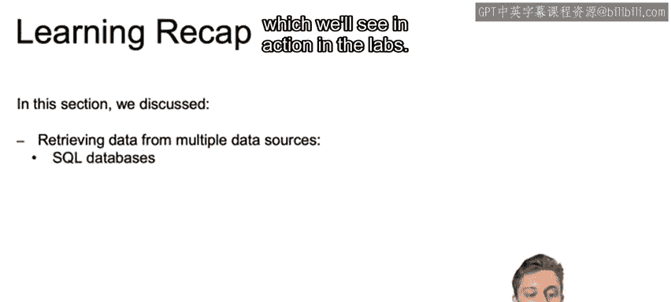

We also saw how you can get unstructured data from no SQL databases， such as Mongo DB。

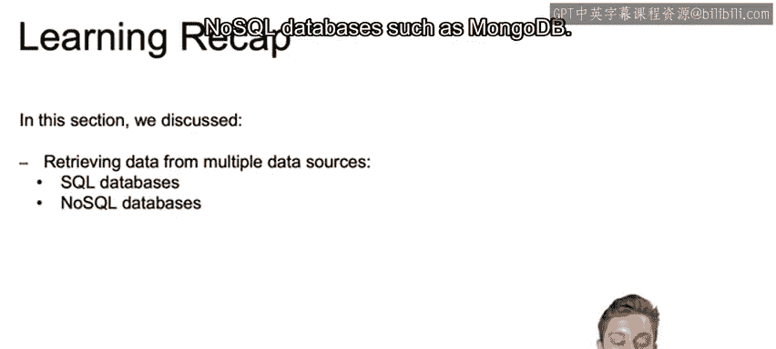

We also had a brief discussion on how we can connect to different APIs or to cloud data sources as we try to pull data from the web。

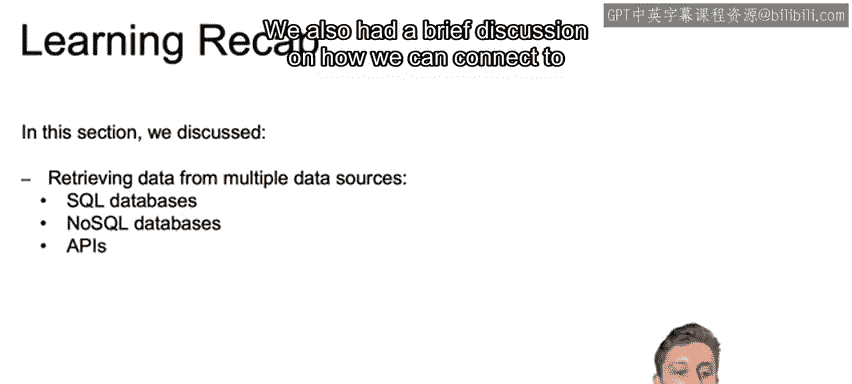

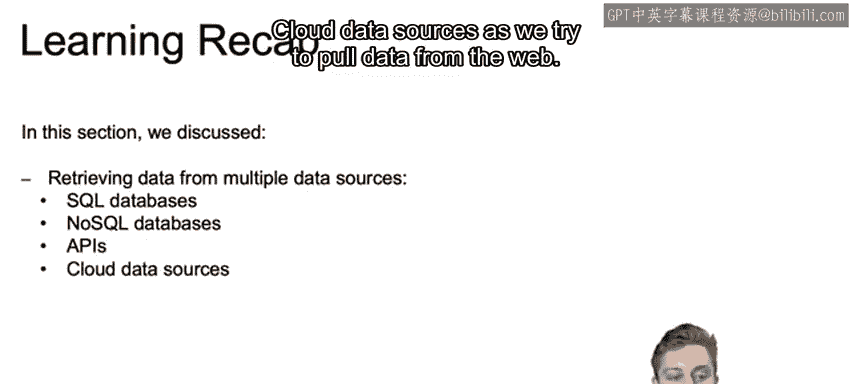

And with that， we also had a brief discussion on some of the common issues that may arise when attempting to import data with the correct format and some of the arguments you may want to be aware of or pass into your functions moving forward。

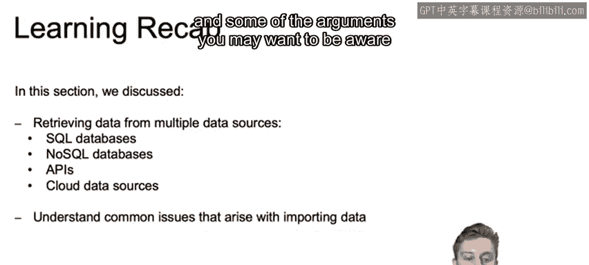

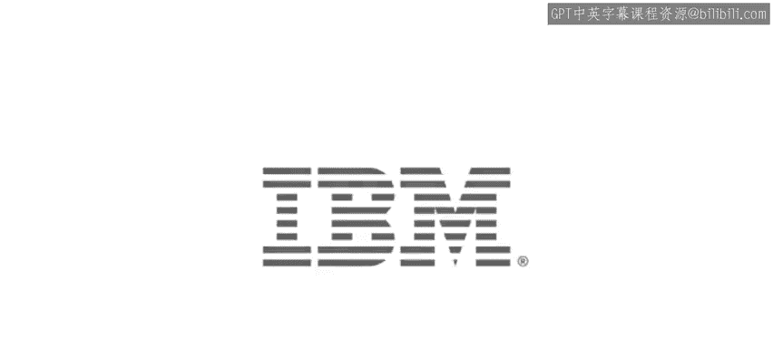