# IBM《机器学习（数据探索、监督学习的回归和分类）｜machine learning》中英字幕 - P130：41_基于集成的算法和bagging第1部分.zh_en - GPT中英字幕课程资源 - BV1xM4m1D7kY

In this next set of videos， we'll learn about ensemble based methods and bagging in order to learn how to leverage multiple models for better performance。

Now let's go over the learning goals for this section。In this section。

 we're going to cover the power of combining models in general。

 which is what we mean by ensemble based methods。

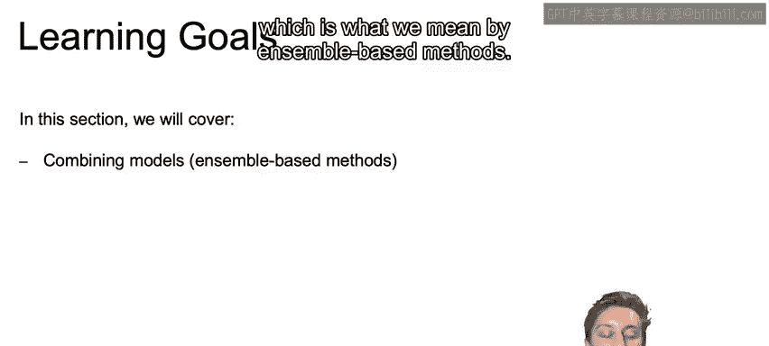

We'll discuss bootstrap aggregation or bagging and how building off of subsets of data will improve our models。

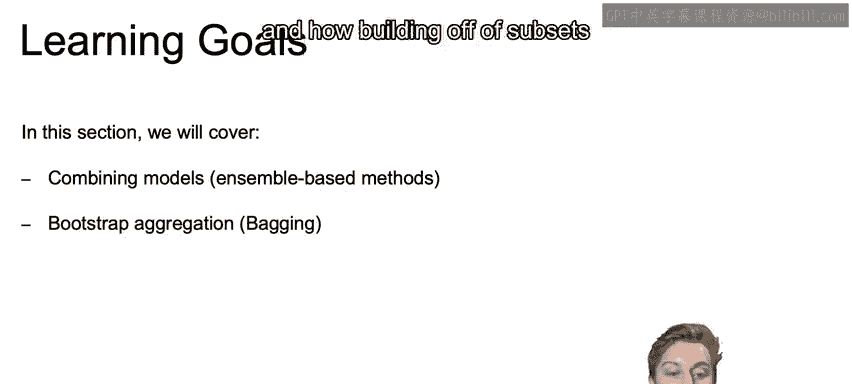

And then we'll discuss further randomization of our models by building off of bagging and introducing random forests as well as extra trees classifiers。

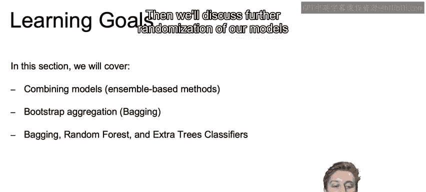

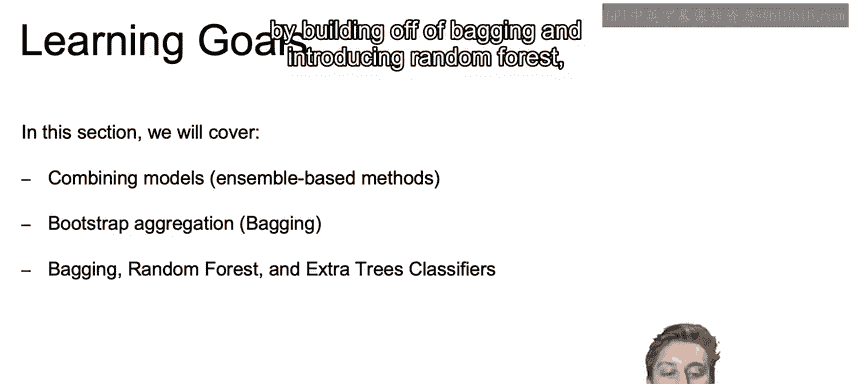

Now， something to note is that these will be powerful models in regards to actually greatly improving our accuracy for stratified data in which predictor variables rarely have a linear or log linear or polynomial relationship with our target variable。

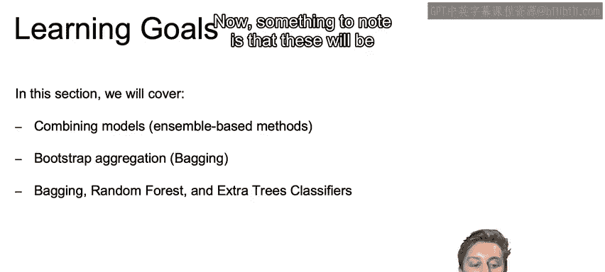

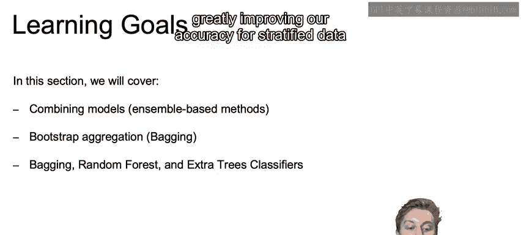

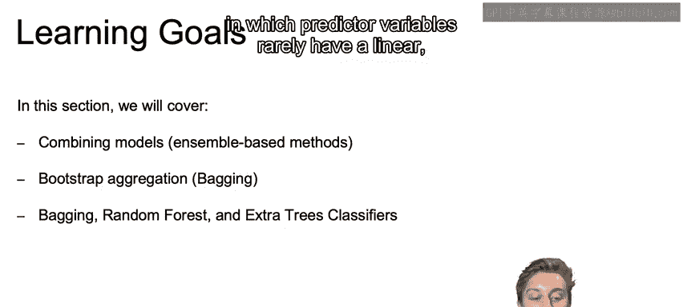

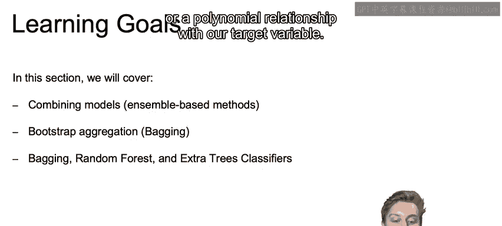

And it's going to be able to do so similar to decision trees。

While managing many of the dangers present from overfitting from these decision trees。

 so it'll be managing the variances while coming up with a decision boundary that's not necessarily like we say linear or log linear or polynomial。

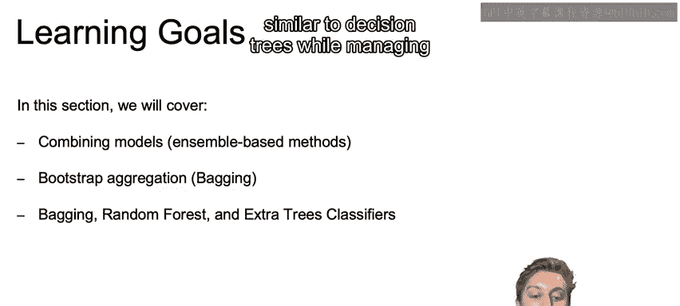

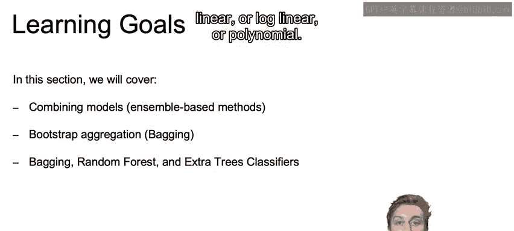

Now we've discussed and seen this in the labs that decision trees will often overfit to our training data。

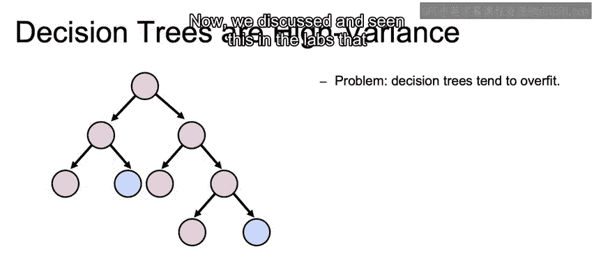

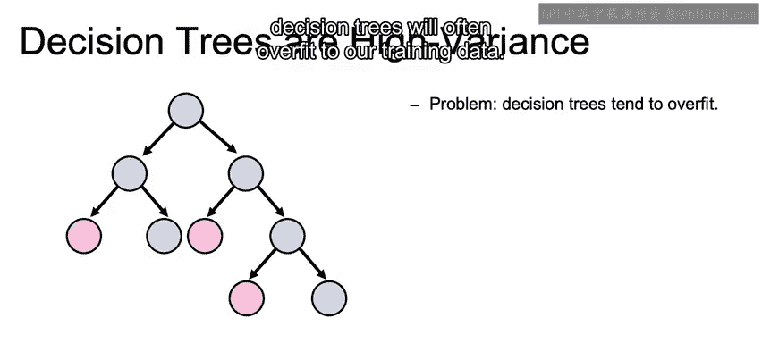

And we discussed that we can prune the tree to help minimize this effect。

 but often simply pruning still does not solve the problem of how strictly the decision tree learns classes from the specific training set。

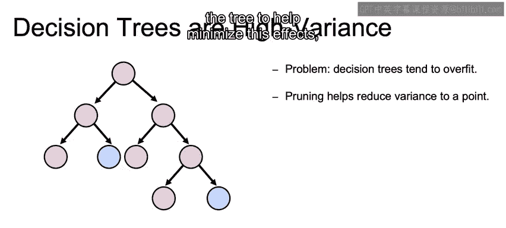

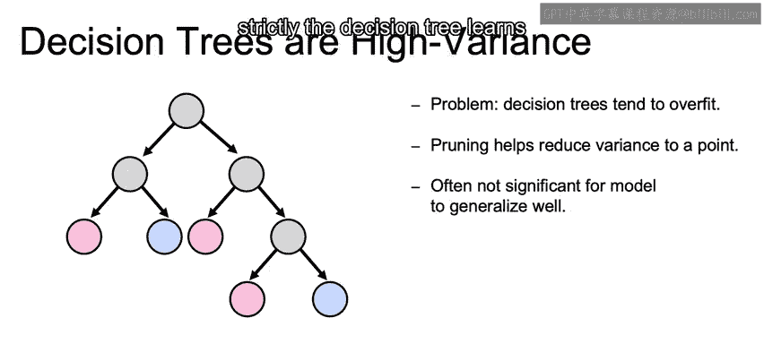

And there are other perhaps better things that we can do。

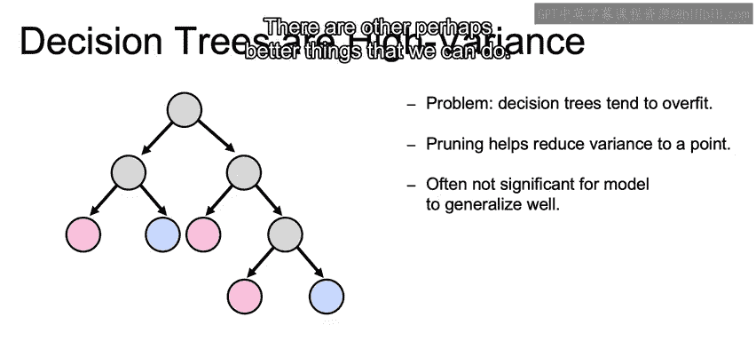

So。

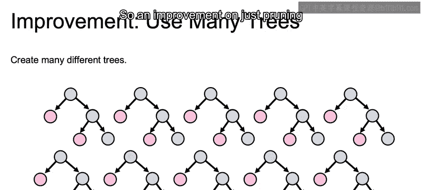

An improvement on just pruning the trees。Would be to create a lot of different trees。

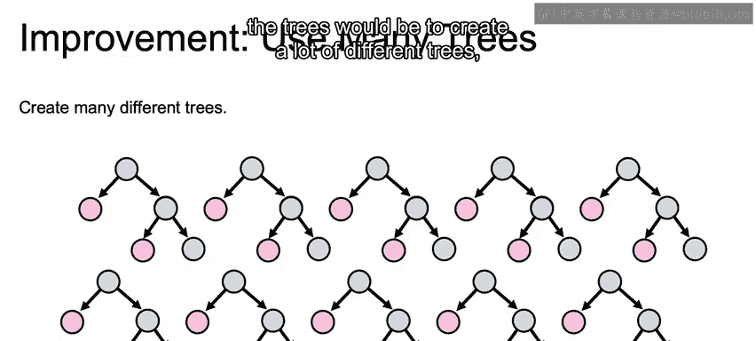

And then with a lot of different trees， we can combine the predictions from those trees to reduce the variance of our model。

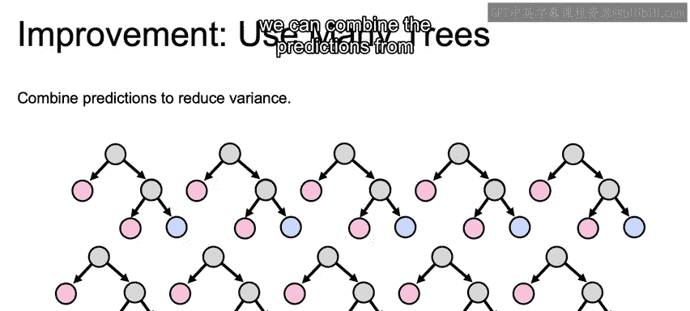

And that's just some introduction to the concepts of ensemble as well as bagging。

 and in this next video we will get an introduction to how this is done in practice。

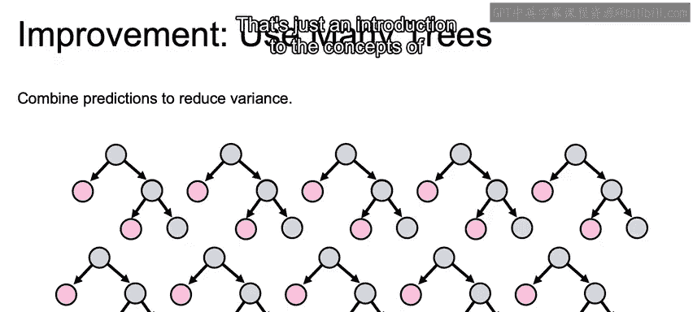

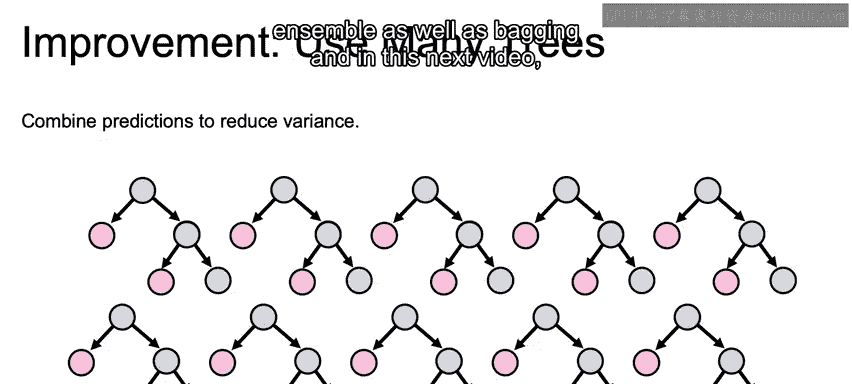

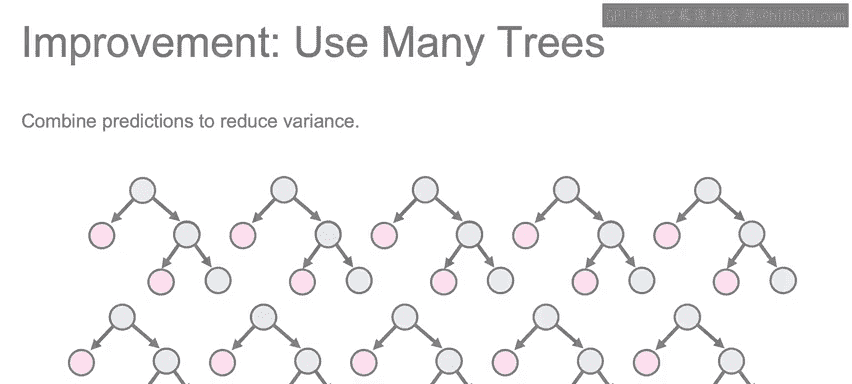