# IBM《机器学习（数据探索、监督学习的回归和分类）｜machine learning》中英字幕 - P131：42_基于集成的算法和bagging第2部分.zh_en - GPT中英字幕课程资源 - BV1xM4m1D7kY

So how do we leverage all these different decision trees based off of these bootstrap samples？

The key is that each tree gets a vote for that final decision。

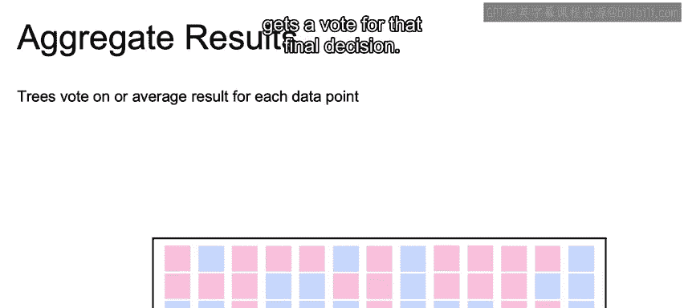

So we see here we're starting off with three different trees。

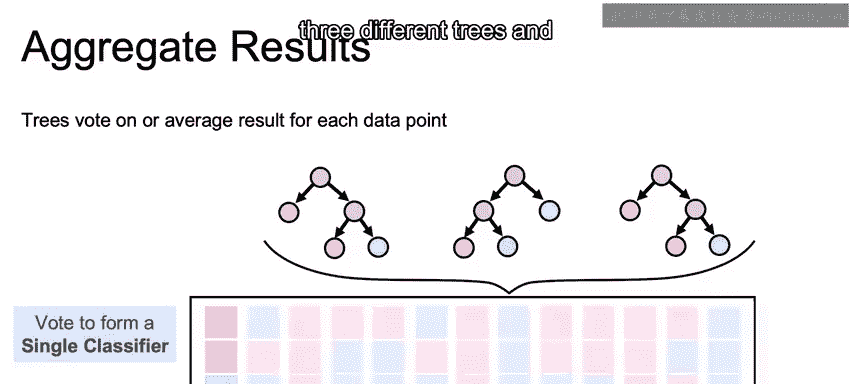

And then we're going to use those three different trees to vote on a single classifier。

So as we see here， we run through the decisions given the fit of each tree。

 and that's going to be that pink， pink blue。

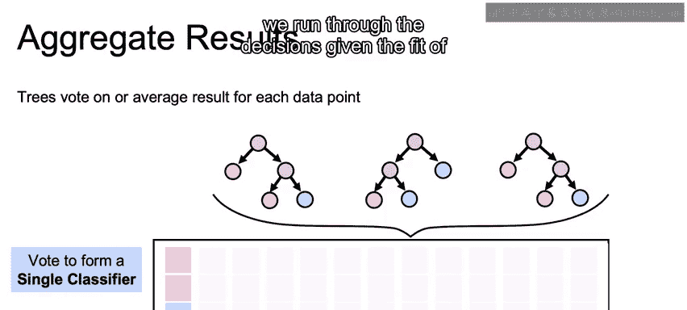

And that's going to be for a specific row within our data set。

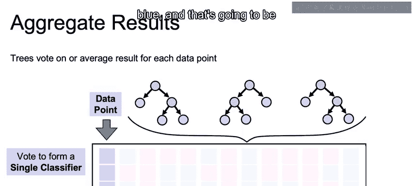

And for that specific a row， we can come up with the majority class that predicted results。

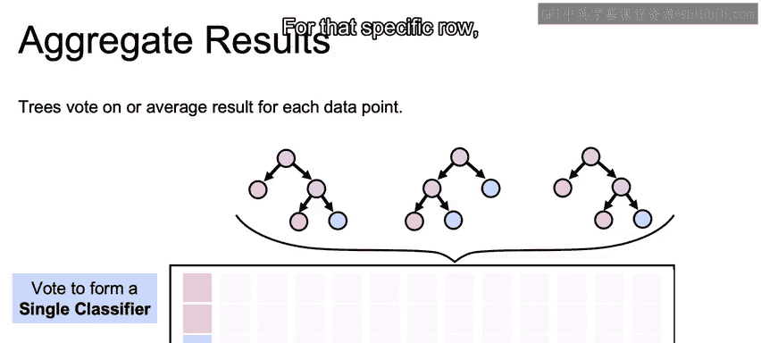

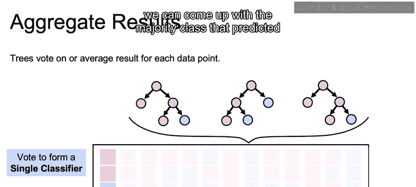

And we can do this across all of our different rows。

 so we take every single one of those different rows and see what the majority class is and getting this majority class will be called meta classificationification。

As it uses several classifiers。In order to take their outputs and decide on the class by combining or aggregating or here voting on which one is the majority class。

And as an example， if we look back to our first row。We see that tree  one may have said red。

 tree2 said red as well， and tree 3 said blue。

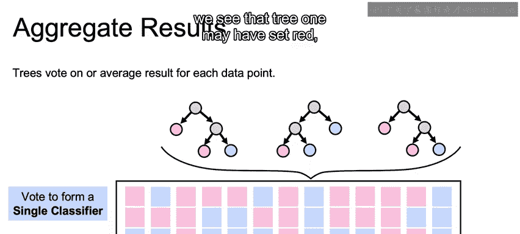

We have a democracy here， we have two reds versus one blue， so we're going to decide red。

So in our intro， we brought up this term baggging。And bagging is just going to be short for bootstrap aggregating。

 which is what we just laid out here。

We bootstrap by getting each one of our smaller samples。

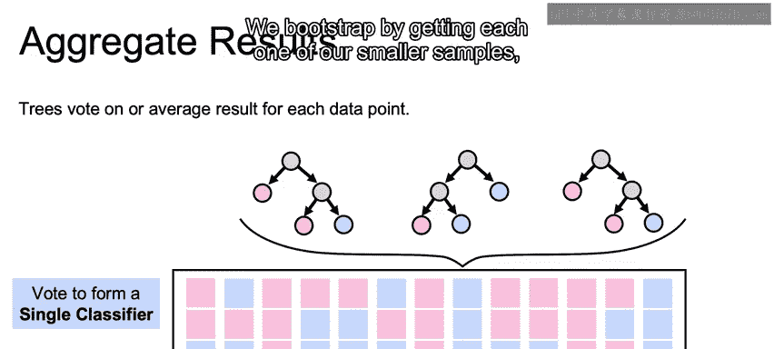

Build out our decision trees， followed by way of bringing together all those different decision trees on those samples。

 that's the aggregating step。 So bagging is Bo sh aggregating。

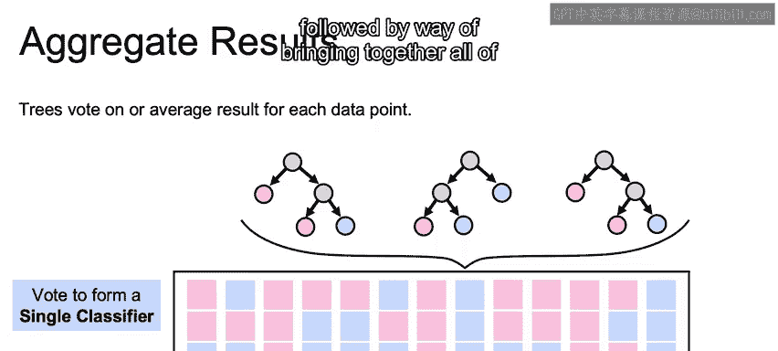

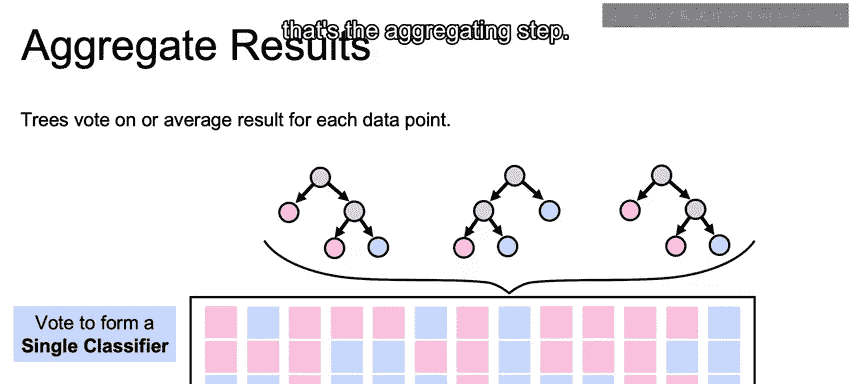

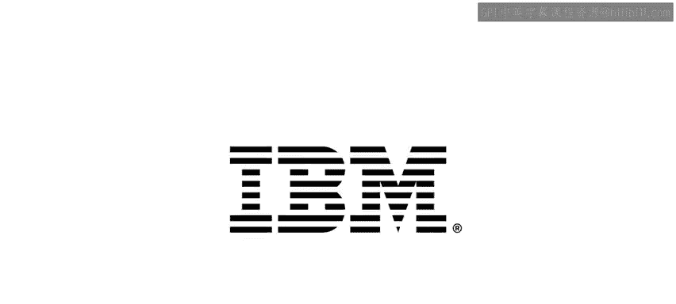